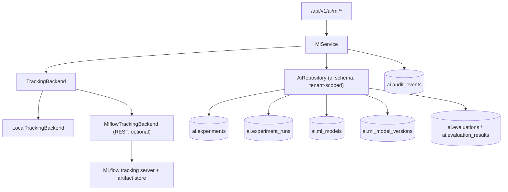

# Phase 11 — Experiment Tracking & Model Registry

This document describes the Phase 11 foundation for **predictive intelligence**:
experiment tracking, a classical-ML **model registry**, and **evaluation
definitions**. It deliberately does **not** train models in the API process and
does **not** claim that any model is production-useful for a manufacturing
outcome. Training, evaluation, and inference stay separate and explicit.

## Goals

- Register **experiments** and **runs** with reproducible configuration snapshots
  and an explicit dataset reference.
- Keep a tenant-scoped **model registry** of classical-ML models and immutable,
  monotonically versioned artifacts, each tied to the run that produced it.
- Optionally mirror runs and model versions to an external tracker (**MLflow**)
  without ever depending on it being available.
- Define **evaluation** suites (retrieval / answer / safety) and record per-case
  results verbatim.
- Reuse enterprise IAM authorization; every resource is tenant-scoped and
  audited.
- Provide a **reference pipeline** (synthetic, clearly labelled) that exercises
  train / evaluate / infer as three separate commands.

## Honesty and non-goals

- No fabricated metrics. Runs, metrics, and validation values are exactly what a
  caller logged. The API never synthesizes numbers.
- The **LLM provider registry** (`ai.models`) is unrelated to the classical-ML
  registry (`ai.ml_models`): an LLM configuration is not a trained artifact.
- Online **model serving** is intentionally **not enabled**. `/ml/status` and the
  capabilities matrix report `model_training: external` and
  `model_serving: not_enabled`.
- The reference pipeline uses **synthetic** data, marked `synthetic: true` in the
  run's `dataset_ref` and the version's `validation`. It is a wiring example, not
  a benchmark.

## Architecture



The `ai` schema is the **authorization-metadata authority**. MLflow, when
configured, is only an optional mirror; the platform stores a reference to it
(`external_*` columns) and degrades to local recording when it is down.

## Data model (migration `0007_ai_ml.sql`)

| Table | Purpose |
| --- | --- |
| `ai.experiments` | One logical experiment per tenant (unique `code`), `problem_type`, `tracking_backend`, `external_experiment_id`, `tags`. |
| `ai.experiment_runs` | A single run: `run_uuid`, `status`, `params`, `metrics`, `training_config`, `dataset_ref`, `code_version`, `external_run_id`, `artifact_uri`, `finished_at`. |
| `ai.ml_models` | Registered model (unique `code`), `framework`, `task`, `stage` (`none`/`staging`/`production`/`archived`). |
| `ai.ml_model_versions` | Immutable version per model (unique `(ml_model_id, version)`), tied to `run_id`, with `metrics`, `parameters`, `validation`, `artifact_uri`, `external_model_version`. |
| `ai.evaluations` | Evaluation suite definitions (`kind`: retrieval/answer/safety) — reused from migration 0004. |
| `ai.evaluation_results` | Per-case results recorded verbatim (`case_id`, `metrics`, `passed`) — reused from migration 0004. |

Status/stage values are constrained by `CHECK` constraints; `updated_at` is
maintained by the shared `ai.touch_updated_at()` trigger.

## Tracking backends

`infrastructure/ml/`:

- `LocalTrackingBackend` — platform registry only; no external calls.
- `MlflowTrackingBackend` — a dependency-free HTTP client over the MLflow
  **tracking REST API** (`/api/2.0/mlflow`). It caches a `/health` probe and
  raises `ProviderError` on any failure. MLflow is **not** a Python dependency of
  the API.
- `build_tracking_backend(settings)` selects `local`, `mlflow`, or `auto`.

`auto` (default) uses MLflow when `MLFLOW_TRACKING_URI` is set, otherwise local.
When MLflow is configured but unreachable, `status()` reports
`{external: true, available: false}` and each write is recorded locally instead
of failing the request.

## API

All routes are under `/api/v1/ai`.

| Method | Path | Permission |
| --- | --- | --- |
| GET | `/ml/status` | `experiments.read` |
| POST / GET | `/ml/experiments`, `/ml/experiments/{id}` | `experiments.write` / `experiments.read` |
| POST | `/ml/experiments/{id}/runs` | `experiments.write` |
| GET | `/ml/runs`, `/ml/runs/{id}` | `experiments.read` |
| POST | `/ml/runs/{id}/finish` | `experiments.write` |
| POST / GET | `/ml/models`, `/ml/models/{id}` | `registry.write` / `registry.read` |
| GET / POST | `/ml/models/{id}/versions` | `registry.read` / `registry.write` |
| POST | `/ml/models/{id}/versions/{version}/status` | `registry.write` |
| POST / GET | `/ml/evaluations`, `/ml/evaluations/{id}` | `evaluations.write` / `evaluations.read` |
| POST / GET | `/ml/evaluations/{id}/results` | `evaluations.write` / `evaluations.read` |

The default capability → enterprise permission map maps all ML capabilities to
`ai.ml:read` / `ai.ml:create`, configurable via `AI_PERMISSION_MAP`.

Creating an experiment or model is idempotent on `code`. Promoting a version to
`production` also sets the model's `stage` to `production`. Every mutation is
audited (`ai.ml.*`).

## Reference pipeline

`apps/ai-api/scripts/ml_sample_pipeline.py` — standard-library only (a minimal
logistic regression is included; scikit-learn is used when installed). Three
separate subcommands:

```
# Train: generate synthetic data, fit, log a run, register a version.
python ml_sample_pipeline.py train --api http://127.0.0.1:8000 --token "$AI_SESSION_TOKEN"

# Evaluate: score a held-out synthetic set and record per-case results.
python ml_sample_pipeline.py evaluate --model-id 1 --version 1 --rows 25

# Infer: score a single sample from a saved artifact.
python ml_sample_pipeline.py infer --model-id 1 --version 1 --features 1.2,-0.4
```

Artifacts are written to `AI_ML_ARTIFACT_DIR` (default `./ml-artifacts`).

## Configuration

| Variable | Default | Meaning |
| --- | --- | --- |
| `MLFLOW_TRACKING_URI` | `http://127.0.0.1:5000` | External tracking server. |
| `ML_TRACKING_BACKEND` | `auto` | `auto` \| `mlflow` \| `local`. |
| `ML_ENABLE_REGISTRATION` | `true` | Register versions with the MLflow model registry. |
| `ML_REQUEST_TIMEOUT_SECONDS` | `10` | Per-request timeout for MLflow calls. |
| `ML_DEFAULT_FRAMEWORK` | `scikit-learn` | Default framework label. |
| `ML_SAMPLE_SEED` | `1729` | Seed for the reference pipeline. |

## Testing

`tests/test_ml.py` covers the full lifecycle (experiment idempotency, run
create/finish with metric merge, model versioning and promotion, evaluation
results), capability enforcement, code validation, and honest degradation when an
external tracker reports up but fails every call.

## Monitoring hooks for later deployment

Runs already carry the information a later deployment/monitoring phase needs:
`status`, `metrics`, `artifact_uri`, the model `stage`, and the external
tracker references. Because serving is not enabled, no endpoint exposes online
inference; a future phase can add a serving gateway and drift/serving metrics on
top of these records without changing the data model.
