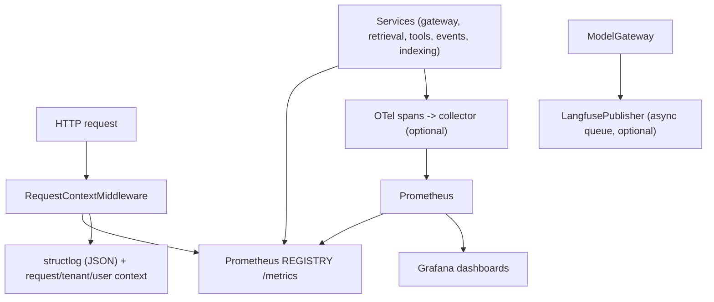

# Phase 12 — Observability

This document describes the Phase 12 observability layer: Prometheus metrics,
OpenTelemetry tracing, optional Langfuse generation tracing, structured logs with
correlation IDs, and liveness/readiness probes. It is additive: existing request
handling is unchanged, and every instrumentation hook is a safe no-op when the
corresponding backend is disabled.

## Goals

- Expose **Prometheus** metrics for HTTP, model calls, retrieval, agent tools,
  event processing and indexing jobs at `GET /metrics`.
- Emit **OpenTelemetry** spans for operations the framework instrumentation does
  not cover (model calls, retrieval, agent tool execution).
- Offer **optional Langfuse** generation tracing over the public ingestion API,
  with no Python Langfuse dependency and no blocking of requests.
- Emit **structured logs** (JSON in production) correlated by request id, plus
  tenant and user references where permitted.
- Provide **health and readiness** endpoints for load balancers and orchestrators.
- Ship **Grafana dashboards** that cover API health, AI latency, provider
  failures, retrieval, indexing queues, Kafka/event processing and AI usage.

## Non-goals and safety

- **No secrets, access tokens, or unnecessary personal information** are logged or
  used as metric labels or span attributes.
- **No unrestricted confidential prompts or document content** are logged or sent
  to tracing backends.
- Metric cardinality is bounded: HTTP labels use the matched **route template**
  (never the raw path), and every other label is a bounded enum (`operation`,
  `provider`, `model`, `outcome`, `status`, `tool`, `event_type`).
- Tracing/Langfuse are **fail-open no-ops**: a failure to export never breaks a
  request. Events are dropped (never buffered indefinitely) when a queue is full.

## Architecture



## Metrics (`telemetry/metrics.py`)

A dedicated `CollectorRegistry` (with process/platform/GC collectors) is exposed
at `GET /metrics`.

| Metric | Type | Labels | Meaning |
| --- | --- | --- | --- |
| `ai_http_requests_total` | counter | `method`, `path`, `status` | HTTP requests handled. |
| `ai_http_request_duration_seconds` | histogram | `method`, `path` | HTTP latency. |
| `ai_model_calls_total` | counter | `operation`, `provider`, `model`, `outcome` | Gateway calls (chat/embed/stream). |
| `ai_model_call_duration_seconds` | histogram | `operation`, `provider`, `model` | Gateway latency. |
| `ai_model_tokens_total` | counter | `operation`, `provider`, `model`, `kind` | Tokens consumed (in/out). |
| `ai_model_cost_usd_total` | counter | `provider`, `model` | Estimated cost. |
| `ai_retrieval_calls_total` | counter | `operation`, `outcome` | Retrieval/RAG operations. |
| `ai_retrieval_duration_seconds` | histogram | `operation` | Retrieval latency. |
| `ai_retrieval_results` | histogram | `operation` | Authorized results returned. |
| `ai_tool_calls_total` | counter | `tool`, `outcome` | Agent tool executions. |
| `ai_tool_call_duration_seconds` | histogram | `tool` | Tool latency. |
| `ai_events_published_total` | counter | `event_type` | Events published. |
| `ai_events_consumed_total` | counter | `consumer_group`, `outcome` | Events processed (delivered/retrying/dead). |
| `ai_index_jobs_total` | counter | `status` | Indexing jobs reaching a terminal status. |

`normalize_path()` is a defensive fallback that collapses UUID/numeric/hex id
segments; the middleware prefers Starlette's matched route template.

## Tracing (`telemetry/tracing.py`)

Thin helpers over the OTel tracer (`span()`, `set_attributes()`,
`record_exception()`). When `OTEL_ENABLED=false` (default) OTel returns a no-op
tracer, so spans cost almost nothing. Manual spans are added for
`model.chat`, `model.chat.stream`, `model.embed`, `ai.retrieval.search`,
`ai.rag.query` and `ai.agent.tool`. The FastAPI server span is produced by the
framework instrumentor configured in `telemetry/otel.py`.

## Langfuse (`telemetry/langfuse.py`)

`LangfusePublisher` is a dependency-free client for `POST {host}/api/public/ingestion`.
It is **disabled** unless `LANGFUSE_HOST` and both keys are set. Generation events
carry provider, model, operation, outcome, latency, token usage, optional cost, and
the request/tenant/user references. Delivery is best-effort via a bounded
`asyncio.Queue` drained by a single background worker; a full queue drops events
and a failing endpoint is recorded at debug level only.

## Structured logs and correlation

`RequestContextMiddleware` assigns or echoes `x-request-id`, binds it to
`request_id_var`, and (for non-probe paths) logs `request.completed` with method,
path, status and `duration_ms`. `get_principal` binds `tenant_id`, `user_id` and
`auth_source` to the log context and to context variables used by Langfuse. The
context is cleared at the end of each request.

## Health and readiness

| Endpoint | Purpose | Notes |
| --- | --- | --- |
| `GET /healthz` | Liveness | Always `{"status": "ok"}`. |
| `GET /readyz` | Readiness | Reports repository, vector store, search index, event bus, ML tracking and telemetry config; probes the database when `AI_REPOSITORY=postgres` and returns `503` when it is unavailable. |
| `GET /api/v1/ai/health` | Detailed health | `HealthResponse` with component summary. |
| `GET /metrics` | Prometheus scrape | Not shown in the OpenAPI schema. |

Probes and `/metrics` are excluded from HTTP request metrics and access logs to
avoid self-instrumentation noise.

## Dashboards

Grafana is provisioned file-based from
`infrastructure/monitoring/grafana/provisioning/dashboards/`:

- `dashboards.yml` — file provider.
- `ai-platform-overview.json` — HTTP rate/latency, model calls and latency, tokens,
  cost, retrieval, tool executions, event processing and indexing jobs.

Prometheus scrapes the OTel collector (`otel-collector:8889`) and the AI API
directly (`ai-api:8000`, `/metrics`) as configured in
`infrastructure/monitoring/prometheus/prometheus.yml`.

## Configuration

| Variable | Default | Meaning |
| --- | --- | --- |
| `OTEL_ENABLED` | `false` | Export OTel traces to the collector. |
| `OTEL_EXPORTER_OTLP_ENDPOINT` | `http://127.0.0.1:4317` | OTLP gRPC endpoint. |
| `OTEL_SERVICE_NAME` | `ai-api` | OTel service name. |
| `LANGFUSE_HOST` | — | Langfuse host; tracing off unless set with both keys. |
| `LANGFUSE_PUBLIC_KEY` | — | Langfuse public key. |
| `LANGFUSE_SECRET_KEY` | — | Langfuse secret key. |

Prometheus metrics require no configuration and are always available.

Background workers run in separate processes and can expose the same registry on
a port of their choice:

```
python -m ai_api.workers.event_consumer --watch --metrics-port 9101
python -m ai_api.workers.indexer --watch --metrics-port 9102
```

## Testing

`tests/test_observability.py` verifies the `/metrics` exposition, liveness and
readiness (including the in-memory database path), request-id echo, path
normalization, that every metric helper records without error, and the
disabled/enabled behavior of the Langfuse publisher.

## Running the stack

```
# Start the observability profile (otel-collector, prometheus, grafana).
docker compose --profile observability up -d

# Scrape check.
curl -s localhost:8000/metrics | head

# Readiness.
curl -s localhost:8000/readyz
```
