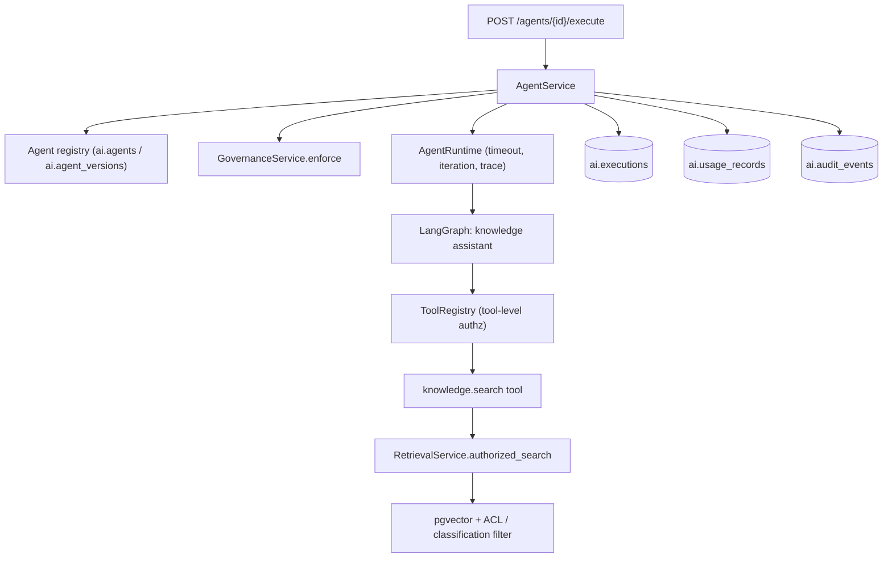
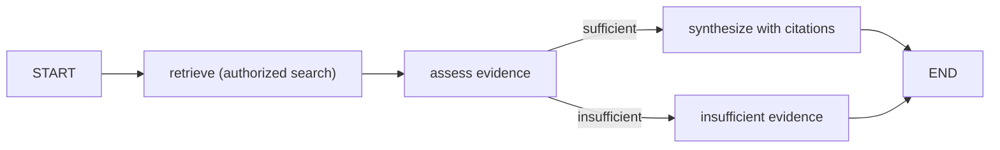

# Phase 9 — Agent Framework

This document describes the initial agent framework and the first demonstrable
agent, the **Enterprise Knowledge Assistant**. V1 agents are strictly
**read-only**: they retrieve authorized knowledge, synthesize an answer with
citations, and state explicitly when evidence is insufficient. Agents never
mutate business objects (BOMs, engineering changes, workflows, manufacturing
orders, etc.).

## Goals

- Agent registry and versioned agent definitions.
- Typed inputs and outputs.
- An allowed-tool registry with **tool-level authorization**.
- Execution timeouts, bounded iteration and bounded tool calls.
- Human-approval checkpoints (framework level).
- Execution traces for every run.
- Error recovery and cancellation.
- Audit and usage records for every execution.

## Architecture



The knowledge assistant graph is deliberately linear and read-only:



## Components

- `application/agents/tools.py` — `ToolSpec`, `Tool`, `ToolRegistry`,
  `ToolCallContext`, `KnowledgeSearchTool`, `build_default_tools`.
- `application/agents/knowledge_assistant.py` — the LangGraph
  `StateGraph`, the typed `KnowledgeAssistantState`, and the versioned
  definition persisted in `ai.agent_versions.definition`.
- `application/agents/runtime.py` — `AgentExecutionContext`, `AgentRuntime`,
  `AgentRunResult`; enforces the wall-clock timeout, bounds recursion
  (iteration) and tool calls, and collects the trace.
- `application/services/agent_service.py` — registry seeding, governance,
  execution orchestration, persistence, audit, usage and event emission.
- `api/v1/routes/agents.py` — the HTTP surface.
- `schemas/agents.py` — typed request/response models.

## Registry and versioning

`AgentService.ensure_registry(tenant_id)` idempotently registers the built-in
agent (`code = knowledge-assistant`) and its active version. Definitions are
stored as JSON in `ai.agent_versions.definition`, so behaviour is reproducible
and auditable. The definition records the framework (`langgraph`), graph name,
allowed tools, node list and typed inputs/outputs.

## Tool-level authorization

Every tool declares the enterprise capability it requires
(`knowledge.search` → `ai.knowledge:read` via the configurable permission map).
`ToolRegistry.run`:

1. rejects unknown tools,
2. authorizes the caller against enterprise permissions (`Policy.require`),
3. enforces the human-approval checkpoint when a tool is approval-gated,
4. only then invokes the tool.

Authorization is always evaluated server-side; similarity scores never grant
access and the model is never trusted to enforce policy.

## Execution guarantees

- **Timeout** — the graph runs under `asyncio.wait_for` with
  `AI_AGENT_TIMEOUT_SECONDS`; a timeout records a `cancelled` execution and
  returns HTTP 503.
- **Bounded iteration** — the graph recursion limit is
  `AI_AGENT_MAX_ITERATIONS`.
- **Bounded tool calls** — `AI_AGENT_MAX_TOOL_CALLS`; exceeding it fails the run.
- **Cancellation** — cancelling the request task cancels the run and records a
  `cancelled` execution.
- **Traces** — each step (`retrieve`, `tool_call`, `assess`, `synthesize`,
  `insufficient_evidence`, `finalize`) is captured with structured detail and
  capped by `AI_AGENT_TRACE_MAX_EVENTS`.
- **Audit + usage** — every run writes `ai.agent.execute` (success/failure/denied)
  to the audit mirror, an `ai.executions` row, and input/output token usage.

## HTTP API

| Method | Path | Permission | Description |
| --- | --- | --- | --- |
| GET | `/api/v1/ai/agents` | `agents.read` | List registered agents |
| GET | `/api/v1/ai/agents/{id}` | `agents.read` | Fetch one agent |
| GET | `/api/v1/ai/agents/{id}/versions` | `agents.read` | List versioned definitions |
| GET | `/api/v1/ai/agents/executions` | `agents.read` | Paginated execution history |
| POST | `/api/v1/ai/agents/{id}/execute` | `agents.execute` | Run the agent |

`POST /agents/{id}/execute` request body:

```json
{ "input": "What maintenance does the pump need?", "model": null, "limit": 5, "approvals": [] }
```

Response:

```json
{
  "agent_id": 1,
  "code": "knowledge-assistant",
  "version": 1,
  "status": "succeeded",
  "answer": "...",
  "citations": [{ "rank": 1, "source_code": "maintenance", "snippet": "..." }],
  "insufficient_evidence": false,
  "confidence": 0.246183,
  "is_mock": true,
  "provider": "mock",
  "usage": { "input_tokens": 134, "output_tokens": 27, "total_tokens": 161 },
  "trace": [{ "seq": 1, "step": "retrieve", "detail": {} }],
  "execution_id": 5,
  "request_id": "..."
}
```

## Configuration

| Variable | Default | Purpose |
| --- | --- | --- |
| `AI_AGENT_DEFAULT_CODE` | `knowledge-assistant` | Built-in agent code |
| `AI_AGENT_DEFAULT_VERSION` | `1` | Active definition version |
| `AI_AGENT_TIMEOUT_SECONDS` | `30` | Wall-clock execution timeout |
| `AI_AGENT_MAX_ITERATIONS` | `6` | Graph recursion limit |
| `AI_AGENT_MAX_TOOL_CALLS` | `6` | Tool-call budget per run |
| `AI_AGENT_TRACE_MAX_EVENTS` | `40` | Max trace events retained |
| `AI_AGENT_REQUIRE_APPROVAL` | `false` | Force approval for all tools |

## Dependencies

- `langgraph` (pinned in the AI API environment) provides `StateGraph`.

## Testing

- `tests/test_agents.py` — registry auto-registration, grounded answers with
  citations, insufficient-evidence path, capability enforcement, tool-level
  authorization, approval checkpoint, prompt-injection blocking, and trace.
- `tests/test_api_v1.py` — list/get/execute smoke coverage.

Run from `apps/ai-api`:

```bash
ruff check src tests
PYTHONPATH=src python3 -m pytest
```

## Limitations (V1)

- Only read-only agents are supported; any definition with `read_only != true`
  is refused.
- The default provider is the clearly-labeled **mock** provider when no
  credentials are configured, so answers are synthetic and not production data.
- Human-approval is implemented at the tool-registry level; no approval-gated
  tools ship in V1.
