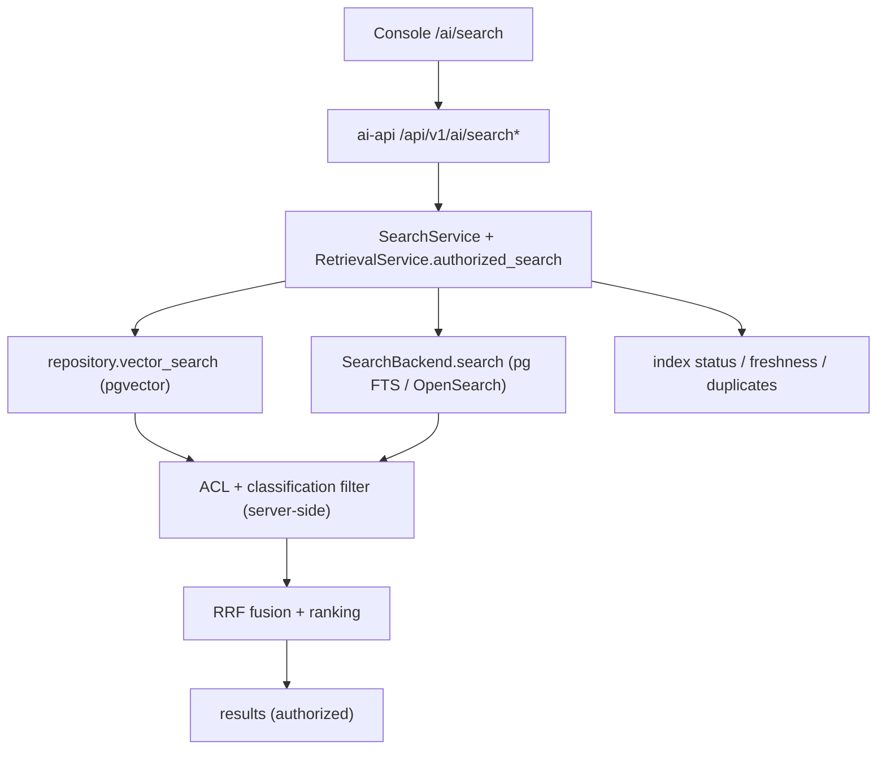

# Stage 4 — Enterprise Search and Knowledge Intelligence (design)

This document is the Phase 0 deliverable for Stage 4. It records the repository
inspection, the reuse-versus-build assessment, and the architecture, API
contracts, authorization flow, ranking strategy and test plan that the
implementation follows. Stage 4 is **additive**: it extends the Stage 3
knowledge pipeline and the existing Helix platform; nothing is rebuilt.

## 1. There are two independent search systems

| | AI knowledge search (Stage 3) | Helix "Enterprise search" foundation |
| --- | --- | --- |
| Backend | `ai-api` (FastAPI), `/api/v1/ai/*` | `server/` (Node), `/api/search/*` |
| Corpus | `ai.documents` / `ai.document_chunks` (uploaded knowledge) | registered business objects (PDM/BOM/requirements…) |
| Engine | pgvector + Postgres FTS + optional OpenSearch, RRF hybrid | Postgres `ILIKE` scan; ranking/facets computed in JS |
| Features | hybrid semantic retrieval + ACL/classification, no facets/history | facets, suggestions, saved, history, exports; no semantic |
| UI | `Ai*` pages under `/ai/*` (no search page yet) | `SearchPage` / `SearchFoundationPage` / `SearchAdminPage` |

Stage 4 targets the **AI knowledge corpus** (reuses Stage 3 embeddings, pgvector,
OpenSearch, RRF and the authorization filter) and adds a **federated search
surface** that also surfaces the Helix business-object results. The two engines
are kept separate: relevance scores from different systems are never blended.

## 2. Reuse-versus-build assessment

| Spec area | Reuse (already exists) | Genuinely new |
| --- | --- | --- |
| A. Search UI | `web/src/aiApi.js`, AI page patterns, `SearchPage` reference | `/ai/search` page: typeahead/debounce/cancel, highlight, sort, pagination, saved/history, index health |
| B. Hybrid engine | `RetrievalService._fuse` RRF, vector+lexical candidates, `AI_HYBRID_SEARCH_ENABLED`, `AI_RRF_K`, candidate multiplier, `SearchBackend` port, OpenSearch backend | mode dispatch, exact-ID/phrase boosts, field weights, chunk→document consolidation, per-mode scores, honest fallback label |
| C. Filters/facets | tenant/ACL/classification enforced; `documents` metadata (`title`, `mime_type`, `external_id`, `status`, `metadata`) | allowlisted filter DSL, server-side validation, facet counts, facet endpoint |
| D. Ranking | `_authorize` sort, RRF | configurable weighted components, freshness term, duplication suppression, diagnostics, eval harness |
| E. Freshness | `ai.jobs` (stage/attempts/error_class/lease), `documents.status` (`stale`), `indexed_at`, `search_indexed_at`, reindex route, `set_document_search_state` | stale/missing detection, reconciliation, index-status + health endpoints |
| F. Duplicates/conflicts | `documents.checksum` + `documents_tenant_checksum_idx`, `external_id`, metadata | detection service + evidence, review listing (never auto-merge) |
| G. Assistant | `rag_query` already calls `authorized_search`; citations persisted | carry filters/mode into RAG; expose revision/lifecycle in citations |
| Data model | 0003 knowledge tables, 0008 jobs/freshness columns | 0009 saved searches + history; 0010 duplicate/conflict findings |
| Security | IAM, `AccessControl`, classification ceiling, audit, rate limit, capabilities | new capabilities, cache isolation, index-status authorization |
| Observability | OTel/Prom metrics, `observe_retrieval` | search-specific metrics (candidates, fallback, stale, facet latency) |

No ingestion, embedding, vector-retrieval, authentication or job infrastructure
is rebuilt.

## 3. Architecture

- One retrieval path (`RetrievalService.authorized_search`) is shared by the
  search endpoint, the RAG query and the assistant. Stage 4 extends it rather
  than adding a parallel retriever.
- `SearchService` adds the read-only endpoints (facets, suggestions, history,
  saved, health) and keeps controllers thin.
- Filters and modes are validated server-side; a filter can never widen tenant,
  object or classification scope.

## 4. API contracts (existing AI namespace)

| Method | Path | Purpose |
| --- | --- | --- |
| POST | `/api/v1/ai/search` | execute a search (extended request/response) |
| GET | `/api/v1/ai/search/facets` | authorized facet counts (phase 3) |
| GET | `/api/v1/ai/search/suggestions` | authorized suggestions (phase 3) |
| GET/POST/DELETE | `/api/v1/ai/search/history` | user search history (phase 3) |
| GET/POST/DELETE | `/api/v1/ai/search/saved[/{id}]` | user saved searches (phase 3) |
| GET | `/api/v1/ai/search/health` | index health (phase 4) |
| GET | `/api/v1/ai/knowledge/index-status` | per-document/source index status (phase 4) |
| POST | `/api/v1/ai/knowledge/reconcile` | enqueue reindex for stale/missing/failed documents (phase 4) |

The spec's suggested root `POST /api/v1/search` is intentionally **not** used:
the Helix platform already owns `/api/search` for a different corpus and the AI
platform owns `/api/v1/ai/*`.

Request: `query`, `mode` (`hybrid` | `lexical` | `semantic`), `filters`
(allowlisted map), `sort` (`relevance` | `recency` | `title`), `page_size`,
`page` (and `limit`/`offset` for backward compatibility).

Response (backward compatible superset of `{query, count, results}`): `results`
with authorized metadata/snippets/scores, `mode`, `fallback`, `took_ms`,
`page`, `page_size`, `total`.

## 5. Authorization flow

1. Resolve the principal (tenant + permissions) via the existing IAM.
2. Retrieve tenant-scoped candidates (never filtered by similarity).
3. Apply the classification ceiling and ACL to **every** candidate, for each
   candidate list, before fusion (`RetrievalService._authorize`).
4. Apply allowlisted metadata filters to authorized candidates only.
5. Rank/fuse; re-check before results leave the service.
6. Facets, suggestions, counts and snippets are computed from the authorized set
   only, so inaccessible documents cannot be inferred.

Similarity is never authorization; the assistant cannot bypass this path.

## 6. Ranking strategy

- Reciprocal Rank Fusion (RRF, `AI_RRF_K`) fuses lexical and semantic lists.
- Explainable weighted components (config-driven): lexical score, semantic
  score, exact-identifier boost, phrase boost, freshness, source authority.
- Relevance is separate from authorization; the newest revision is not assumed
  correct unless configured.
- Single-list results keep their original similarity score and are labelled
  `mode=lexical`/`semantic` — never reported as hybrid.

## 7. Data model (forward-only migrations)

Migration **0009** adds `ai.search_saved` and `ai.search_history` — both
tenant- and actor-scoped, with indexes, timestamps and retention rules. A saved
search stores the *request* (query + mode + filters + sort), never a frozen
result set, so replaying it always re-applies current ACLs/classification;
history is data-minimized (query text, mode, result count only — no content,
snippets or identifiers).

Migration **0010** adds `ai.search_duplicate_findings` for advisory
duplicate/conflict review. Each finding is keyed by a canonical, order-dependent
document pair (`document_a_id < document_b_id`) and a `dedupe_key`, so a rescan
updates the existing finding instead of duplicating it. Detection never merges,
overwrites or deletes content: it records `kind` (`duplicate` when content
matches, `conflict` when an identifier matches but content differs),
`match_type` (`checksum`/`external_id`/`title`), a confidence and minimal
evidence (ids/identifiers/titles — never content). Document FKs cascade, so a
finding cannot outlive either side. Findings are tenant-scoped; review is
`open → dismissed|resolved` and reviewed findings stay reviewed across rescans.
The scan is bounded by `AI_DEDUP_SCAN_LIMIT`; a separate reconciliation table is
not required because index reconciliation reuses the existing job queue.

## 8. Testing and quality plan

- **Unit**: query/filter validation, fusion/ranking, exact-ID boost, duplicate
  rules, freshness, fallback.
- **Integration**: pgvector, Postgres FTS, OpenSearch, migrations, indexing,
  authz, Stage 3 assistant.
- **Security**: cross-tenant, revoked ACL, malicious input, filter/sort
  injection, saved-search ownership, cache isolation, prompt injection.
- **End-to-end**: index → exact-number search → natural-language search → hybrid
  → filters → pagination/ranking → inaccessible never appears → freshness →
  idempotent reindex → assistant citations.
- **Relevance evaluation**: version-controlled query set with judgements;
  report Recall@K, Precision@K, MRR, nDCG@K.

## 10. Implementation status and verification

| Phase | Delivered | Verification |
|---|---|---|
| 0 Design | This document, reuse/build table, contracts | Reviewed before implementation |
| 1 Search foundation | Mode dispatch, allowlisted filters, pagination/sort, honest fallback, document metadata | `test_retrieval.py`, live search |
| 2 Hybrid ranking | RRF + multiplicative explainable boosts, document consolidation, freshness, `score_components` | `test_retrieval.py`, live search |
| 3 Facets/suggestions/saved/history | Migration 0009, `SearchService`, `/search/*` routes | `test_search_stage4.py`, live smoke |
| 4 Freshness/index ops | `/search/health`, `/knowledge/index-status`, advisory `/knowledge/reconcile` | `test_search_stage4.py`, live smoke |
| 5 Knowledge intelligence | Migration 0010, duplicate/conflict scan + review | `test_search_duplicates.py`, live smoke |
| 6 Assistant integration | Shared retrieval, filters/mode carried into RAG and assistant, lifecycle metadata in context | `test_assistant_search_integration.py`, live smoke |
| 7 Hardening | Evaluation, security regression tests, docs | `test_search_evaluation.py` |

Automated results at the time of writing: **197 passed, 14 skipped** for the AI
API suite (skips are opt-in integration tests requiring external services);
`ruff check src tests` clean; web suite 27 passed.

Measured on the in-memory repository (deterministic mock embeddings):

- Labeled relevance set (4 queries, one known relevant document each):
  Recall@3 = 1.0, mean nDCG@3 >= 0.8.
- 20 sequential 10-result searches complete in well under the 5 s regression
  bound (typically < 1 s total on the CI runner).

Known limitations worth calling out to operators:

- Freshness ranking is **off by default** (`half-life = 0`); enable it only once
  document timestamps are trustworthy for the corpus.
- Duplicate/conflict detection is metadata-based (checksum, external ID,
  normalized title). It is advisory and intentionally conservative; semantic-only
  similarity is never treated as a conflict.
- The console's federated view runs AI and Helix searches independently and
  displays them as separate groups. Their scores use different scales and are
  never blended or used to reorder one another.
- OpenSearch/Kafka/Grafana/Langfuse remain optional provider paths; local
  verification uses PostgreSQL FTS and the mock model provider.

## 9. Known limitations / risks

- Filters that need document-level metadata require the candidate query to join
  `ai.documents`; this is additive but enlarges the candidate shape.
- Facets computed from authorized candidates only; large corpora may need
  aggregation in SQL rather than in the service.
- Advanced LLM contradiction detection is optional and evaluated, never
  destructive.
- Heavy dependencies (OpenSearch, Kafka, Grafana, Langfuse) run behind provider
  toggles; local verification uses the Postgres FTS fallback and the mock
  provider.
