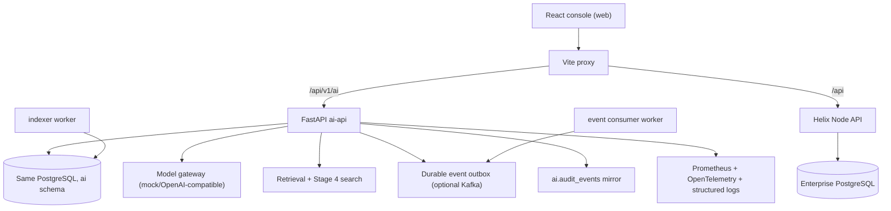
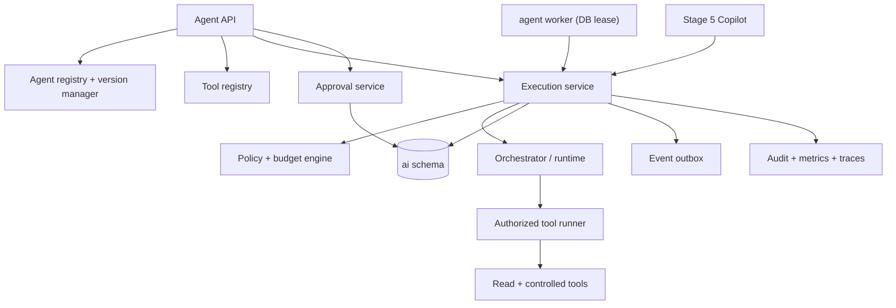
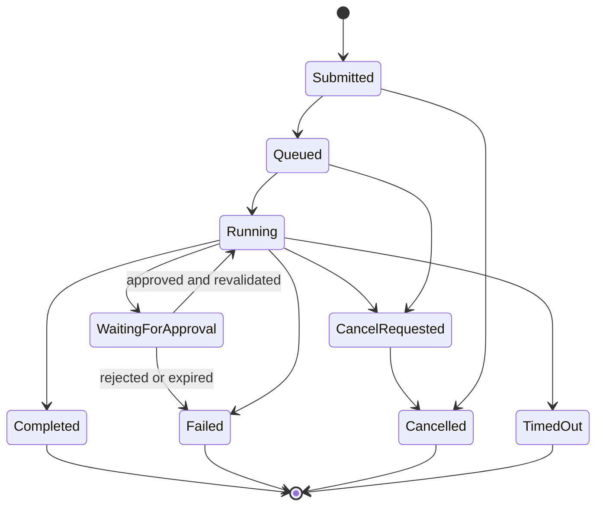

# Stage 6 — Enterprise AI Agent Platform: Architecture Discovery Report

Status: **Phase 0 complete**. No Stage 6 runtime code has been written. This
document is the reuse-versus-build assessment and implementation contract to be
approved before Phase 1.

Repository baseline inspected:

- AI service: `ai-platform/apps/ai-api` (FastAPI, Python 3.11).
- Console: `web` (React + Vite), proxied to the AI API and the Helix API.
- Enterprise platform: `server` (Helix Node API), PostgreSQL.
- Migrations applied: `0001`–`0011`; next version is `0012`.
- Baseline tests: backend 218 passed / 14 skipped; web 29 passed.
- Branch `postgres`; Stage 4 and Stage 5 changes are present but uncommitted.

## 1. Architecture discovered

Important boundaries:

- The AI API and Helix API are separate services. They share PostgreSQL but the
  AI service owns only the `ai` schema.
- Identity, tenant, roles and effective permissions are supplied by the
  verified enterprise session; the AI API re-checks permissions server-side.
- The console is not a security boundary. Every action must exist as an
  authorized backend endpoint.
- Helix already has a workflow and approval engine
  (`server/services/workflow/approvals.js`, `workflow_approvals`,
  `approval_rules`), but it is not exposed to the AI API as a service interface
  and shares no ORM with it. Stage 6 must not read or write Helix workflow
  tables directly.

### Existing Stage 1–5 capabilities relevant to Stage 6

| Area | Current implementation |
|---|---|
| IAM | `Principal`, `Policy`, configurable `AI_PERMISSION_MAP`, capability dependencies |
| Tenant isolation | `require_tenant`, tenant-scoped repository methods |
| LLM gateway | `ModelGateway`, provider registry, mock provider, usage/cost records |
| Retrieval/RAG | Authorized hybrid retrieval, ACL + classification ceiling, citation snapshots |
| Search | Stage 4 federated search, ranking explanations, duplicates |
| Copilot | Stage 5 conversations, context adapters, tasks, SSE, prompt versioning |
| Agent registry | `ai.agents`, `ai.agent_versions`, built-in read-only knowledge assistant |
| Agent runtime | LangGraph, timeout, recursion bound, tool budget, trace |
| Tools | Hardcoded `ToolSpec` registry, one read-only `knowledge.search` tool |
| Approval | Framework flag plus client-supplied approval names (not a real workflow) |
| Execution records | `ai.executions` (pending/running/succeeded/failed/cancelled) |
| Jobs | `ai.jobs` with advisory lease, bounded retries, timeout, reclaim |
| Workers | `indexer` and `event_consumer`; no generic agent worker |
| Events | Versioned registry, durable outbox, optional Kafka, idempotent consumer |
| Audit | `ai.audit_events` mirror; enterprise audit remains authoritative |
| Observability | HTTP/model/retrieval/tool metrics, OTel spans, structured logs, `/metrics` |
| Evaluation | `ai.evaluations` and `ai.evaluation_results` (retrieval/answer/safety) |
| Frontend | `/ai/agents` list, run, results, recent executions; no admin or approval UI |

## 2. Reuse-versus-build assessment

| Capability | Existing implementation | Required extension | Reuse or build |
|---|---|---|---|
| Identity and invocation authz | Enterprise token to `Principal`; `Policy.require`; `agents.read`/`agents.execute` | Add `agents.manage`, `agent_tools.read/manage`, `agent_approvals.read/decide`; ownership checks | Reuse + extend |
| Tenant isolation | `require_tenant`, tenant-scoped queries | Tenant scope on every new table and query; authz-or-404 behavior | Reuse |
| Agent catalog | `ai.agents` + list/get endpoints | Lifecycle, owner/team/category, search/filter, draft creation | Extend |
| Agent versioning | `ai.agent_versions` with draft/active/archived | Immutable published versions, publish/validate/rollback, optimistic locking, actor and timestamps | Extend |
| Agent configuration | JSON `definition` stored per version | Typed validation, schema, budgets, allowlist, approval policy, output rules | Extend |
| Tool registry | Hardcoded Python `ToolSpec` map | Persisted tool definitions/versions, enablement, risk class, schemas, limits | Build (persisted registry), keep Python implementations |
| Tool authorization | Capability check in `ToolRegistry` | Agent-version allowlist, enabled/risk policy, object authz, argument validation | Extend |
| Execution engine | Synchronous `AgentService.execute` + LangGraph | Durable state machine, async queue, checkpoints, steps, cancellation, retry | Extend heavily |
| Orchestration | One linear read-only graph | Deterministic sequential/branch plan, bounded LLM tool loop, resumable steps | Extend runtime, no new framework |
| Human approval | Client-supplied tool-name set | Persisted approval requests bound to operation hash, expiry, reviewer, revalidation | Build |
| Execution state | `ai.executions` with coarse statuses | Add agent state/columns, steps, checkpoints, leases, idempotency keys | Extend |
| Async execution | `ai.jobs` lease pattern + workers | New agent worker using the same DB lease/reclaim pattern | Reuse pattern, build worker |
| Retry/timeout | `classify_error`, job retries, runtime timeout | Tool/model retry policy, backoff, non-retryable classes, uncertain-outcome handling | Extend |
| Events | Outbox + Kafka + versioned registry | New Stage 6 event types (execution/approval lifecycle) | Extend |
| Audit | `AuditService` + `ai.audit_events` | Approval decisions, policy denials, admin/version changes | Reuse |
| Observability | Prometheus/OTel/logging | Queue depth, approval wait, cancellation, budget, policy-denial metrics | Extend |
| Evaluation | Evaluation tables + mock-provider evaluation suite | Agent validation and publication gate; tool-selection/argument/loop/approval cases | Extend |
| Approval UI/workflow | Helix workflow approvals exist, not exposed to AI API | AI-native approval service; optional event adapter to Helix workflow later | Build AI-native, do not couple DBs |
| Copilot integration | Stage 5 context/task service | Invoke published agents or expose execution status as a controlled action | Extend |
| Console | `/ai/agents` run page | Agent admin, tool registry, execution monitor, approval inbox | Extend |
| Rate limiting | Per-route limiter, governance quotas | Per-agent/tool concurrency and rate limits, budgets | Extend |
| Secrets | Environment/settings only | Forbid secrets in agent/tool definitions; validate config | Reuse policy |

### Components to reuse directly

- PostgreSQL and the migration runner (`scripts/migrate.sh`).
- Identity, `Policy`, `PermissionMap`, governance feature flags.
- `ModelGateway` and mock provider.
- `RetrievalService`, Stage 4 `SearchService`, Stage 5 `ContextService`.
- `AuditService`, event outbox/consumer, `classify_error`.
- The `ai.jobs` lease/reclaim pattern and existing worker bootstrap style.
- Prometheus, OpenTelemetry, structured logging.
- Evaluation tables and console design system/routing.

### Missing capabilities that must be built

1. Immutable, validated agent publication and rollback.
2. Persisted, versioned tool registry with risk and schema metadata.
3. Agent-version tool allowlists and argument validation.
4. Durable execution state machine with steps, checkpoints and leases.
5. Real human-approval requests with binding, expiry, separation of duties and
   revalidation.
6. Asynchronous agent worker and recovery/reconciliation.
7. Idempotency and uncertain-outcome handling for controlled mutations.
8. Agent validation/evaluation publication gate.
9. Admin, monitoring and approval-inbox UI.
10. Stage 6 event types, metrics and security tests.

## 3. Security and operational risks found

1. **Client-supplied approvals are not authorization.** `AgentExecuteRequest.approvals`
   is a list of tool names from the browser. If an approval-gated tool were
   registered today, a caller could self-approve by sending its name. Stage 6
   must remove this field from the trust path and replace it with persisted,
   reviewer-authorized approval records.
2. **Published versions are not immutable.** Nothing prevents updating a
   version's JSON after activation; there are no update endpoints but direct
   repository use could mutate history.
3. **No lifecycle validation.** A definition with unknown tools or invalid
   limits can be inserted; execution only checks `read_only`.
4. **Synchronous-only execution.** Long runs hold the HTTP request and are not
   recoverable after a worker/API restart.
5. **No execution-step or checkpoint persistence.** The trace is returned in the
   response but only a coarse execution row is retained.
6. **No tool registry persistence or allowlist snapshots.** Tools are a global
   Python map; an agent definition's `tools` list is descriptive only.
7. **No consequence boundary exists yet.** V1 is read-only, so controlled
   mutations and approvals cannot be exercised end to end.
8. **No dedicated agent worker.** `ai.jobs` is coupled to knowledge sources and
   index jobs; reusing it for agent runs would overload `source_id` semantics.
9. **No publication gates.** Agent definitions are auto-seeded; there is no
   validation/evaluation evidence recorded before activation.
10. **Helix approvals cannot be reused as-is.** Cross-service table access would
    violate service ownership; an API adapter would be required.
11. **Tests cover only the read-only path.** No tests for tenant boundaries on
    new resources, approval replay, lease races, cancellation or recovery.
12. **Search/context authorization is sound** (ACL + classification rechecked
    server-side), but retrieved text must remain untrusted in agent prompts.

## 4. Proposed Stage 6 architecture

All logical components remain inside the existing AI API process, with one new
worker. No new database, queue, LLM gateway, identity provider or workflow
engine is introduced.

### Execution state machine

Transitions are compare-and-set on `(id, state, lease_owner)`; invalid
transitions are rejected, not coerced.

### Execution flow

1. Authenticate, resolve tenant/principal, enforce `agents.execute` and
   governance feature/quotas.
2. Resolve the **published** agent version and reject disabled/deprecated agents.
3. Validate typed input against the version input schema.
4. Create the execution with a client idempotency key and immutable snapshots of
   agent version, configuration hash and input.
5. Build a validated plan from the version's deterministic workflow definition;
   reject unregistered tools and invalid dependencies.
6. Queue for the worker, or run inline only for a single short deterministic step.
7. For each step: re-authorize caller and tool, validate arguments, enforce
   budgets/timeouts, execute, validate output, persist step and checkpoint.
8. If approval is required, persist the exact operation hash and pause.
9. On approval: verify reviewer authorization, expiry, binding and current
   permission, then resume. Reject changed inputs or replayed approvals.
10. Validate final output, persist result, usage and audit; emit events.

## 5. Proposed data model (migration 0012)

Additive only. Extend `ai.executions`; do not create a competing execution table.

| Table | Purpose and key points |
|---|---|
| `ai.agents` (extend) | Owner/team, category, lifecycle, current published version, `lock_version`, created/updated by |
| `ai.agent_versions` (extend) | Immutable `published` status, `published_at/by`, validation report, config hash, optimistic lock; allow draft/published/deprecated/disabled/archived |
| `ai.agent_tools` | Stable tool code, name, description, owner, enabled, current version |
| `ai.agent_tool_versions` | Versioned input/output schema, capability, read-only/risk class, timeout, concurrency, idempotency and approval requirements |
| `ai.agent_version_tools` | Immutable allowlist snapshot per published agent version, with pinned tool version |
| `ai.executions` (extend) | `agent_version_id`, normalized state, current step, idempotency key, input/output snapshots, plan, budgets, retry parent, lease owner/expiry, cancel request, timestamps; unique `(tenant_id, idempotency_key)` |
| `ai.agent_execution_steps` | Step id/key, status, attempts, input/output summaries, timing, error class, checkpoint ref |
| `ai.agent_tool_invocations` | Tool/version, arguments hash and redacted summary, status, timing, idempotency key, outcome certainty |
| `ai.agent_checkpoints` | Durable state snapshot needed to resume, bounded and redacted |
| `ai.agent_approvals` | Execution/step/tool, operation hash, target, redacted inputs, expected effect, evidence, risk, requester, expiry, status, reviewer, decision, reason, decided_at |
| `ai.agent_artifacts` | Platform-owned draft artifacts produced by the controlled-mutation tool; never an enterprise business record |

Reused: `ai.executions`, `ai.usage_records`, `ai.feedback`, `ai.evaluations`,
`ai.evaluation_results`, `ai.audit_events`.

Constraints and indexes: tenant-leading indexes on every table; FK cascades from
execution to steps/invocations/checkpoints; partial index for pending approvals;
unique operation hash per approval; state/lease indexes for the worker; JSON
schemas stored as JSONB, never secrets.

Retention: execution payload snapshots are redacted and bounded; approval and
audit records follow governance retention. No credentials in any JSON column.

## 6. Tool policy and risk model

| Risk class | Default behavior | Stage 6 tools |
|---|---|---|
| `read_only` | Execute after authz | `knowledge.search`, `knowledge.document.read`, `search.enterprise` |
| `low_risk_preparation` | Execute within limits | `summary.generate`, `comparison.generate` |
| `controlled_mutation` | Policy + explicit permission; approval when configured | `artifact.draft.create` (platform-owned artifact only) |
| `consequential` | Not enabled in Stage 6; requires business API, approval, idempotency and reconciliation | None |
| `prohibited` | Always blocked | Shell, SQL, arbitrary HTTP/filesystem, credential access |

Every tool call checks, in order: caller permission, agent published/enabled,
tool registered/enabled, tool pinned in the agent-version allowlist, argument
schema, object/tenant authorization, risk/approval policy, timeout/concurrency,
then executes through a typed service interface.

The model never chooses its own permissions or risk class. A plan may only
reference tools already present in the allowlist; unknown tools and invalid
dependencies fail validation before any step runs.

## 7. Approval design

- Approval requirement comes from the pinned tool version plus tenant policy and
  caller permissions, never from model text.
- The request stores a canonical operation hash over agent version, step key,
  tool code/version, normalized arguments and target. Changing any input
  invalidates the approval.
- Only a principal with `agent_approvals.decide` and reviewer eligibility may
  decide. Separation of duties is configurable; the requester cannot approve
  their own request by default.
- Expired, rejected, cancelled, already-decided or mismatched approvals cannot
  authorize execution.
- Immediately before the gated step, the engine rechecks reviewer validity,
  requester permission, agent state, tool state and the operation hash.
- The approved operation is single-use. Approval does not authorize any other
  step or tool.
- Decisions are audited and emitted as events.

## 8. API surface (reuse `/api/v1/ai` conventions)

| Method | Path | Purpose |
|---|---|---|
| POST/GET | `/agents` | Create draft / list authorized agents |
| GET/PATCH | `/agents/{id}` | Details / update draft with optimistic lock |
| POST | `/agents/{id}/validate` | Validate configuration, tools, schemas, budgets, policy |
| POST | `/agents/{id}/publish` | Publish validated immutable version |
| POST | `/agents/{id}/disable` | Disable new executions |
| POST | `/agents/{id}/rollback` | Activate a previous published version |
| GET | `/agents/{id}/versions` | Version history |
| POST/GET | `/agent-tools` | Register / list tools |
| GET/PATCH | `/agent-tools/{id}` | Inspect / update draft tool version |
| POST | `/agent-tools/{id}/validate` | Schema and policy validation |
| POST/GET | `/agent-executions` | Request / list executions |
| GET | `/agent-executions/{id}` | Status, steps and budgets |
| GET | `/agent-executions/{id}/trace` | Authorized trace |
| GET | `/agent-executions/{id}/result` | Completed result |
| POST | `/agent-executions/{id}/cancel` | Request cancellation |
| POST | `/agent-executions/{id}/retry` | Retry only eligible failures |
| GET | `/agent-approvals` | Caller's approval inbox |
| GET | `/agent-approvals/{id}` | Bound operation and evidence |
| POST | `/agent-approvals/{id}/approve` | Approve exact operation |
| POST | `/agent-approvals/{id}/reject` | Reject with reason |

Keep the existing `POST /agents/{id}/execute` as the synchronous convenience
endpoint for eligible single-step agents. It must use the same engine, policy,
idempotency and audit path; it is not a second implementation.

## 9. Reliability and recovery

- **Worker:** `python -m ai_api.workers.agent` using `FOR UPDATE SKIP LOCKED`
  leases, heartbeats, bounded batch size and graceful shutdown.
- **Idempotency:** client request key on execution creation; tool idempotency key
  on every invocation. Consequential tools must declare `idempotent` or
  `reconcile` behavior.
- **Retries:** only transient classes (timeout, provider, dependency, rate
  limit), exponential backoff with jitter, bounded attempts. Never retry invalid
  input, authorization/policy denials, rejected approvals or permanent
  validation errors.
- **Uncertain outcomes:** record `outcome_unknown`; reconcile before retrying.
  Never blindly repeat an irreversible call.
- **Recovery:** expired leases are reclaimed; the engine resumes from the last
  completed checkpoint and skips completed steps. Steps are claimed
  compare-and-set so two workers cannot run the same non-repeatable step.
- **Cancellation:** cooperative cancel flag plus lease-aware state transition;
  in-flight calls receive cancellation where supported and outcomes are recorded.
- **Timeouts:** per model call, per tool and per execution; each produces a
  distinct terminal state and diagnostic.
- **Abandoned runs:** expired approvals and stale queued/running executions are
  reconciled to `timed_out`/`failed` with an audit entry.

## 10. Observability and performance

Add bounded-label metrics: executions by state/risk/outcome, queue depth, step
and tool latency, approval wait, cancellations, retries, policy denials, budget
exhaustion and model failures. Propagate `request_id`/`correlation_id` into
worker spans. Logs never include prompts, document text, raw tool payloads or
secrets; trace/result APIs return redacted summaries.

Benchmarks to run and report (no scalability claims before measurement):
single read-only execution, five-step read-only execution, approval pause/resume,
concurrent leases on one execution, and worker recovery.

## 11. Testing and evaluation plan

- **Unit:** config/schema validation, version immutability, allowlist, risk and
  approval policy, state transitions, budgets, retry classification, approval
  binding/hash, output validation, idempotency.
- **Integration:** registry persistence, tool registry, LLM gateway, retrieval,
  worker claim/lease, checkpoints, approvals, audit/events, recovery.
- **Security (all 14 spec cases):** restricted invocation, allowlist escape,
  prompt/plan permission override, tenant isolation, approval replay/mutation,
  revoked permission recheck, disabled agent, expired approval, duplicate
  consequential action, untrusted document content, secret exposure, trace
  authorization, concurrent non-repeatable step.
- **End-to-end scenarios A–J:** read-only agent, multi-step report, approval
  approved, approval rejected, timeout/retry, worker restart, permission change,
  budget limit, unauthorized tool, concurrent execution.
- **Evaluation gate:** configurable per-agent policy; default blocks publication
  without passing mandatory validation and required cases. Model-based scores are
  signals, not proof.

## 12. Phase plan

| Phase | Deliverable | Exit criteria |
|---|---|---|
| 0 | This report | Approved |
| 1 | Registry, lifecycle, immutable versions, ownership, validation/publish/rollback, audit | Tests for lifecycle/immutability/authz pass |
| 2 | Persisted tool registry, schemas, risk classes, allowlist snapshot, policy checks | Allowlist and risk tests pass |
| 3 | Execution state machine, engine, worker, LLM gateway integration, budgets | Sync/async read-only scenarios pass |
| 4 | Checkpoints, leases, retries, timeouts, cancellation, recovery, idempotency | Restart/concurrency tests pass |
| 5 | Approval service, exact-operation binding, expiry, SoD, revalidation | Approve/reject/replay/mutation tests pass |
| 6 | Copilot integration through a documented, authorized interface | Copilot-initiated execution works and is audited |
| 7 | Agent/tool admin, execution monitor, approval inbox | UI uses only implemented APIs |
| 8 | Validation/evaluation framework, security suite, benchmarks | Publication gate and all security tests pass |
| 9 | Migrations 0012, docs, config, final report | Full regression + Stage 1–5 compatibility |

## 13. Explicit non-goals and limitations

- No domain-specific business agents, BOM/change/quality logic or invented
  business rules.
- No shell, SQL, arbitrary HTTP/filesystem tool, credential access or
  unrestricted autonomous loop.
- No enterprise business-record mutation in Stage 6. The only controlled
  mutation is a platform-owned draft artifact needed to exercise the approval
  lifecycle. Consequential enterprise actions remain blocked until an approved
  business API with idempotency/reconciliation exists.
- Helix workflow approvals are not reused directly. Stage 6 implements an
  AI-native approval service; a future adapter may publish decision events to
  Helix workflows. Direct cross-schema access is prohibited.
- The model-generated plan is untrusted. V1 prefers validated deterministic
  step definitions; LLM tool selection is bounded by the same allowlist and
  budgets.
- No live Kubernetes or multi-node worker test in this environment; lease races
  are tested against PostgreSQL and simulated workers.
- Mock-provider outputs are labelled and never presented as real analysis.

## 14. Approval requested

Per the Stage 6 instruction, implementation stops here. Approving this report
authorizes Phase 1 (registry, lifecycle, immutable versions, validation,
publish/rollback, ownership and audit) followed by the phases above, each
reported with verified test results before moving on.

## 15. Implementation status (Phases 1–9)

- **Registry/lifecycle**: `AgentRegistryService` + `/agents` create/update/
  validate/publish/disable/rollback/version-tool endpoints; published versions
  are protected by `ai.guard_agent_version_immutable`.
- **Tool registry**: `AgentToolService` + `/agent-tools`; versioned schemas and
  risk classes, credential rejection, allowlist snapshot at publication, and a
  hard block on publishing `prohibited` tools.
- **Execution engine/worker**: `AgentExecutionService` +
  `python -m ai_api.workers.agent`; deterministic validated steps, pinned tool
  versions, budgets, idempotency, leased claims, checkpoints, cancellation,
  retry, timeout and tenant-scoped reads. `ai.executions` remains the only
  execution ledger.
- **Approvals**: `AgentApprovalService` + `/agent-approvals`; operation hash
  binds agent version/step/tool version/arguments, requests expire, requesters
  cannot approve their own operation (except platform superusers), and a
  decision releases or cancels the paused execution.
- **Copilot integration**: `POST /assistant/agents/run` delegates to the same
  execution service and records `ai.copilot.agent_run`.
- **Console**: `/ai/agents/admin` provides agent/tool admin, execution monitor
  and approval inbox using only the implemented APIs.
- **Verification**: backend 233 passed / 14 skipped; frontend 30 passed / 6
  files; ruff clean; Vite build succeeds. Live PostgreSQL smoke tests covered
  publish, read-only execution, approval pause/approve/resume and the draft
  artifact.
