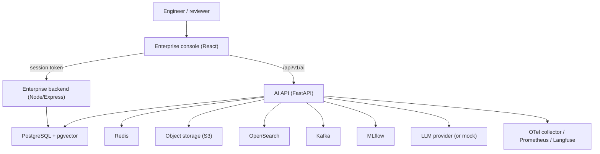
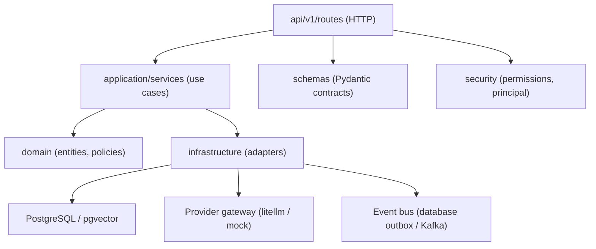
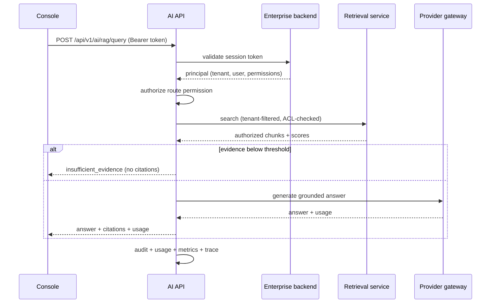

# Architecture

The Enterprise AI Platform is an **additive** AI layer over the existing
FutureForge enterprise platform (PDM/PLM/MES/SLM engineering, manufacturing,
quality and service modules). The existing Node/Express backend, PostgreSQL
database, IAM, audit, events, jobs, file storage and search remain
authoritative; the AI layer reuses them rather than duplicating them.

## Context

Identity is not re-implemented: the AI API validates the same opaque enterprise
session token against the enterprise backend and reuses its users, tenants,
roles and permissions.

## AI API layering

The FastAPI service in `apps/ai-api` is strictly layered:

- `api/` — routing, dependency injection, request/response schemas.
- `application/` — use cases: model gateway, retrieval, RAG, ingestion,
  indexing, agents, events, feedback, ML tracking.
- `domain/` — entities and policies with no framework dependencies.
- `infrastructure/` — adapters (database, repository, vector store, search,
  object storage, cache, providers, MLflow).
- `security/` — principal resolution and the capability→permission map.
- `telemetry/` — metrics, tracing, Langfuse, logging, middleware.

## Request flow (authorized RAG query)

Authorization is applied **before** retrieval (tenant and ACL filters in the
query) and again on every result and tool action. Vector similarity never
grants access; the retrieved text is treated as untrusted data.

## Data model

All AI state lives in the `ai` schema of the shared PostgreSQL database
(migrations `0001`–`0007`): configuration, knowledge sources/documents/chunks
(with `pgvector` embeddings), runtime records, governance, the durable event
log/outbox, and ML tracking/registry. See `database.md`.

## Deployment topology

- **API and console**: stateless containers, horizontally scaled.
- **Stateful backing services**: PostgreSQL/pgvector, Redis, object storage,
  optional OpenSearch, Kafka and MLflow — internal only.
- **Observability**: OTLP collector, Prometheus, Grafana, optional Langfuse.

See `deployment.md` for the Kubernetes topology and `observability.md` for the
telemetry pipeline.

## Key design decisions

Summarised in `technology-decisions.md`, including: reuse over re-implementation,
pgvector for V1 vectors, PostgreSQL as the authorization-metadata authority,
a durable database outbox instead of requiring Kafka, and a clearly-labelled
mock provider by default with no fabricated results.
