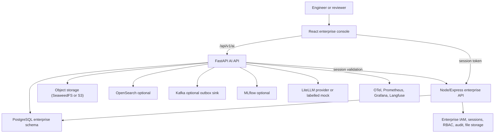

# Enterprise AI Platform - Stages 1-6 Implementation Audit

- Audit date: 2026-10-22
- Repository: `/workspace`
- Branch: `postgres`
- Commit inspected: `296ea36`
- Working tree: contains uncommitted Stage 4, 5 and 6 implementation work; this audit assessed the working tree as the current platform snapshot.
- Audit type: read-only implementation, security and quality assessment. No application code, schema, migration, dependency or runtime configuration was changed. This report is the only new artifact.
- Scope: Stages 1-6 of the Enterprise AI Platform, plus the enterprise identity, authorization, audit, storage and worker substrate it depends on.

## A. Executive Summary

### Verdict

The platform is a substantive functional MVP/beta, not a placeholder. The model gateway, enterprise identity bridge, tenant-scoped knowledge ingestion, authorization-aware retrieval, Copilot context checks, search pipeline, agent registry and durable execution records are real code with meaningful tests.

It is **not production-ready**, and it is **not ready to start Stage 7** without remediation. The main blockers are tenant-boundary and object-level authorization defects, unsafe search-index lifecycle in OpenSearch mode, and missing enforcement in the Stage 6 execution/approval path.

### Overall maturity

| Area | Assessment |
|---|---|
| Overall Stages 1-6 | Functional prototype/MVP with production-oriented structure; not production-ready |
| Strongest layer | Stage 2 model/retrieval foundations and Stage 3 retrieval authorization |
| Weakest layer | Stage 6 execution governance and approval enforcement |
| Security posture | Structured capability model, but confirmed cross-tenant and object-level gaps |
| Test posture | Good hermetic unit/integration coverage for happy paths; weak PostgreSQL, OpenSearch, race-condition and cross-actor coverage |
| Operational posture | CI, manifests, health checks and docs exist; worker deployment, backup automation and production telemetry are incomplete |

### Stage-by-stage status

| Stage | Primary status | Maturity | Summary |
|---|---|---|---|
| Stage 1 - Environment and infrastructure | Partially Implemented | Functional/beta | Working local stack, identity bridge, migrations, CI and manifests. Missing worker deployment and backup automation; cross-tenant event reads; production defaults remain mock/telemetry-off. |
| Stage 2 - AI platform foundation | Partially Implemented | Functional | Real gateway, shared services, ACL, metrics and evaluation storage. Model/version pinning, provider fallback, streaming hardening, full usage accounting and general redaction are incomplete. |
| Stage 3 - Enterprise Knowledge Assistant | Partially Implemented | Beta | Ingestion, chunking, embeddings, retrieval, abstention and citations are implemented. Direct document download bypasses document ACL/classification; ingestion permits caller relabeling; deletion and source lifecycle are incomplete. |
| Stage 4 - Enterprise Search | Partially Implemented | Beta | Lexical, vector and hybrid retrieval, filters, facets and saved searches work. OpenSearch lifecycle is unsafe, result totals are misleading, analytics are mostly absent and conflict detection is noisy. |
| Stage 5 - Copilot | Partially Implemented | Beta | Authorized document context, grounded answers, tasks and safe markdown are real. Enterprise object connectors are limited to knowledge documents; citation validation is advisory; streaming is mock-only; injection blocking is opt-in. |
| Stage 6 - Agent Platform | Partially Implemented | MVP/prototype | Registry, immutable published versions, tools, durable execution and approvals exist. Lease fencing, approval revalidation/single-use, tool-permission enforcement, output validation, worker deployment and governance telemetry are missing. |

### Most important verified strengths

1. The AI API is genuinely layered: routes, services, ports and PostgreSQL adapters.
2. Enterprise session tokens are validated against the enterprise IAM; production identity fails closed.
3. Retrieval applies tenant filtering, document ACL and classification ceiling before content reaches a prompt.
4. RAG abstains when evidence is insufficient and returns persisted citations rather than fabricated sources on the main Copilot path.
5. Copilot context references are server-resolved under caller identity and denied/missing objects share a 404.
6. Markdown rendering is safe and tested against script, image and `javascript:` injection.
7. Stage 6 published agent/tool versions are protected by database immutability triggers.
8. Stage 6 blocks prohibited and consequential tools; no shell, arbitrary SQL, filesystem, unrestricted network or credential tools exist in the dispatch path.
9. The AI test suite (`233 passed, 14 skipped`), web suite (`30 passed`), ruff, frontend build and manifest validation all pass.

### Critical concerns

1. **Cross-tenant AI event disclosure.** PostgreSQL event listing, lookup, dead-letter listing and replay have no tenant predicate, while routes only require `ai.audit:read`.
2. **Document ACL bypass.** `GET /knowledge/documents/{id}/download` returns raw bytes for any tenant document to a caller with `ai.knowledge:read`; it does not evaluate document ACL or classification.
3. **Classification/ACL integrity.** Ingestion accepts caller-supplied classification and ACL and does not constrain them by caller clearance or source policy.
4. **Stale OpenSearch content.** Deletes, reindexes and ACL tightening do not propagate correctly to OpenSearch; old chunks can remain searchable with old ACLs.
5. **Stage 6 duplicate execution.** Worker leases are not fenced or renewed; a reclaimed execution can be run concurrently by two workers.
6. **Stage 6 approval bypass.** Approvals are not revalidated at resume, not consumed, and can be reused from checkpoints; tool permission, enabled state and schemas are not enforced at execution.
7. **Second agent execution path.** `/agents/{id}/execute` still uses the legacy engine and client-supplied approval names.
8. **Production defaults.** Kubernetes production configuration still uses `LLM_PROVIDER=mock` and disables OTel.
9. **Prompt-injection controls.** Blocking is opt-in and the `/rag/query` path does not scan retrieved evidence or the instruction under the policy.
10. **Citation contract.** Invalid or missing citations produce warnings that are dropped on the non-stream path and invisible after refresh.

### Major missing capabilities

- Provider fallback and runtime model/version pinning.
- General PII/sensitive-data redaction.
- Enterprise Copilot connectors for products, BOMs, requirements, changes, quality and manufacturing records.
- Agent worker deployment, lease heartbeats, agent metrics/events, usage accounting and pre-publication evaluation.
- Automated backup/restore jobs and restore verification.
- Search analytics, meaningful production-scale ranking evaluation, and retention jobs.
- Database row-level security or an equivalent mandatory tenant predicate mechanism.

### Stage 7 readiness

**Not ready.** Verified blockers are listed in section H. The platform has the right conceptual architecture, but Stage 7 would build a knowledge graph and digital thread on top of authorization and execution paths that still have confirmed bypasses and unverified recovery behavior.

### Audit limitations

- No production system, live enterprise LLM, live OpenSearch cluster, Kafka, MLflow, Kubernetes cluster or object-store failure mode was exercised.
- No migrations were run; applied migration state was read from `ai.schema_migrations`.
- No destructive security test, exploit, load test or consequential agent action was performed.
- Test results are hermetic or local. They do not prove production behavior.
- The enterprise server test suite was started but did not complete within the audit window; its partial run is recorded in section F.
- The working tree is uncommitted, so line references may shift after later edits.

## B. Stage-by-Stage Feature Matrix

Status values follow the audit specification: Implemented and Verified; Implemented, Verification Incomplete; Partially Implemented; Missing; Broken; Blocked; Not Applicable.

### Stage 1 - Environment and Infrastructure

| Stage | Feature | Status | Maturity | Evidence | Test Evidence | Security Gap | Recommended Action | Priority |
|---|---|---|---|---|---|---|---|---|
| 1 | Repository/module boundaries | Implemented and Verified | Production-capable | `server/` Node API, `web/` React console, `ai-platform/apps/ai-api` FastAPI, `ai-platform/migrations` | Lint, tests, build pass | None material | Keep boundaries; remove duplicate AI console drift | P2 |
| 1 | Build, lint and CI | Implemented and Verified | Production-capable | `.github/workflows/ai-platform-ci.yml` runs ruff, pytest, web tests/build, manifest checks, Trivy, SBOM, pip-audit | Local ruff, AI tests, web tests and build pass | Enterprise `npm audit` is advisory only | Make dependency audit fail on high severity | P2 |
| 1 | Environment separation | Partially Implemented | Beta | Pydantic settings and `AI_ENV`; production identity is fail-closed | Identity tests | Production ConfigMap still uses mock LLM and OTel off | Add production startup guards and overlay overrides | P1 |
| 1 | Database and migrations | Implemented and Verified | Beta | `scripts/migrate.sh`; `0001`-`0012`; `ai.schema_migrations`; live DB has 44 `ai` tables and pgvector | Read-only DB query confirms applied through `0012` | Runner does not verify checksum drift; no RLS | Add checksum validation and RLS or mandatory scoped-query tests | P1 |
| 1 | Authentication and sessions | Implemented, Verification Incomplete | Beta | `server/services/authentication.js`, `sessions.js`, `mfa.js`; AI bridge `security/enterprise_identity.py` | Identity/permission tests; live 401 without token | Session bearer tokens stored plaintext; fixed seed credentials | Hash session tokens; gate seed credentials to development | P1 |
| 1 | AI identity bridge | Implemented and Verified | Production-capable | `security/enterprise_identity.py`; token-hash cache; enterprise permissions mapped to AI capabilities | `test_enterprise_identity.py` | Development provider accepts any non-empty token outside production | Require explicit development opt-in and reject in staging | P1 |
| 1 | Capability authorization | Implemented and Verified | Production-capable | `security/permissions.py`; `api/deps.py` `require_capability`; route dependencies | Permission/access tests | Authorization metadata endpoints are over-exposed | Restrict `/api/authorization/check` and `/effective/:userId` | P1 |
| 1 | Tenant isolation | Partially Implemented | Beta | Tenant filters in most repositories; `require_tenant` | Stage 3/5 tenant tests | PostgreSQL event queries are unscoped; no RLS | Add tenant predicate to every event query; add cross-tenant regression tests | P0 |
| 1 | Secrets management | Partially Implemented | Beta | `SecretStr`; env references; example secret; CI audit | Adapter secret-leak test | No secret manager integration; credentials read from env only | Adopt external secrets for production | P2 |
| 1 | API routing/versioning | Implemented and Verified | Production-capable | `/api/v1/ai`; route groups; Vite proxy | Route tests and live `/healthz` | `/docs`, `/openapi.json`, `/metrics` unauthenticated | Disable docs or require auth in production; restrict metrics | P2 |
| 1 | Upload/storage | Implemented, Verification Incomplete | Beta | MIME/magic-byte validation; tenant-prefixed keys; signed enterprise downloads | Upload validation tests | Direct AI object-key prefix not enforced; 25 MiB app limit vs 16 MiB ingress | Enforce key prefix and align limits | P1 |
| 1 | Workers/queues | Partially Implemented | Beta | Indexer and event consumer workers; durable jobs; agent worker CLI | Indexer and event tests | Agent worker not deployed; indexer claim is read-then-write | Add worker deployment and atomic claims | P1 |
| 1 | Cache/session/rate limits | Partially Implemented | Prototype | DB sessions; in-process rate limiter; provider limiter | Reliability tests | In-process limits multiply per replica; limiter map unbounded | Use Redis/distributed limits or document single-replica constraint | P2 |
| 1 | Health/logging/readiness | Implemented and Verified | Production-capable | `/healthz`, `/readyz`; structured logging; request IDs | Live 200 responses | Readiness checks database only | Add dependency-aware readiness | P2 |
| 1 | Docker/Kubernetes | Implemented, Verification Incomplete | Configured, not operational | Compose; base/production overlays; probes; NetworkPolicy; TLS ingress | `validate-k8s.py`: 20 documents, 16 files OK | No AI API/worker in Compose; agent worker absent; prod telemetry blocked | Add worker manifests and fix observability network policy | P1 |
| 1 | Backup/recovery | Missing | Doc-only | `docs/backup-recovery.md` | None | No backup CronJob, restore drill or verification | Automate and test restore | P1 |

### Stage 2 - AI Platform Foundation

| Stage | Feature | Status | Maturity | Evidence | Test Evidence | Security Gap | Recommended Action | Priority |
|---|---|---|---|---|---|---|---|---|
| 2 | Central model gateway | Implemented and Verified | Functional | `application/services/model_gateway.py`; chat/embed/stream path | `test_model_gateway.py`, `test_mock_provider.py`, `test_litellm_adapter.py` | None material | Keep as sole provider entry point | P3 |
| 2 | Provider/model configuration and versioning | Partially Implemented | Prototype | Env/registry code; `ai.providers`, `ai.models`, `ai.model_versions` are orphaned | Resolution/kind tests only | No runtime config, no model version pinning | Wire DB registry or remove orphaned schema | P1 |
| 2 | Secret references and rotation | Partially Implemented | Functional | `SecretStr`; provider `credential_ref` exists but unused | Adapter no-secret-leak test | Env-only credentials; no rotation | Use secret references and rotation | P2 |
| 2 | Timeouts, retries, rate limits | Implemented, Verification Incomplete | Functional | Gateway `_invoke`; reliability primitives; circuit breaker | Reliability and gateway tests | Streaming bypasses timeout/breaker/usage | Wrap streaming with the same controls | P1 |
| 2 | Provider fallback | Missing | Unknown | No fallback/priority routing | None | Single provider failure exhausts retries | Add ordered fallback with explicit policy | P2 |
| 2 | Streaming | Partially Implemented | Prototype | `MockLLMProvider.stream` only; LiteLLM has no stream | Mock-only streaming tests | Default-on UI streaming fails with real providers | Implement real provider streaming with cancellation and usage | P1 |
| 2 | Usage/token/cost tracking | Partially Implemented | Functional | Usage writes for chat/RAG/agent | Usage tests | Copilot, embeddings and streaming are not recorded; quota bypass | Record all billable paths | P1 |
| 2 | Shared AI interfaces | Implemented and Verified | Functional | Ports and injected services | Broad API/service tests | None material | Reuse for Stage 7 | P3 |
| 2 | Prompt/template versioning | Partially Implemented | Prototype | Static `copilot_prompts.PROMPT_VERSION`; `ai.prompt_*` tables unused | No override tests | Documentation claims overrides that do not exist | Wire templates or correct docs | P2 |
| 2 | Structured output validation | Implemented, Verification Incomplete | Functional | Gateway JSON parsing; optional jsonschema | Parse tests; schema branch untested | Fails open if jsonschema is absent | Make schema validation mandatory and tested | P1 |
| 2 | Embeddings and compatibility | Implemented and Verified | Functional | Gateway dimension checks; deterministic mock embeddings | Embedding tests | None material | Keep | P3 |
| 2 | AI configuration management | Partially Implemented | Prototype | Env only; `ai.platform_settings` unused | None | No admin/runtime configuration path | Implement or remove advertised tables | P2 |
| 2 | Shared context contracts | Implemented and Verified | Functional | `context.py`; typed context refs; server resolution | Copilot security tests | Only knowledge documents supported | Add enterprise adapters | P1 |
| 2 | Authorization before retrieval/tools | Implemented and Verified | Functional | Policy checks and ACL before context use | Permission/ACL tests | Stage 6 tool-level enforcement is missing | Unify policy enforcement across all engines | P0 |
| 2 | Tenant/organization isolation | Partially Implemented | Functional | Tenant filtering in SQL; organization carried but unused | Tenant tests | Organization-level isolation absent | Define and enforce organization scope | P1 |
| 2 | Sensitive-data redaction | Partially Implemented | Prototype | Agent secret-field rejection and summaries | Registry tests | No prompt/message PII/DLP redaction | Add redaction policy at gateway and audit boundaries | P2 |
| 2 | Prompt-injection defense | Partially Implemented | Functional | Heuristic scanner; hardened system prompt; Copilot optional block | Prompt safety, Stage 5 security tests | Blocking off by default; `/rag` does not scan instruction/evidence | Default blocking or quarantine, scan RAG, audit detections | P0 |
| 2 | Provider allowlists | Partially Implemented | Functional | Per-tenant model allowlist | Governance tests | No provider allowlist; deployment-fixed provider | Add provider allowlist if multiple providers are enabled | P2 |
| 2 | Audit/usage policy | Partially Implemented | Functional | Audit and daily quota | Governance tests | Audit writes best-effort; quota TOCTOU; retention unused | Durable audit queue, atomic quota, retention job | P1 |
| 2 | Metrics/tracing | Implemented and Verified | Functional | Metrics, tracing, middleware | Observability tests | Production OTel disabled; Prometheus scrape blocked | Fix production configuration | P1 |
| 2 | Quotas/concurrency | Partially Implemented | Prototype | Per-user in-process limit; daily token quota | Reliability tests | No concurrency cap; per-replica limits | Add distributed quota/concurrency | P2 |
| 2 | Evaluation infrastructure | Partially Implemented | Prototype | Definition/result storage | Deterministic mock evaluations | No runner or publication gate | Add evaluation runner and gate | P2 |
| 2 | Configuration validation/fail-safe | Partially Implemented | Functional | Bounded settings; fail-closed identity | Identity/observability tests | Production mock provider allowed | Fail startup on mock provider in production | P1 |

### Stage 3 - Enterprise Knowledge Assistant

| Stage | Feature | Status | Maturity | Evidence | Test Evidence | Security Gap | Recommended Action | Priority |
|---|---|---|---|---|---|---|---|---|
| 3 | Source registration and metadata | Implemented and Verified | Beta | Knowledge routes/service; tenant-scoped sources | API tests | None material | Keep | P3 |
| 3 | Upload validation and safe storage | Implemented, Verification Incomplete | Beta | MIME/signature/size validation; opaque keys | Upload tests | Client object-key prefix not verified | Enforce tenant prefix on ingest | P1 |
| 3 | Document permissions and ownership | Broken | Beta | Download route checks only capability; `get_document_content` is tenant-only | No download-ACL test | Any `ai.knowledge:read` holder can fetch restricted originals | Apply ACL and classification on download/list; add tests | P0 |
| 3 | Classification/ACL integrity on ingest | Partially Implemented | Beta | Caller values override source; chunks inherit | No write-side ceiling test | Ingestor can downgrade labels or replace ACL | Constrain labels by caller/source policy | P0 |
| 3 | Index status/history | Partially Implemented | Beta | Job and document status fields | Stage 3 tests | Search-sync failure recorded as `indexed` plus error | Add explicit sync states and repair job | P2 |
| 3 | Delete/reindex/update lifecycle | Partially Implemented | Beta | DB delete and object delete; reindex replace | Limited tests | OpenSearch/old chunks not deleted; disabled sources still retrievable | Implement index deletion/update and status filters | P0 |
| 3 | Extraction, normalization, formats | Implemented, Verification Incomplete | Beta | Ingestion parsers and chunking | Unit tests for supported formats | Live multi-format/S3 paths unverified | Add fixture corpus and live S3 integration test | P2 |
| 3 | Chunking and metadata | Implemented and Verified | Production-capable | `chunking.py`; page/section metadata | Chunking tests | None material | Keep | P3 |
| 3 | Embeddings/vector index | Implemented and Verified | Beta | pgvector HNSW; dimension checks | Embedding/retrieval tests | Mock vectors in tests only | Validate with real embedding model | P2 |
| 3 | Async indexing jobs | Implemented, Verification Incomplete | Beta | Durable jobs, leases, retries, timeout | Job tests | Indexer claim not atomic | Use `FOR UPDATE SKIP LOCKED` or compare-and-set | P1 |
| 3 | Idempotency/retry/recovery | Partially Implemented | Beta | Checksum dedupe; job retries | Stage 3 tests | Cross-source dedupe skips target source; no failure reconciliation | Define dedupe and retry semantics | P2 |
| 3 | Retrieval and query processing | Implemented and Verified | Functional | Hybrid RRF, filters, modes | Retrieval tests | None material | Keep | P3 |
| 3 | Permission-aware retrieval | Implemented and Verified | Functional | ACL and ceiling before content | `test_retrieval.py` | Unknown ACL keys fail open; disabled sources not filtered | Fail closed and filter lifecycle | P1 |
| 3 | Metadata filtering/provenance | Implemented and Verified | Functional | Validated filters; source/title/page metadata | Filter tests | None material | Expand revision/lifecycle tests | P2 |
| 3 | Context construction/grounding | Implemented and Verified | Functional | Character-bounded context; hardened prompt | RAG tests | Evidence not scanned under injection policy | Scan evidence and preserve provenance | P1 |
| 3 | Citations/citation verification | Partially Implemented | Beta | Citation rows persisted; Copilot checks indexes | Citation helper test | `/rag` cites chunks not included in truncated context; warnings dropped | Cite only used context; enforce/warn visibly | P1 |
| 3 | Insufficient evidence | Implemented and Verified | Functional | Fixed abstention response, no citations | Stage 3/5 tests | None material | Keep | P3 |
| 3 | Conversation experience | Partially Implemented | Beta | Copilot streaming/tasks; legacy ask path | Stage 3/5 and web tests | Two implementations with unequal history/authz behavior | Consolidate on Copilot service | P1 |
| 3 | History/context window | Partially Implemented | Beta | Bounded history in Copilot | Stage 5 tests | Legacy non-stream path does not include history | Route legacy path through Copilot | P2 |
| 3 | Frontend/feedback/status screens | Partially Implemented | Beta | Knowledge, chat and search pages | Component tests | No ACL editor; accessibility gaps | Add controls and a11y tests | P2 |
| 3 | Data/API/lifecycle | Partially Implemented | Beta | 0003/0008; tenant columns; indexes | API tests | No RLS; snippets/search history retention undefined | Add RLS, retention and cleanup | P1 |

### Stage 4 - Enterprise Search

| Stage | Feature | Status | Maturity | Evidence | Test Evidence | Security Gap | Recommended Action | Priority |
|---|---|---|---|---|---|---|---|---|
| 4 | Keyword/full-text | Implemented and Verified | Functional | PostgreSQL FTS; optional OpenSearch | Search tests | OpenSearch path untested | Add OpenSearch integration tests | P2 |
| 4 | Semantic/vector | Implemented and Verified | Functional | pgvector search | Retrieval tests | Real embedding behavior unverified | Validate with real embeddings | P2 |
| 4 | Hybrid fusion | Implemented and Verified | Functional | RRF fusion and mode fallback | Mode tests | None material | Keep | P3 |
| 4 | Filters/facets | Partially Implemented | Beta | Validated registry; post-filtering | Filter/facet tests | Filters only apply to AI results; post-filter reduces recall | Push filters into candidate queries or document behavior | P1 |
| 4 | Ranking/reranking | Implemented, Verification Incomplete | Beta | RRF and heuristic boosts | Synthetic nDCG test | No production corpus or reranker | Add representative evaluation set | P2 |
| 4 | Search authorization | Implemented and Verified | Functional | ACL/ceiling/tenant in retrieval | Security tests | Unknown ACL keys fail open | Fail closed | P1 |
| 4 | Provenance/navigation | Partially Implemented | Beta | Source metadata returned | UI test | Result cards are non-interactive; no source navigation | Add safe deep links | P2 |
| 4 | Duplicate/near-duplicate | Implemented, Verification Incomplete | Beta | Duplicate service and UI dismiss | Duplicate tests | Cross-source `external_id` false conflicts | Scope dedupe by source or canonical ID | P2 |
| 4 | Conflicting information | Partially Implemented | Prototype | Advisory findings | Same-source tests only | False positives; no resolution workflow | Improve detection and resolution | P2 |
| 4 | Revision/lifecycle awareness | Partially Implemented | Beta | Metadata surfaces revision/status | No lifecycle filter tests | Disabled/deleted lifecycle not removed | Add lifecycle filters and tests | P1 |
| 4 | Index synchronization/freshness | Partially Implemented | Beta | `search_indexed_at`, health, reconcile | Hermetic tests | Delete/update/ACL changes do not propagate to OpenSearch | Implement index outbox and deletion propagation | P0 |
| 4 | Index health/recovery | Partially Implemented | Beta | Health endpoint and reconcile | Duplicate/health tests | Failed sync double-counted; no automated repair | Fix accounting and run repair worker | P2 |
| 4 | Saved searches | Implemented and Verified | Functional | Actor-scoped saved queries | `test_search_stage4.py` | None material | Keep | P3 |
| 4 | Advanced/history/suggestions | Partially Implemented | Beta | History and suggestions backend | Limited tests | No history UI or retention; raw queries stored | Add UI, retention and privacy controls | P2 |
| 4 | Analytics | Missing | Unknown | No analytics table/endpoint/dashboard | None | None direct | Add zero-result, latency and usage analytics | P2 |
| 4 | Evaluation/regression | Partially Implemented | Prototype | 4-query synthetic nDCG in CI | `test_search_evaluation.py` | In-memory ranker, not PostgreSQL/OpenSearch | Build representative regression corpus | P2 |
| 4 | Pagination/totals | Broken | Beta | `total = len(ranked)` over capped candidates; UI sends page 1 only | No pagination test | Misleading totals and unreachable results | Compute true totals; add pagination | P1 |

### Stage 5 - Enterprise Copilot

| Stage | Feature | Status | Maturity | Evidence | Test Evidence | Security Gap | Recommended Action | Priority |
|---|---|---|---|---|---|---|---|---|
| 5 | Conversation UI/history | Implemented, Verification Incomplete | Beta | `AiChatPage.jsx`; persisted conversations | Web component tests | Accessibility and responsive gaps | Add a11y/responsive tests | P2 |
| 5 | Multi-turn conversations | Implemented and Verified | Beta | Persisted messages and bounded history | Stage 5 tests | Cross-actor isolation not tested | Add actor-aware tests | P1 |
| 5 | Streaming/cancellation | Partially Implemented | Prototype | SSE flow and cancel polling | Mock streaming tests | Real provider cannot stream; no fallback | Implement provider streaming and fallback | P1 |
| 5 | Retry/error/loading states | Partially Implemented | Beta | UI states and retry | Basic UI tests | Retry duplicates user turn; no retry test | Make retry idempotent and tested | P2 |
| 5 | Citation display/navigation | Partially Implemented | Beta | Sources persisted and rendered | Citation UI test | Citation warnings dropped; sources may precede answer without markers | Enforce citation contract and surface warnings | P1 |
| 5 | Feedback | Implemented and Verified | Functional | Message feedback endpoint/UI | Stage 5 and web tests | None material | Keep | P3 |
| 5 | Accessibility/responsive | Partially Implemented | Beta | Labels and semantic controls | No a11y test | Clickable divs, no `aria-live`, fixed sidebar | Add keyboard and a11y tests | P2 |
| 5 | Enterprise context adapters | Partially Implemented | Beta | Only `knowledge_document` adapter | Context authz tests | No product, BOM, requirement, change, quality or manufacturing adapters | Build authorized enterprise adapters before claiming Stage 5B | P1 |
| 5 | Stage 3/4 integration | Implemented and Verified | Functional | Copilot retrieval and search integration | Integration tests | Search filters not applied to enterprise payload | Clarify federated search contract | P2 |
| 5 | Server-side object resolution | Implemented and Verified | Functional | Context pointers re-read under caller identity | Stage 5 security tests | Only documents supported | Extend adapter registry | P1 |
| 5 | Permission-aware context | Implemented and Verified | Functional | ACL/ceiling on refs and chunks | `test_stage5_security.py` | Unknown ACL keys fail open | Fail closed | P1 |
| 5 | Revision/lifecycle/tenant awareness | Partially Implemented | Beta | Tenant, revision and status metadata | Tenant tests | Stale/disabled content not consistently excluded | Enforce lifecycle at retrieval/context | P1 |
| 5 | Missing/stale/conflicting context | Partially Implemented | Beta | 404 for denied/missing; warnings | Security tests | No explicit conflicting-evidence resolution | Add conflict reporting and UX | P2 |
| 5 | Summarize/explain/compare/extract | Implemented and Verified | Functional | Versioned prompts and task handlers | Stage 5 tests | Extraction validation is optional/fail-open | Make schema validation mandatory | P1 |
| 5 | Structured response validation | Partially Implemented | Beta | JSON/schema extraction validation | Extraction tests | General answers not schema-validated | Enforce task-specific schemas | P1 |
| 5 | Grounding/insufficient evidence | Implemented and Verified | Functional | Evidence gate and abstention | Copilot tests | Citations advisory | Enforce citations | P1 |
| 5 | Conversation persistence/context window | Implemented, Verification Incomplete | Beta | Conversation/message/source tables; summaries | Stage 3/5 tests | Legacy path lacks history; ownership bypass when `actor_id` absent | Consolidate and enforce owner | P1 |
| 5 | Prompt/model versioning | Partially Implemented | Prototype | Static prompt version; model code stored | No version override tests | No runtime prompt overrides | Wire prompt registry | P2 |
| 5 | Reusable orchestration | Implemented and Verified | Functional | CopilotService and shared gateway/retrieval | Integration tests | Duplicate `AssistantService.ask` path | Remove duplicate | P2 |
| 5 | Feedback/evaluation | Partially Implemented | Beta | Feedback persisted; deterministic eval | Feedback/eval tests | No production evaluation loop | Add feedback-to-eval pipeline | P2 |
| 5 | Informational vs business actions | Implemented and Verified | Functional | Copilot is read-only; agent run separate | Tests | None material | Preserve separation | P3 |
| 5 | Unsupported/insufficient requests | Implemented and Verified | Functional | Validation and abstention | Tests | None material | Keep | P3 |
| 5 | Security and quality tests | Partially Implemented | Beta | Authz, isolation, injection, markdown tests | Meaningful but narrow | No cross-actor or real-provider tests | Expand security regression suite | P1 |

### Stage 6 - Agent Platform

| Stage | Feature | Status | Maturity | Evidence | Test Evidence | Security Gap | Recommended Action | Priority |
|---|---|---|---|---|---|---|---|---|
| 6 | Agent registry/catalog | Implemented and Verified | MVP | Registry service, routes, migration 0012 | `test_agent_registry.py` | None material | Keep | P3 |
| 6 | Lifecycle draft/validate/publish/disable | Partially Implemented | MVP | Lifecycle fields and endpoints | Registry tests | Publish/rollback re-enable disabled agents; no evaluation gate | Make disable durable; add publication gate | P1 |
| 6 | Immutable published versions | Implemented and Verified | MVP | Immutability triggers | Registry tests | None material | Keep | P3 |
| 6 | Rollback/version history | Implemented, Verification Incomplete | MVP | Rollback and versions endpoints | Registry tests | No evaluation evidence; re-enables disabled agent | Add policy checks | P2 |
| 6 | Ownership/access control | Partially Implemented | MVP | Capability gates and tenant filters | Tenant test | Approval inbox tenant-wide; full input exposed to readers | Add ownership/role filters and redaction | P2 |
| 6 | Typed tool registry and schemas | Implemented and Verified | MVP | Tool versions and JSON schemas | Registry tests | Schemas not enforced at execution | Enforce at invocation | P0 |
| 6 | Per-agent tool allowlists | Implemented and Verified | MVP | `agent_version_tools` links | Registry tests | Disabled/non-published tools still execute | Check enabled/lifecycle at runtime | P0 |
| 6 | Tool permissions/risk/limits | Partially Implemented | Prototype | Risk classes; timeout; approval flag | Positive prohibited-tool tests | No caller permission check; capability-risk mismatch; budgets overridable | Enforce permission, risk mapping, clamped budgets | P0 |
| 6 | Tool input/output validation | Missing | Unknown | No runtime schema use | None | Malformed args/output accepted | Validate both at execution | P0 |
| 6 | Idempotency/reconciliation | Partially Implemented | Prototype | Execution idempotency key; invocation columns | Idempotent-create test | No arguments hash; different input returns old execution | Compare request hash; add invocation idempotency | P1 |
| 6 | Arbitrary execution prevention | Implemented and Verified | MVP | Dispatch supports knowledge search and platform draft only | Prohibited tool tests | `platform.draft` can be mislabeled read-only | Enforce capability-to-risk mapping | P1 |
| 6 | Execution records/step tracking | Implemented and Verified | MVP | `ai.executions`, steps, invocations, checkpoints, artifacts | Execution tests | None material | Keep | P3 |
| 6 | Sync and async execution | Partially Implemented | Prototype | Durable worker plus legacy sync endpoint | Tests for both | Sync endpoint is a second engine and bypasses approvals | Route sync through the durable engine | P0 |
| 6 | Status transitions/cancel/result | Partially Implemented | MVP | Status endpoints, cancellation, result | Execution tests | Cancel/completion can clobber; no compare-and-set | Use fenced state transitions | P0 |
| 6 | Bounded planning/tool calls | Implemented, Verification Incomplete | MVP | Step/tool/time budgets | Execution tests | Caller can raise budgets; no concurrency cap | Clamp budgets and enforce limits | P1 |
| 6 | Output validation/failure reporting | Missing | Unknown | No output schema enforcement | None | Invalid outputs accepted | Validate and persist failure reason | P1 |
| 6 | Sequential/conditional orchestration | Partially Implemented | MVP | Workflow steps; conditional behavior limited | Execution tests | No controlled model-generated plans | Define supported plan semantics | P2 |
| 6 | Persisted state/checkpoints | Implemented and Verified | MVP | Checkpoints and completion map | Execution tests | Approval map reused on retry | Consume approvals once | P0 |
| 6 | Worker restart recovery | Partially Implemented | Prototype | Expired-lease reclaim; `SKIP LOCKED` claim | Reclaim test | No heartbeat; no lease fencing; no worker deployment | Add heartbeat/fencing and deploy worker | P0 |
| 6 | Retry/backoff/duplicates | Partially Implemented | Prototype | Manual retry; duplicate request handling | Limited tests | Retries policy denials; no backoff; weak idempotency | Classify retryable errors and backoff | P1 |
| 6 | Unbounded loop/delegation prevention | Implemented and Verified | MVP | Step/tool/time caps; no delegation tools | Execution tests | Budget override weakens caps | Clamp and test | P1 |
| 6 | Approval requests/reviewer authz | Implemented and Verified | MVP | Persisted approvals; separation of duties; audit | Approval tests | Reviewers cannot see bound operation in UI | Display target/hash/effect/evidence | P1 |
| 6 | Exact action binding | Partially Implemented | MVP | Operation hash includes agent version, step, tool version, args | Approval tests | Hash omits target; resume does not revalidate | Include target; recheck at resume | P0 |
| 6 | Approval expiry/replay/single-use | Broken | MVP | Expiry at decision; mapping checkpointed | Expiry not tested | Approval reusable on retry; no consumed state | Mark consumed atomically; test replay | P0 |
| 6 | Revalidation before execution | Missing | Unknown | No permission/state/tool recheck at resume | None | Revocation/disablement does not stop action | Revalidate immediately before gated step | P0 |
| 6 | Separation of duties/audit | Implemented and Verified | MVP | Requester cannot self-approve; decisions audited | Registry/approval tests | Superuser exception is intentional but should be explicit | Document exception | P2 |
| 6 | Governance/monitoring/evaluation | Partially Implemented | Prototype | Generic tool metric only | No agent metrics/events | No queue, approval, budget, usage or evaluation records | Add events, metrics, usage and publication eval | P1 |
| 6 | Integration with Stage 2-5 and enterprise | Partially Implemented | Prototype | Reuses gateway/retrieval/Copilot/audit | Positive knowledge workflow test | No enterprise business APIs; no enterprise search tool | Add governed enterprise adapters | P1 |
| 6 | Admin console | Partially Implemented | MVP | `AiAgentAdminPage.jsx` | One UI test | Approval blind; draft edit discards definition; no run action | Fix UI contract and add tests | P2 |

## C. Architecture and Dependency Map

### Logical architecture



### AI service boundaries

- HTTP layer: `ai-platform/apps/ai-api/src/ai_api/api/v1/routes/*`
- Use cases: `application/services/*`
- Domain policies and contracts: `domain/*`
- Adapters: `infrastructure/*`
- Security: `security/*`
- Workers: `workers/indexer.py`, `workers/event_consumer.py`, `workers/agent.py`
- Telemetry: `telemetry/*`

The structure is coherent. The main architectural drift is duplicate conversation/agent execution paths and multiple frontends.

### Data and infrastructure

- PostgreSQL `ai` schema with 44 live tables and pgvector.
- Migrations `0001`-`0012` are applied locally.
- Durable event outbox in PostgreSQL, optional Kafka sink.
- Object storage for knowledge originals.
- OpenSearch optional; PostgreSQL full-text is the default lexical provider.
- Redis is configured, but AI rate limiting is currently in-process.
- MLflow is optional; local tracking is the default.
- Agent worker is a CLI process, not deployed by provided manifests.

### Cross-stage dependencies

- Stage 3 depends on Stage 2 gateway/embeddings and enterprise identity.
- Stage 4 depends on Stage 3 chunks/ACLs and the search backend.
- Stage 5 depends on Stage 2, Stage 3 retrieval and Stage 4 search.
- Stage 6 depends on Stage 2 gateway, Stage 3 retrieval, Stage 5 orchestration, enterprise identity/audit and PostgreSQL leases.

### Duplicate or overlapping implementations

| Duplicate | Evidence | Consequence |
|---|---|---|
| Assistant conversation path vs Copilot path | `assistant_service.py` non-stream `ask`; `copilot_service.py` streaming/tasks | Unequal history, injection and citation behavior |
| Legacy `AgentService` vs durable `AgentExecutionService` | `/agents/{id}/execute` and `/agent-executions` | Two engines, different version selection and approval semantics |
| Summarize in `ChatService` and Copilot tasks | `chat_service.py`; `copilot_service.py` | Different grounding guarantees |
| Enterprise console AI pages vs standalone `web-ai` | `web/src/pages/Ai*Page.jsx`; `ai-platform/apps/web-ai` | Deployed standalone app is a skeleton; full functionality is in a different console |
| In-memory and PostgreSQL repositories | Tests use memory; production uses PostgreSQL | PostgreSQL-only defects are not caught |
| Sync and async enterprise service twins | `server/services/*` | Behavioral drift risk |

## D. API and Data Model Audit

### Existing API surface

The AI API exposes the following groups under `/api/v1/ai`:

- Health and capabilities: `/health`, `/capabilities`, `/models`, `/providers`
- Chat and summarization: `/chat`, `/chat/stream`, `/summarize`
- Knowledge: `/knowledge/sources`, `/knowledge/sources/{id}/documents`, `/knowledge/sources/{id}/upload`, `/knowledge/sources/{id}/ingest`, `/knowledge/sources/{id}/reindex`, `/knowledge/documents/{id}`, `/knowledge/documents/{id}/download`, `/knowledge/jobs`, `/knowledge/jobs/{id}/retry`, `/knowledge/index`, `/knowledge/index-status`, `/knowledge/reconcile`, `/knowledge/duplicates*`
- Retrieval and search: `/rag/query`, `/search`, `/search/facets`, `/search/health`, `/search/history*`, `/search/saved*`, `/search/suggestions`
- Assistant/Copilot: `/assistant/conversations*`, `/assistant/messages/{id}/feedback`, `/assistant/summarize`, `/assistant/explain`, `/assistant/compare`, `/assistant/extract`, `/assistant/feedback`, `/assistant/agents/run`
- Agents: `/agents*`, `/agent-tools*`, `/agent-executions*`, `/agent-approvals*`
- Governance: `/audit`, `/usage`, `/usage/records`, `/events*`, `/feedback`
- ML: `/ml/experiments*`, `/ml/runs*`, `/ml/evaluations*`, `/ml/models*`, `/ml/status`

### API findings

1. **Duplicate `/agents/{id}/execute` path.** It selects the legacy active version and accepts client-supplied approvals. It should delegate to the durable engine or be removed.
2. **Missing object-level authorization on download/list.** `CAP_KNOWLEDGE_READ` is necessary but not sufficient; document ACL and classification are not checked.
3. **Tenant-unscoped event endpoints.** `list_events`, `get_event`, dead letters and replay lack tenant constraints.
4. **Unbounded request bodies.** `ai_max_request_bytes` is defined but not wired into middleware.
5. **Inconsistent pagination totals.** Search totals are the capped candidate count, not the accessible result set.
6. **Citation warnings not represented in API payloads.** The non-stream Copilot response drops them.
7. **Approval API exposes meaningful binding data, but the UI does not.** The API is better than the UI.
8. **No explicit API for enterprise context connectors.** Only `knowledge_document` is accepted.
9. **Docs and metrics are public.** `/docs`, `/openapi.json` and `/metrics` return 200 without authentication.

### Data model and lifecycle findings

- Tenant columns exist across AI tables, but no row-level security policies were found.
- `ai.schema_migrations` is authoritative for applied versions; checksums are stored but not revalidated.
- Published agent/tool versions are protected by immutability triggers.
- Search and assistant snippets can outlive source document deletion because `assistant_message_sources` has no document foreign key and no documented retention policy.
- Search history stores raw query text without retention or deletion UI.
- Orphaned configuration tables (`ai.providers`, `ai.models`, `ai.model_versions`, `ai.prompt_templates`, `ai.prompt_versions`, `ai.platform_settings`) have no application code path.
- OpenSearch is a secondary index with no reliable delete/update propagation.
- No retention job enforces governance `retention_days`.

### Mock and hard-coded behavior

- The mock LLM provider is explicit and labelled; it is not covert fabrication. The problem is that production configuration can still select it.
- Agent dispatch is intentionally limited to `knowledge.search`, `retrieval.search` and `platform.draft.create`.
- No hard-coded search results or fake citation bodies were found.
- Test evaluation corpora are synthetic and hermetic; they do not validate production ranking.

### Compatibility risks

- Uncommitted Stage 4-6 work means the audited snapshot is not a release commit.
- The deployed `web-ai` app is not the full enterprise console.
- Provider, prompt and model registry tables are ahead of code.
- In-memory test behavior can diverge from PostgreSQL SQL behavior.

## E. Security Findings

### SEC-01 - Cross-tenant AI event disclosure

- Severity: High
- Confidence: Confirmed at code level
- Components: `infrastructure/events/postgres_event_store.py`; `api/v1/routes/events.py`
- Evidence: `list_events`, `get_event`, `list_dead_letters` and `replay` have no `tenant_id` predicate. Routes require only `ai.audit:read`.
- Impact: a tenant principal with audit read can enumerate event payloads, actor/subject IDs, dead-letter errors and replay state across tenants.
- Validation: code review; no destructive replay performed.
- Remediation: require tenant in every event query and replay, add tenant to dead-letter model, add a two-tenant PostgreSQL regression test.
- Status: Confirmed.

### SEC-02 - Document download bypasses document ACL and classification

- Severity: High
- Confidence: Confirmed
- Components: `api/v1/routes/knowledge.py`; `application/services/knowledge_service.py`
- Evidence: download requires `CAP_KNOWLEDGE_READ`; `get_document_content` only checks tenant and returns stored bytes. Retrieval by contrast applies ACL and ceiling.
- Impact: a user who can list AI knowledge can download restricted or confidential originals they are not entitled to read.
- Validation: static trace; no unauthorized request executed.
- Remediation: apply document ACL and classification ceiling to download and listing; test with a restricted user.
- Status: Confirmed.

### SEC-03 - Caller can relabel classification/ACL during ingestion

- Severity: High
- Confidence: Confirmed
- Components: `application/services/ingestion_service.py`; `schemas/knowledge.py`
- Evidence: `classification = document.classification or source.classification`; `acl = document.acl if document.acl else source.acl`; no caller ceiling check. Chunks inherit the values.
- Impact: a holder of ingest permission can downgrade restricted content or replace source ACLs, making it retrievable by a wider audience.
- Remediation: enforce source/caller ceiling, restrict relabeling, and audit label changes.
- Status: Confirmed.

### SEC-04 - Stale OpenSearch documents and ACLs after delete/update

- Severity: High when `SEARCH_PROVIDER=opensearch`
- Confidence: Confirmed from code; runtime unverified
- Components: `knowledge_service.py`, `postgres_ai_repository.py`, `opensearch.py`
- Evidence: document deletion removes DB row and object only; reindex replaces the document row (new ID); OpenSearch deletion is only called inside `index_document` and targets the new ID. Old chunks remain with old ACL/classification.
- Impact: deleted or tightened documents remain discoverable and readable through search; access revocation is not effective.
- Remediation: index deletion/update outbox, delete by stable document identity, and filter disabled sources; add OpenSearch integration tests.
- Status: Remediated (Phase 3; real-cluster verified in Phase 4). Retrieval revalidates every candidate against live document/source/chunk state (tenant, existence, status, effective classification and all ACL layers) and fails closed; deletes propagate to the search backend by stable `(source_id, external_id)` identity before the database row is removed; reindex replaces prior chunks by that same identity; disabled sources are excluded; reindex clamps labels to live document/source values so stale chunk labels cannot be restored. Stale index entries from deletions made before this fix remain physically present until the next reindex/cleanup, but are never returned because live revalidation drops them.

### SEC-05 - Stage 6 execution lease has no fencing

- Severity: High
- Confidence: Confirmed
- Components: `agent_execution_service.py`; `workers/agent.py`; `postgres_ai_repository.py`
- Evidence: leases expire after 120 seconds; tool timeouts can be 600 seconds; no heartbeat; worker updates use `expected_state=None`; SQL updates do not predicate on `lease_owner`.
- Impact: two workers can execute the same step, duplicate draft artifacts and tool calls, and overwrite terminal state.
- Remediation: heartbeat/renew lease; include `(state, lease_owner)` in every transition; add a two-worker race test.
- Status: Remediated (Phase 2). Heartbeat plus monotonic `lease_generation` fencing on every execution-owned write; two-worker reclaim and PostgreSQL fencing tests added.

### SEC-06 - Stage 6 approvals are not revalidated or single-use

- Severity: High
- Confidence: Confirmed
- Components: `agent_approval_service.py`; `agent_execution_service.py`
- Evidence: decision checks expiry and self-approval, but resume trusts the approval row; no recheck of operation hash, caller permission, agent/tool state or target; approval map is checkpointed and reused on retry.
- Impact: revoked permissions, disabled tools/agents or changed inputs can still proceed; an approved operation can be replayed by retry.
- Remediation: revalidate all binding inputs and authorization immediately before the gated step; atomically consume approval; add revocation/replay tests.
- Status: Remediated with a residual limitation (Phase 2). Operation-hash, caller authorization snapshot, agent/tool state and target are revalidated before the gated step; approvals are consumed atomically and single-use; replay, hash-mismatch and PostgreSQL consumption tests added. The engine re-checks the creation-time permission snapshot rather than re-resolving live IAM permissions by user id, because the identity provider only resolves bearer tokens and tokens are intentionally not persisted; live revocation therefore applies to new executions and approvals, not to an already-authorized read-only step.

### SEC-07 - Stage 6 tool permissions, enabled state and schemas are not enforced

- Severity: High
- Confidence: Confirmed
- Components: `agent_execution_service.py`; `agent_tool_service.py`
- Evidence: `_execute_tool` has no `policy.require`; runtime loads tool version but does not check `tool.enabled` or lifecycle; input/output schemas are stored but never validated; caller permissions come from a snapshot.
- Impact: callers can invoke tools they lack permission for, disabled tools remain usable, and malformed argument/output contracts are accepted.
- Remediation: enforce permission, enabled/lifecycle, risk mapping and schemas at invocation; use current permissions or re-resolve the caller.
- Status: Remediated (Phase 2). Runtime permission, enabled/published/version, capability/risk and input/output JSON Schema checks enforced; disabled-tool, schema and risk-mismatch tests added.

### SEC-08 - Legacy synchronous agent endpoint bypasses Stage 6 controls

- Severity: High
- Confidence: Confirmed
- Components: `agent_service.py`; `schemas/agents.py`; `/agents/{id}/execute`
- Evidence: selects `get_active_agent_version`, passes `payload.approvals` into the runtime and does not use persisted approval records.
- Impact: client-supplied approval names can bypass the human approval workflow; a published Stage 6 version may not be the executed version.
- Remediation: route through `AgentExecutionService`; reject client approval tokens.
- Status: Confirmed.

### SEC-09 - Authorization metadata can be enumerated

- Severity: Medium
- Confidence: Confirmed
- Components: `server/app.js` `/api/authorization/check`, `/api/authorization/effective/:userId`
- Evidence: both require authentication only; no self/administrator check.
- Impact: any authenticated user can inspect another user's roles and effective permissions.
- Remediation: require self-access or `iam.users:read` plus tenant scope.
- Status: Confirmed.

### SEC-10 - Prompt-injection blocking is optional and absent from RAG

- Severity: Medium
- Confidence: Confirmed
- Components: `governance.py`; `copilot_service.py`; `retrieval_service.py`
- Evidence: `block_prompt_injection` defaults to false; `/rag/query` hardens the system prompt but never scans instruction or retrieved evidence; detections are not audited when not blocked.
- Impact: malicious instructions in documents or queries receive only prompt-level mitigation.
- Remediation: default to quarantine/block for sensitive workflows, scan evidence, audit detections, test behavior with a real model.
- Status: Confirmed.

### SEC-11 - Production deployment can use the mock provider

- Severity: Medium
- Confidence: Confirmed
- Components: `infrastructure/kubernetes/base/configmap.yaml`; `settings.py`
- Evidence: `LLM_PROVIDER: "mock"` and `OTEL_ENABLED: "false"` in base; production overlay does not override.
- Impact: a deployed environment can return labelled but fabricated answers and lack traces.
- Remediation: fail startup in production on mock; require real provider and OTel in production overlay.
- Status: Confirmed.

### SEC-12 - Citation validation is advisory and invisible

- Severity: Medium
- Confidence: Confirmed
- Components: `copilot_service.py`
- Evidence: `_citation_warnings` is computed then dropped on non-stream; `answer_status` stays answered; `_message_payload` omits warnings; sources are persisted before generation.
- Impact: users can see "sources" for an answer that cites none; citation quality cannot be audited after refresh.
- Remediation: persist and return warnings, downgrade status, and test end-to-end.
- Status: Confirmed.

### SEC-13 - Session bearer tokens stored in plaintext

- Severity: Medium
- Confidence: Confirmed
- Components: `server/schema.sql`; `server/services/sessions.js`
- Evidence: `sessions.token` is plaintext primary key and lookup compares raw token.
- Impact: database or backup read access yields replayable live sessions.
- Remediation: store HMAC/SHA-256 of token; rotate session format.
- Status: Confirmed.

### SEC-14 - Request body limit not enforced; upload limits mismatch

- Severity: Medium
- Confidence: Confirmed
- Components: `settings.py`; ingress manifest
- Evidence: `ai_max_request_bytes` is unused; app upload limit is 25 MiB; ingress body limit is 16 MiB.
- Impact: resource exhaustion on direct API access; confusing failures for 16-25 MiB uploads.
- Remediation: body-size middleware and aligned limits.
- Status: Confirmed.

### SEC-15 - Client-supplied object keys not tenant-prefix constrained

- Severity: Medium/Low
- Confidence: Medium
- Components: `schemas/knowledge.py`; `ingestion_service.py`; `infrastructure/storage`
- Evidence: ingest accepts `object_key`; `validate_object_key` checks syntax but not tenant prefix; keys contain random UUIDs.
- Impact: potential cross-tenant object read if a key is known; practical exploitation is limited by opaque keys.
- Remediation: require `knowledge/{tenant}/` prefix or resolve object keys server-side only.
- Status: Suspected, defense-in-depth.

### SEC-16 - Unknown ACL keys fail open

- Severity: Low/Medium
- Confidence: Confirmed
- Components: `security/access_control.py`
- Evidence: `present` only considers known ACL keys; an ACL with only an unknown key returns allowed.
- Impact: a typo or unsupported ACL field silently broadens access.
- Remediation: reject unknown ACL keys or fail closed.
- Status: Remediated (Phase 3). `AccessControl.allows` now denies any ACL containing a non-empty unknown key (except a platform superuser), and retrieval enforces the same check against live ACLs.

### SEC-17 - Ownership check bypass when actor ID is absent

- Severity: Low
- Confidence: Confirmed
- Components: `copilot_service.py`; `assistant_service.py`; development identity
- Evidence: owner checks only reject when both owner and caller IDs are non-null; development identity leaves actor ID unset.
- Impact: non-production principals can read conversations without owner enforcement.
- Remediation: require actor ID for conversation access or use principal identity fallback.
- Status: Confirmed.

### SEC-18 - Public AI docs and metrics

- Severity: Low
- Confidence: Confirmed
- Components: `main.py`; Vite proxy; ingress
- Evidence: `/api/v1/ai/docs` and `/metrics` return 200 without auth; docs exposed through proxy.
- Impact: API and metric disclosure.
- Remediation: disable docs in production; authenticate or network-restrict metrics.
- Status: Confirmed.

### SEC-19 - No row-level security backstop

- Severity: Low/Medium
- Confidence: Confirmed
- Components: all AI migrations
- Evidence: no `ENABLE ROW LEVEL SECURITY` or `CREATE POLICY`.
- Impact: one missed tenant predicate becomes a cross-tenant leak; SEC-01 is a concrete example.
- Remediation: add RLS or mandatory repository enforcement tests.
- Status: Confirmed.

### SEC-20 - Backup/restore is not automated

- Severity: Low operational
- Confidence: Confirmed
- Components: `docs/backup-recovery.md`
- Evidence: documentation only; no CronJob/script/restore drill.
- Impact: no evidence of recoverability.
- Remediation: automate encrypted backups and periodic restore verification.
- Status: Confirmed.

## F. Test and Quality Report

### Executed checks

| Command | Result | Notes |
|---|---|---|
| `cd ai-platform/apps/ai-api && python3 -m pytest -o addopts="" -q` | 233 passed, 14 skipped in 73.93s | Hermetic suite; 247 test functions discovered |
| `cd ai-platform/apps/ai-api && python3 -m ruff check src tests scripts` | All checks passed | No lint findings |
| `cd /workspace && npm run test:web` | 30 passed, 6 files in 23.89s | Component/client tests |
| `cd /workspace && npx vite build` | Success in 11.11s | Production bundle built |
| `python3 ai-platform/scripts/validate-k8s.py` | OK, 20 documents in 16 files | Structural only; no cluster apply |
| `npm test` (enterprise server) | Timed out after 30 minutes; no final pass/fail count | Partial output progressed through async auth/authorization and classification; stopped as non-blocking for the AI-stage audit |
| Live probes | Node `/api/health` 200; AI `/healthz` 200; `/readyz` 200; `/docs` 200; `/events` without auth 401 | Safe read-only probes |
| Database read-only query | 44 `ai` tables; pgvector present; migrations `0001`-`0012` applied | No migration executed |

### Tests discovered

- AI API: 247 test functions in 32 files.
- Enterprise server: 154 test files.
- Enterprise web: 6 test files.
- CI runs ruff, hermetic pytest, web tests/build, web-ai tests/build, manifest rendering and kubeconform, image build, Trivy, SBOM and pip-audit.

### Tests not executed and why

- Live AI smoke tests: require `AI_E2E=1`, target URL and token.
- Live PostgreSQL/OpenSearch/Kafka/Redis/S3 integration: opt-in flags and/or heavy services.
- Live LLM provider: no external provider and no credentials used.
- Kubernetes deployment: no cluster.
- Backup/restore: no backup artifacts and not safe to create data.
- Browser end-to-end and accessibility: no browser harness.
- Full enterprise server suite: exceeded the audit window.

### Important missing test scenarios

1. PostgreSQL two-tenant event listing, lookup, dead letters and replay.
2. Document download and listing with restricted ACL/classification.
3. Ingest relabeling above caller clearance or contrary to source policy.
4. OpenSearch delete, reindex and ACL-tightening propagation.
5. Disabled/deleted source exclusion from retrieval and search.
6. Cross-actor conversation isolation with `actor_id` present.
7. Citation warnings surfaced and answer status downgraded end to end.
8. Real-provider streaming, cancellation, usage and fallback.
9. Stage 6 two-worker lease race and heartbeat.
10. Approval permission revocation, input change, expiry and retry replay.
11. Disabled tool and caller-without-tool-permission execution.
12. Input/output schema validation and budget clamping.
13. Postgres-backed Stage 6 execution and approval flows.
14. Worker deployment smoke test and queue drain.
15. Search totals, pagination and filter consistency across AI and enterprise results.
16. Backup restore and index rebuild.

### Test quality assessment

- Strong: gateway, reliability, ACL, identity failure, prompt detection, tenant retrieval, Stage 5 context authorization, markdown safety.
- Moderate: Stage 6 happy paths use the real FastAPI app but the in-memory repository.
- Weak: production SQL behavior, OpenSearch, cross-actor access, race conditions, real model behavior, operational recovery.
- Coverage assessment: Adequate for core happy paths; Partial for security boundaries; Missing for production recovery and distributed behavior.

## G. Prioritized Gap Backlog

| ID | Stage/Feature | Gap | Impact | Severity/Priority | Dependencies | Acceptance Criteria | Verification | Effort |
|---|---|---|---|---|---|---|---|---|
| GAP-01 | S1/S2 Events | Add tenant scoping to event list/get/dead-letter/replay | Stops cross-tenant disclosure | High/P0 | None | Two-tenant test proves no cross-read; replay cannot target another tenant | Postgres integration test | S |
| GAP-02 | S3 Document access | Enforce ACL/ceiling on download and document listing | Stops unauthorized raw document retrieval | High/P0 | ACL model | Restricted user gets 404/403; authorized user succeeds | API tests with two users | M |
| GAP-03 | S3 Ingestion | Constrain classification/ACL changes | Prevents label downgrade and ACL replacement | High/P0 | GAP-02, policy | Ingest cannot exceed caller/source policy; changes audited | API + unit tests | M |
| GAP-04 | S4 Index lifecycle | Propagate delete/update/ACL changes to OpenSearch | Removes stale searchable content | High/P0 | Outbox/reconcile | Deleted/tightened doc is not returned; old chunks removed | OpenSearch integration test | M |
| GAP-05 | S6 Execution | Add lease heartbeat and compare-and-set fencing | Prevents duplicate execution | High/P0 | Repository CAS | Two workers cannot run same step; terminal state cannot be clobbered | Race test with two workers | M |
| GAP-06 | S6 Approvals | Revalidate and consume approval atomically | Prevents approval replay and stale authorization | High/P0 | GAP-05 | Revocation, changed input, expired approval and retry all blocked | Integration tests | L |
| GAP-07 | S6 Tools | Enforce permission, enabled/lifecycle, schema, risk mapping | Prevents unauthorized or malformed tool execution | High/P0 | Policy resolver | Unauthorized/disabled/schema-invalid calls fail and audit | API tests | L |
| GAP-08 | S6 Sync path | Route legacy execute through durable engine | Removes approval bypass and version drift | High/P0 | GAP-06 | Sync and async share version, policy, approval and audit behavior | Contract test | M |
| GAP-09 | S2 Provider | Fail production startup on mock; real streaming/fallback/usage | Prevents fabricated answers and dead streaming | High/P1 | Provider config | Production rejects mock; streaming works with real provider | Config and live smoke tests | M |
| GAP-10 | S2 Security | Default prompt-injection quarantine and scan RAG evidence | Reduces injection risk | High/P1 | Governance | Malicious evidence/instruction blocked or quarantined and audited | Security tests with real model | M |
| GAP-11 | S5 Citations | Enforce citation contract and persist warnings | Prevents uncited "grounded" answers | High/P1 | Copilot | Missing/invalid citations downgrade status and are visible after refresh | End-to-end test | M |
| GAP-12 | S1 Auth | Restrict authz metadata endpoints; hash sessions; enforce body limit | Reduces disclosure and resource abuse | Medium/P1 | None | Only self/admin can read permissions; token hashes stored; 413 works | API + DB tests | M |
| GAP-13 | S6 Operations | Deploy worker; add agent events/metrics/usage | Makes execution operational | High/P1 | GAP-05 | Worker runs in deployment; queued executions drain; metrics/events exist | Deployment smoke test | M |
| GAP-14 | S1 Operations | Automate backup and restore verification | Makes recovery credible | High/P1 | Storage/DB | Restore drill passes objective checks | Scheduled drill | M |
| GAP-15 | S5 Context | Add enterprise object adapters with authorization | Enables real Copilot enterprise context | High/P1 | Enterprise APIs | Product/BOM/requirement/change/quality/manufacturing refs resolve safely | Contract and security tests | L |
| GAP-16 | S4 Search | Correct totals/pagination; apply filters consistently | Removes misleading results | Medium/P1 | Retrieval | Totals are accessible-set totals; pages work; filter semantics documented | API/UI tests | M |
| GAP-17 | S3/S4 Lifecycle | Exclude disabled/deleted sources; fix sync status; retention jobs | Prevents stale/unauthorized content and unbounded history | Medium/P1 | GAP-04 | Disabled sources absent; status accurate; retention enforced | Integration tests | M |
| GAP-18 | S6 Output | Validate tool output and final response; clamp budgets | Enforces contracts and caps | Medium/P1 | GAP-07 | Invalid output fails safely; caller cannot raise limits | Unit/API tests | M |
| GAP-19 | S4 Analytics/Eval | Add search analytics and representative evaluation | Enables tuning and regression control | Medium/P2 | Telemetry | Zero-result/latency/usage dashboards; corpus-based regression | Eval job | M |
| GAP-20 | S1 Tenant | Add RLS or mandatory scoped-query guard | Adds defense in depth | Medium/P2 | GAP-01 | Unscoped query fails test; RLS active or equivalent | DB test | L |
| GAP-21 | S1/S3 Storage | Enforce tenant-prefixed object keys; align upload limits | Prevents cross-tenant object access and 413 drift | Medium/P2 | Storage | Non-prefixed key rejected; 25 MiB consistent | Unit/integration tests | S |
| GAP-22 | S6 Governance | Add publication evaluation gate and rollback evidence | Prevents unvalidated publication | Medium/P2 | Eval infra | Publication blocked on failed eval; evidence stored | Registry test | M |
| GAP-23 | S6 UI | Show approval target/hash/effect/evidence; fix draft edit | Prevents blind approval and silent edit loss | Medium/P2 | API fields | Reviewer sees exact operation; draft definition persists | UI tests | M |
| GAP-24 | S5/S4 A11y | Add keyboard, aria-live and responsive behavior | Improves usability and compliance | Medium/P2 | None | Automated and manual a11y checks pass | A11y suite | M |
| GAP-25 | S2 Cleanup | Wire or remove orphaned model/prompt/config tables and duplicate assistant path | Reduces drift and false documentation | Low/P2 | None | Single documented path; no orphaned schema claims | Code review | M |
| GAP-26 | S4 Duplicates | Scope duplicate/conflict detection correctly | Reduces false conflicts | Low/P2 | Canonical ID | Cross-source filename collisions not flagged as conflicts | Unit test | S |

## H. Stage 7 Readiness Decision

### Decision: Not ready

Stage 7 would add a knowledge graph and digital thread across enterprise objects. That requires trustworthy identity, document authorization, enterprise context resolution, agent governance and recoverability. The current snapshot has confirmed bypasses in the first four areas and unverified recovery in the fifth.

### Mandatory blockers

1. SEC-01 cross-tenant AI event access.
2. SEC-02 document download ACL bypass.
3. SEC-03 ingestion classification/ACL relabeling.
4. SEC-04 stale OpenSearch content and ACLs.
5. SEC-05 Stage 6 lease fencing and duplicate execution.
6. SEC-06 approval revalidation and replay prevention.
7. SEC-07 Stage 6 tool permission/enabled/schema enforcement.
8. SEC-08 legacy agent execution bypass.
9. SEC-11 production mock provider fail-safe.
10. SEC-10 default prompt-injection posture for RAG/Copilot.
11. SEC-12 citation contract enforcement.
12. Automated backup/restore verification.

### Optional improvements before Stage 7

- Provider fallback and runtime model version pinning.
- Search analytics and representative evaluation.
- Accessibility and responsive polish.
- Removal of orphaned configuration tables and duplicate assistant implementation.
- RLS as defense in depth.
- Better approval inbox UX.

### Conditions to revisit readiness

- All P0 gaps closed with tests.
- Cross-tenant, object-level and tool authorization tests running in CI against PostgreSQL.
- OpenSearch integration tests for delete/update/ACL changes.
- Two-worker and approval replay tests.
- One deployment smoke test that drains a queued agent execution.
- Backup/restore drill evidence.
- Production configuration review showing real provider, telemetry and worker deployment.

## I. Remediation Roadmap

### Phase 0 - Immediate containment and quick wins

- Tenant-scope all event queries and replay.
- Enforce ACL/ceiling on document download and listing.
- Restrict authorization metadata endpoints.
- Fail production startup on mock provider.
- Disable public docs or require authentication; restrict metrics.
- Enforce request body limit and tenant-prefixed object keys.
- Fail closed on unknown ACL keys.
- Correct search totals if a low-risk fix is available.

### Phase 1 - Stage 6 execution integrity

- Add heartbeat, lease renewal and fenced compare-and-set transitions.
- Revalidate and atomically consume approvals.
- Enforce tool permission, enabled state, risk mapping, schemas and clamped budgets.
- Route the legacy sync execute endpoint through the durable engine.
- Deploy the worker and add two-worker/approval replay/regression tests.

### Phase 2 - Knowledge and index integrity

- Enforce ingestion label/ACL policy.
- Implement OpenSearch delete/update/ACL propagation and source lifecycle filtering.
- Fix index status semantics and add reconcile verification.
- Add disposition/retention for snippets, queries and deleted sources.

### Phase 3 - AI foundation hardening

- Real-provider streaming with timeout, cancellation and usage.
- Fail-safe structured output and provider fallback.
- Full usage and cost accounting for Copilot, embeddings and streaming.
- Default injection quarantine, evidence scanning and audit.
- Durable audit writes and atomic quotas.
- Prompt/model registry or removal of orphaned tables.

### Phase 4 - Copilot and search quality

- Enterprise context adapters for product, BOM, requirement, change, quality and manufacturing records.
- Enforced citation contract and visible warnings.
- Consolidate conversation paths and owner enforcement.
- Search filters/totals/pagination, analytics and representative evaluations.
- Accessibility and source navigation.

### Phase 5 - Operations and recovery

- Automated encrypted backups and restore drills.
- Worker and telemetry deployment; Prometheus scrape policy.
- Retention jobs and operational dashboards.
- Production secret management and provider allowlist.
- RLS or mandatory scoped-query guard.

### Phase 6 - End-to-end validation and Stage 7 gate

- Cross-stage tests: identity -> retrieval -> answer -> citation.
- Upload -> ingest -> index -> search -> delete -> no result.
- Agent invoke -> policy -> tool -> approval -> resume -> trace.
- Two-tenant security regression suite.
- Worker failure and recovery drill.
- Stage 7 readiness review against objective evidence.

### Sequencing notes

- GAP-01, GAP-02 and GAP-12 are quick containment wins.
- GAP-05 through GAP-08 should be treated as one execution-governance workstream; partial fixes can leave bypasses.
- GAP-04 and GAP-17 should follow the authorization fixes so stale content cannot remain visible.
- GAP-15 depends on the enterprise API contract and should not be simulated.

## Appendix - Inspected Areas and Evidence Index

### Backend

- `ai-platform/apps/ai-api/src/ai_api/api/v1/routes/*`
- `ai-platform/apps/ai-api/src/ai_api/application/services/*`
- `ai-platform/apps/ai-api/src/ai_api/application/agents/*`
- `ai-platform/apps/ai-api/src/ai_api/domain/*`
- `ai-platform/apps/ai-api/src/ai_api/infrastructure/*`
- `ai-platform/apps/ai-api/src/ai_api/security/*`
- `ai-platform/apps/ai-api/src/ai_api/workers/*`
- `ai-platform/apps/ai-api/src/ai_api/telemetry/*`
- `ai-platform/migrations/0001`-`0012`

### Enterprise backend

- `server/app.js`, `server/index.js`, `server/middleware.js`
- `server/services/authentication.js`, `sessions.js`, `authorization.js`, `audit.js`, `files/*`
- `server/schema.sql`

### Frontend

- `web/src/pages/Ai*.jsx`
- `web/src/aiApi.js`, `web/src/aiMarkdown.jsx`, `web/src/styles.css`
- `ai-platform/apps/web-ai`

### Operations

- `ai-platform/compose.yaml`
- `ai-platform/infrastructure/kubernetes/*`
- `.github/workflows/ai-platform-ci.yml`
- `ai-platform/scripts/migrate.sh`, `validate-k8s.py`
- `ai-platform/docs/*`

### Tests inspected

- AI: `test_model_gateway.py`, `test_reliability.py`, `test_governance.py`, `test_prompt_safety.py`, `test_retrieval.py`, `test_ingestion.py`, `test_stage3_assistant.py`, `test_search_stage4.py`, `test_search_duplicates.py`, `test_search_evaluation.py`, `test_assistant_search_integration.py`, `test_stage5_copilot.py`, `test_stage5_security.py`, `test_agent_registry.py`, `test_agent_executions.py`, `test_agents.py`, `test_enterprise_identity.py`, `test_permissions.py`, `test_events.py`, `test_live_smoke.py`, `test_integration_services.py`
- Web: `AiChatPage.test.jsx`, `AiSearchPage.test.jsx`, `AiAgentAdminPage.test.jsx`, `aiApi.test.js`, `aiMarkdown.test.jsx`, `ErrorBoundary.test.jsx`

### Report integrity

This report intentionally does not include credential values, tokens, private keys, personal data or full sensitive payloads. Findings marked "confirmed" are based on static code evidence or safe local probes. Findings that depend on unavailable live infrastructure are marked as conditional or verification incomplete.

## Phase 2 remediation — Stage 6 execution governance

Scope: SEC-05, SEC-06, SEC-07 plus the Stage 6 lifecycle/idempotency/retry
findings that share the same execution path. Legacy `/agents/{id}/execute`
routing and approval-inbox privacy remain out of scope for this phase.

### Implemented

- **Lease fencing (SEC-05).** `ai.executions.lease_generation` is a monotonic
  fencing token incremented on every claim. `update_agent_execution`,
  `upsert_execution_step`, `record_tool_invocation`,
  `update_tool_invocation` and `add_execution_checkpoint` require matching
  `lease_owner` + `lease_generation`; stale workers receive no row and abort
  with `_LeaseLost`. The worker renews via a heartbeat every lease/3 and before
  each tool call (`max(lease, timeout+15)`).
- **Approval revalidation and single-use (SEC-06).** Approvals bind
  `(execution, step, tool_version, target, operation_hash)` and are revalidated
  immediately before the gated step (status, expiry, unconsumed, hash,
  creation-time authorization snapshot, tool/agent state). `consume_agent_approval` atomically sets
  `consumed_at/consumed_by`; a second consumption fails, and a consumed
  approval can never resume the step. A partial unique index
  (`agent_approvals_active_uniq`) allows exactly one active approval per
  execution/operation while retaining consumed rows as audit history.
- **Runtime tool governance (SEC-07).** The engine resolves the caller
  principal from the persisted plan, enforces capability permission,
  allowlist membership, tool `enabled`/`published` state, tool-version
  published state, capability/risk consistency, and blocks
  `prohibited`/`consequential` classes. Input and output JSON Schemas are
  enforced with `jsonschema`.
- **Idempotency and retry.** Execution `input_hash` mismatch on a reused
  idempotency key returns `409`. Mutating tool invocations are recorded with
  `outcome_certainty=unknown` until completion; a crash-after-effect fails
  closed with `reconciliation_required` rather than re-running the effect.
  Policy denials and other non-retryable classes cannot be retried.
- **Budgets.** `max_steps` 25, `max_tool_calls` 30, `max_elapsed_seconds` 600
  are hard ceilings; caller and definition limits are clamped; invalid budgets
  are rejected.
- **Durable disable.** Publish and rollback preserve
  `lifecycle_status='disabled'` and `enabled=false`; new executions against a
  disabled agent are rejected.
- **Schema.** Migration `0013_stage6_execution_governance.sql` adds
  `lease_generation`, invocation `result`, approval consumption columns,
  supersedes legacy duplicate active approvals and replaces the legacy
  `(tenant_id, operation_hash)` uniqueness with the active-approval partial
  index.

### Verification

- `tests/test_agent_executions.py`: stale-worker fencing, renewal ownership,
  approval single-use, fresh approval after restart, hash mismatch,
  permission revocation, disabled tool, input/output schema, risk mismatch,
  budget clamp, idempotency conflict, expired-approval replacement, durable
  disable (publish and rollback), uncertain-outcome reconciliation, retry
  denial.
- `tests/test_integration_services.py` (opt-in `AI_TEST_POSTGRES=1`): lease
  fencing and reclaim, fenced step/invocation/checkpoint writes, approval
  single-use + replacement, execution idempotency reuse, and migration 0013
  schema/index assertions against PostgreSQL.
- Local results: `259 passed, 20 skipped` (full AI suite) and `ruff` clean.
  PostgreSQL integration: 5 governance tests passed against the dev database
  after applying `0013`.

### Residual limitations (out of scope for Phase 2)

- **Live IAM revocation.** The worker verifies the caller against the permission
  snapshot authorized at execution creation. Re-resolving live permissions by
  user id requires an enterprise authorization lookup that is not exposed by
  the current identity provider (token-only). Revocation is therefore effective
  for new executions and for approval decisions, but not retroactively for an
  already-authorized read-only step. This should be revisited when a by-user
  authorization API is available.
- **Legacy `/agents/{id}/execute`.** Still returns `503` for workflow agents
  (`test_security_remediation.py`); routing it through the durable engine was
  explicitly deferred.
- **Approval inbox privacy.** Ownership/redaction of approval listings remains
  deferred; decision authorization is unchanged.
- **In-flight executions across the 0013 upgrade.** `operation_hash` now
  includes `target`. Approvals created before 0013 therefore no longer match;
  an execution resumed across the upgrade fails closed with
  `approval_invalid` and must be restarted (which requests a fresh approval).
  This is intentional: silently accepting an approval computed under different
  binding rules would weaken the control.
- **Worker deployment.** Kubernetes manifests and image digest pinning remain
  deferred; only configuration documentation was updated.

## Phase 3 remediation — search authorization and index lifecycle

Scope: SEC-04 (stale OpenSearch content and ACLs) plus SEC-16 (unknown ACL keys
fail open) and the Stage 3/4 lifecycle findings that share the retrieval path.
The search backend is treated as a retrieval index, never as an authorization
authority.

### Implemented

- **Retrieval-time revalidation.** After vector/lexical fusion and before
  filters, ranking, context building, citations or tool output, the retrieval
  service batch-loads authoritative chunk, document and source rows for the
  candidate chunk ids (`get_authoritative_chunks`, tenant-scoped). A candidate is
  dropped when it no longer exists, belongs to another tenant, its document is
  not `indexed`, its source is `disabled`, the effective classification (maximum
  of chunk/document/source) exceeds the tenant ceiling, or any non-empty ACL
  layer (chunk, document, source) denies the caller. Returned content and
  metadata are replaced with the live values, so stale indexed text cannot leak
  even if an old chunk id survives.
- **Fail-closed ACLs.** `AccessControl.allows` denies ACLs containing a non-empty
  unknown key unless the principal is a platform superuser, so a typo cannot
  broaden access. This applies to rotation, download, search and agent tools.
- **Download parity.** Document download now also checks the source ACL,
  source classification and disabled-source state, not just the document row.
- **Delete propagation.** Document/source deletion calls the search backend
  first and fails closed with `503` if it is unavailable, so deleted content
  cannot remain searchable while the database rows are already gone. Deletes
  match on the stable `(tenant_id, source_id, external_id)` identity as well as
  `document_id`.
- **Reindex identity.** `OpenSearchBackend.index_document` removes prior chunks
  by `(tenant_id, source_id, external_id)` before re-adding, so the new document
  id assigned by `create_or_replace_document` no longer orphans old chunks.
- **Reindex label clamping.** Rebuilt rows use the maximum of the live
  source/document/chunk classification and prefer the live document then source
  ACL. Old chunk ACLs are only used when neither authoritative level has one, so
  a reindex cannot restore labels that were tightened after ingestion.
- **Source lifecycle.** Disabled sources are excluded at retrieval time rather
  than relying on index freshness.

### Verification

- `tests/test_search_lifecycle_security.py`: stale candidate after delete,
  stale chunk id after reindex, live ACL tightening, live classification
  increase, disabled source, unknown-ACL fail-closed, reindex label clamping,
  document/source delete propagation (including stable identity), delete
  fails closed when search is down, and OpenSearch delete-by-identity request
  shapes (document, reindex, source).
- `tests/test_integration_services.py` (opt-in `AI_TEST_POSTGRES=1`):
  `get_authoritative_chunks` reflects live document/source labels after an ACL
  change, `list_source_chunks` exposes the labels used for reindex clamping, and
  cross-tenant/missing ids resolve to nothing.
- Full AI suite: `272 passed, 20 skipped`; `ruff` clean. PostgreSQL integration:
  `8 passed, 7 skipped`.

### Residual limitations (out of scope for Phase 3)

- **No live OpenSearch cluster was exercised.** The adapter request shapes and
  revalidation logic are unit-tested; end-to-end propagation against a running
  OpenSearch cluster (including delete-by-query refresh behaviour under load)
  remains an opt-in integration test.
- **Pre-existing orphan entries.** Index entries left by deletions performed
  before this change are not enumerated for cleanup; they are ignored by live
  revalidation and will disappear on the next reindex or a future index sweep.
- **No index-side ACL enforcement.** OpenSearch remains a single tenant-filtered
  index without per-document security; all authorization stays in the retrieval
  service. This is intentional (one enforcement point) but means a compromised
  search backend could still expose content to a caller that bypasses the API.
- **Source ACL/classification updates.** There is no API to update a source's
  ACL/classification yet; the revalidation and reindex clamping are ready for
  such updates when they are added.
- **Object cleanup on source delete.** Source deletion still removes database
  rows and search entries; orphaned object-storage originals are not swept in
  this phase.

## Phase 4 remediation — real OpenSearch verification and lifecycle recovery

Scope: verify the Phase 3 search authorization/lifecycle remediation against a
real OpenSearch cluster, close integration gaps, and prove failure/recovery and
orphan-reconciliation behaviour. Findings stay evidence-based; unit coverage
alone is not treated as remediation evidence.

### Findings discovered before changes

| ID | Evidence | Severity | Reproduction | Fix | Test |
| --- | --- | --- | --- | --- | --- |
| P4-01 | `IngestionService._sync_search` passed only id/source fields to `SearchBackend.index_document`; `external_id`, title, mime type, status and document labels were absent from the indexed document. Deletes and reindex cleanup match on `(tenant_id, source_id, external_id)`, so chunks indexed by the ingestion path had `external_id: null` and were not removed by identity. | High | Ingest one document, delete it, then query the raw index: the chunk remains although live retrieval correctly returns nothing (OpenSearch integration C2). | Propagate the full authoritative document row (stable identity plus metadata/labels) into the index payload. | `test_ingestion_propagates_stable_identity_to_search_index`; OpenSearch C2/C3/C4 |
| P4-02 | The test harness reused one async `AsyncOpenSearch` client across multiple `TestClient` event loops; the cached aiohttp session was bound to the first, closed loop. | Test infrastructure only | Multiple `TestClient` contexts in one test raised `RuntimeError: Event loop is closed`. | Use a synchronous client for raw index assertions/cleanup and reset the async client per request loop. | All OpenSearch integration tests |
| P4-03 | Deletion was backend-first but a database failure after the search delete had no explicit retry/consistency contract. | Medium | Fake repository raises after search delete. | Not-committed deletion returns `409`; other database errors are logged and re-raised (retryable, idempotent). | `test_*delete*` cases in `test_search_lifecycle_security.py`; OpenSearch D1 |
| P4-04 | Reconcile only queued reindexes; it could not detect indexed chunks whose authoritative document/source no longer exists. | Medium | Index a document, remove the authoritative rows, run reconcile. | Bounded tenant-scoped orphan scan (`search_after`) with report-only default and explicit `purge_orphans`. | `test_reconcile_*`; OpenSearch F1 |

### Implemented

- **Real-cluster integration harness.** `tests/test_opensearch_integration.py`
  is opt-in via `AI_TEST_OPENSEARCH=1`, fails (not skips) when explicitly enabled
  but unusable, uses a unique `ai-itest-<uuid>` index prefix, asserts raw index
  state with a synchronous client, and deletes only its own index.
- **Stable identity propagation (P4-01).** `IngestionService._sync_search` now
  sends `external_id`, title, mime type, status, classification, ACL, timestamps
  and metadata from the authoritative document row. This makes the existing
  delete/reindex identity matching effective for documents created through the
  normal ingestion path.
- **Deletion recovery (P4-03).** `KnowledgeService.delete_document` and
  `delete_source` keep backend-first deletion but distinguish a not-committed
  database delete (`409 ConflictError`) from an exception after the search delete
  (logged warning, re-raised for retry). Retried deletes are idempotent and
  tenant/source scoped.
- **Bounded orphan reconciliation (P4-04).**
  - `AiRepository.existing_document_ids`, `source_states`, `scan_documents`,
    `delete_documents` implemented for memory and PostgreSQL repositories.
  - `OpenSearchBackend.scan_documents` pages distinct document identities with
    `search_after` (capped pages), and `delete_documents` is tenant-scoped.
  - `ReconcileRequest` (`limit`, `scan_orphans`, `purge_orphans`) and extended
    `ReconcileResponse` (`orphans_detected`, `orphan_document_ids`,
    `missing_source_ids`, `disabled_source_ids`, `orphans_deleted`).
  - `KnowledgeService.reconcile_index` reports disabled/missing sources, deletes
    only explicit orphaned document ids for the caller's tenant, and audits the
    full report. Disabled sources are never auto-purged because retrieval
    already excludes them.

### Refresh, deletion and reconciliation semantics

- Index and delete operations request `refresh=true`, so a successful call is
  visible to subsequent search requests. This is a single-node test and
  application-level guarantee, not a cross-cluster latency guarantee.
- Deletion order is search first, then authoritative database row. Search
  failure fails closed with `503` before the row is removed. A database failure
  after search deletion leaves no retrievable content (live revalidation drops
  missing rows) and is retryable; the warning log and response distinguish the
  partial outcome.
- Reindex removes prior chunks by stable identity before indexing replacements;
  repeated or retried reindexes are idempotent and do not duplicate chunks.
- Reconciliation is bounded by `limit`, tenant-scoped, report-only unless
  `purge_orphans` is explicitly set, and idempotent. Orphan deletion never reads
  ACL/classification from the index.

### Verification

Environment: OpenSearch 2.19.6 (disposable single-node container,
`127.0.0.1:9201`), PostgreSQL 15.19.

```bash
AI_TEST_OPENSEARCH=1 OPENSEARCH_URL=http://127.0.0.1:9201 \
  python3 -m pytest -o addopts="" -q -m integration tests/test_opensearch_integration.py
python3 -m pytest -o addopts="" -q tests/test_search_lifecycle_security.py
AI_TEST_POSTGRES=1 python3 -m pytest -o addopts="" -q -m integration tests/test_integration_services.py
python3 -m pytest -o addopts="" -q
python3 -m ruff check src tests scripts
git diff --check
```

- Real OpenSearch integration: **8 passed** (C1 basic indexing/search, C2
  document deletion across retrieval/RAG/citations, C3 reindex identity and
  duplicate prevention, C4 tenant isolation for search/delete/reindex/source
  deletion, C5 stale ACL/classification cannot authorize, C6 disabled/deleted
  source, D1 search-deleted/database-failed recovery, F1 orphan
  detection/purge/idempotency).
- Search lifecycle security: **21 passed** (includes ingestion identity
  regression and reconcile/failure cases).
- PostgreSQL integration: **8 passed, 7 skipped**.
- Full AI API suite: **280 passed, 29 skipped**.
- `ruff`: clean. `git diff --check`: clean.

### Residual limitations (out of scope for Phase 4)

- **No index-side security.** OpenSearch remains a tenant-filtered retrieval
  index without per-document security; authorization stays in the retrieval
  service. A caller that bypasses the API and reaches the index directly is out
  of the application threat boundary.
- **Reconciliation is manual and bounded.** There is no periodic scheduler, and
  one invocation scans at most a bounded window (`limit`, up to 20 internal pages
  per call). Pre-existing orphans beyond that window require another run.
- **Orphan purge scope.** `purge_orphans` deletes orphaned document ids only;
  missing/disabled sources are reported, not purged. There is no tombstone or
  durable deletion journal; recovery relies on retry plus reconciliation.
- **Object-storage originals are not cleaned up** on source/document deletion.
- **No load/performance or multi-node failover testing.** The integration
  cluster is single-node with the security plugin disabled for test isolation;
  `refresh=true` latency under production volume was not measured.
- **Enterprise-server suite** remains unverified in this environment (previous
  timeout); its result is not inferred from the AI API suite.

### Follow-ups

1. Object-storage original-file and derived-artifact retention/cleanup.
2. Periodic reconciliation scheduling and metrics/alerts for orphan counts.
3. Full original Stage 1–6 security re-audit.
4. Enterprise-server test timeout investigation.
5. Legacy agent execution endpoint containment verification.
6. PostgreSQL dead-letter behaviour discrepancy.


## Phase 5 remediation — knowledge-source security management

Scope: expose and enforce safe ACL/classification updates for knowledge
sources without making the search index an authority. The authoritative store
must take effect immediately; refresh is a retryable accelerator concern.

### Implemented

- **Optimistic concurrency.** Migration `0014_source_security_version.sql` adds
  `knowledge_sources.version` (default 1, `CHECK >= 1`). `GET
  /knowledge/sources/{id}` returns it; both update routes require
  `expected_version` and return `409` on mismatch. An unchanged update is
  idempotent and does not bump the version or emit work.
- **ACL update (`PUT /knowledge/sources/{id}/acl`).**
  - Input is validated by `validate_acl`: only `users`, `roles`, `permissions`
    and `deny_all` are accepted; unknown keys and malformed values are rejected
    (`422`); `deny_all` cannot be combined with grants; entries are trimmed,
    deduplicated and bounded (50 per list, 256 chars, 8 KiB total).
  - In one transaction the source row and all descendant documents/chunks are
    updated, and descendant `search_indexed_at` is cleared. Retrieval therefore
    uses the new policy on the next request even if reindexing never runs.
  - Non-superusers may only tighten policy: remove existing grants or add
    `deny_all`. They cannot clear a restricted ACL to the default-open state,
    replace/add grants (including roles or permissions they hold), grant other
    users, grant themselves access they did not have, or remove `deny_all`.
    This closes the "empty ACL means tenant-wide" broadening path. Rejections
    are audited with `outcome=denied`.
- **Classification update (`PUT /knowledge/sources/{id}/classification`).**
  - Raises take effect immediately because effective classification is the
    maximum of source/document/chunk labels; child labels are not lowered, so an
    explicit higher child classification is preserved.
  - Non-superuser downgrades return `403` and are audited as denied; platform
    administrators may downgrade.
  - Successful updates clear descendant search state for refresh.
- **Retryable propagation.** After the authoritative commit, the service queues
  an idempotent index job (`source-security-{source_id}-v{version}`) and emits
  `KnowledgeSourceSecurityUpdated` (v1, version-ordered invalidation signal).
  Queue or event-publish failures are logged and do not roll back the applied
  policy; `POST /knowledge/reconcile` or a later reindex repairs the index.
  Reindex precedence was hardened so a live non-empty source ACL replaces stale
  document/chunk copies.
- **Authorization.** Both routes require `ai.knowledge:update`; reads require
  `ai.knowledge:read`. Tenant scoping is enforced in the service and repository,
  so cross-tenant reads/updates return `404`.
- **Audit.** Accepted ACL/classification changes and denied privilege
  escalations/downgrades record tenant, actor, source, version and before/after
  detail.

### Verification

Environment: PostgreSQL 15.19 and OpenSearch 2.19.6 (disposable single-node
container, `127.0.0.1:9201`).

```bash
python3 -m pytest -o addopts="" -q
python3 -m pytest -o addopts="" -q tests/test_source_security.py
AI_TEST_POSTGRES=1 python3 -m pytest -o addopts="" -q -m integration tests/test_integration_services.py
AI_TEST_OPENSEARCH=1 OPENSEARCH_URL=http://127.0.0.1:9201   python3 -m pytest -o addopts="" -q -m integration tests/test_opensearch_integration.py
python3 -m ruff check src tests scripts
git diff --check
```

- Source security API/unit suite: **21 passed** (tenant isolation, capability
  enforcement, validation, version conflicts, idempotent repeat, privilege
  ceiling, broadening/clearing rejection, allowed tightening, audit, immediate
  search/RAG/agent/download enforcement, indexed staleness, queue-failure
  recovery, reindex source-ACL precedence, disabled and deleted sources).
- PostgreSQL integration: **9 passed, 7 skipped** (adds transactional update,
  child propagation, version conflict and cross-tenant rejection).
- Real OpenSearch integration: **9 passed** (adds C7: ACL restriction and
  classification raise are enforced by retrieval while the raw index still holds
  the previous ACL/label).
- Full AI API suite: **301 passed, 31 skipped**.
- `ruff`: clean. `git diff --check`: clean.

### Residual limitations (out of scope for Phase 5)

- **No index-side security.** OpenSearch remains a tenant-filtered accelerator;
  authorization stays in retrieval. Direct index access is outside the
  application threat boundary.
- **Event consumers are not implemented here.** The invalidation event is
  emitted with a version for ordering, but downstream caches/indexers must still
  treat the store as authoritative and reconcile duplicates/out-of-order
  delivery themselves.
- **No bulk/policy inheritance editor.** Updates are per source and require the
  caller to supply the read version; there is no transactional multi-source
  policy change.
- **Queue failure has no automatic retry beyond reconciliation.** The policy is
  applied, but the index refresh depends on reconcile or the next reindex job.
- **Existing earlier-phase follow-ups remain** (object-storage cleanup,
  reconciliation scheduling/alerting, load/failover testing, full re-audit,
  enterprise-server suite, legacy agent endpoint containment, PostgreSQL
  dead-letter discrepancy).

### Follow-ups

1. Object-storage original-file and derived-artifact retention/cleanup.
2. Periodic reconciliation scheduling and metrics/alerts for orphan/stale counts.
3. Full original Stage 1–6 security re-audit.
4. Enterprise-server test timeout investigation.
5. Legacy agent execution endpoint containment verification.
6. PostgreSQL dead-letter behaviour discrepancy.

## Phase 6 remediation — propagation, reconciliation and recovery

Scope: make security-policy propagation reliable and recoverable without making
OpenSearch or background workers authoritative. The database remains the source
of truth; retrieval-time authorization stays mandatory.

### Implemented

- **Durable security-update consumer.** `KnowledgeSourceSecurityUpdated` (v1) is
  now handled by `build_security_updated_handler`. The handler validates event
  version and source identity, re-reads the current source, ignores stale
  versions (`source.version > event.version`), skips deleted/disabled sources,
  and enqueues only an idempotent refresh for the authoritative state. It never
  writes ACL/classification values from the payload. Malformed or unsupported
  events raise into the normal bounded-retry/dead-letter path.
- **Transactional refresh request.** Source ACL/classification updates insert the
  security refresh job in the same database transaction as the policy and child
  propagation. Event publication remains a non-authoritative invalidation signal.
  A publication/queue failure leaves the policy applied, stale documents marked,
  a structured log/counter (`ai_events_publish_failed_total`) and a recoverable
  job or reconciliation path; it never rolls back enforcement.
- **Persisted retry backoff (migration `0015_reliability_backoff.sql`).** Index
  jobs and event deliveries carry `next_attempt_at`. Workers use bounded
  exponential backoff with jitter (`AI_JOB_RETRY_*`, `AI_EVENT_RETRY_*`), so
  restarts keep the delay. Exhausted attempts retain the existing
  queued/failed/dead semantics and stay visible to operators.
- **Automated reconciliation.** `python -m ai_api.workers.reconciler` runs
  bounded, tenant-paginated passes. It queues reindex work only for sources with
  problem/stale documents, skips sources with active index jobs, and uses
  time-bucketed idempotency keys (`reconcile-{source_id}-{bucket}`) so concurrent
  or repeated runs do not duplicate work. Orphan scanning compares index
  identities with tenant-scoped authoritative rows; dry-run reports without
  enqueueing/deleting, and purge removes only index entries whose database
  identity is gone. Disabled sources are reported, never resurrected/purged.
  Settings are validated (`AI_RECONCILE_*`); disabling the scheduler is a safe
  no-op.
- **Dead-letter/replay corrections.** Replay now removes the matching dead-letter
  row in both stores, remains tenant-scoped, and records audit evidence
  (`ai.events.replay`) including actor, event and consumer group; out-of-window
  replays are audited as denied. PostgreSQL dead-letter creation now matches the
  in-memory contract, including terminal status on the first attempt when the
  retry budget is one.
- **Operational visibility.** Added `ai_events_publish_failed_total`,
  `ai_event_delivery_backlog{state}`, `ai_index_jobs_current{status}`,
  `ai_security_refresh_overdue` and `ai_index_reconcile_runs_total{outcome}`.
  Workers log actionable failures without prompts/content or secrets.

### Security invariants checked

- Restricting ACLs and raising classification take effect immediately in search,
  RAG, Copilot, agent tools, citations and downloads even while the index is
  stale (existing Stage 5 tests plus OpenSearch C7).
- Stale/out-of-order security events cannot reverse newer policy; deleted and
  disabled sources cannot be resurrected by retry, replay or reindex.
- Reconciliation is tenant-scoped, never writes ACL/classification from index
  metadata, and never deletes authoritative documents because an index entry is
  missing.
- Queue, event, worker and OpenSearch failures fail closed for authorization;
  recovery is retryable and observable.

### Verification

Environment: PostgreSQL 15.19, OpenSearch 2.19.6 (disposable single-node
container on `127.0.0.1:9201`). Migration `0015` was applied to the development
database.

```bash
python3 -m pytest -o addopts="" -q tests/test_security_reconciliation.py
python3 -m pytest -o addopts="" -q tests/test_source_security.py tests/test_events.py
python3 -m pytest -o addopts="" -q
AI_TEST_POSTGRES=1 python3 -m pytest -o addopts="" -q -m integration tests/test_integration_services.py
AI_TEST_OPENSEARCH=1 OPENSEARCH_URL=http://127.0.0.1:9201 python3 -m pytest -o addopts="" -q -m integration tests/test_opensearch_integration.py
python3 -m ruff check src tests scripts
git diff --check
```

- New Phase 6 unit/service tests: **12 passed** (consumer success/duplicates,
  stale/deleted/disabled/malformed events, persisted backoff, dry-run/apply,
  bounded pagination, idempotent/concurrent runs, orphan report/purge, replay
  cleanup, disabled scheduler, settings validation, event-publication failure).
- Source security + event regression: **29 passed**.
- PostgreSQL integration: **10 passed, 7 skipped** (adds transactional refresh
  job creation and persisted event backoff/tenant-scoped replay).
- Real OpenSearch integration: **10 passed** (adds C8 delayed refresh
  convergence; F1 now covers report-only before purge).
- Full AI API suite: **313 passed, 33 skipped**.
- `ruff`: clean. `git diff --check`: clean.

### Residual risks and unimplemented items

- **No external alerting destination is configured or verified.** Metrics and
  structured logs are exposed for operators; this document does not claim active
  paging/alert delivery.
- **Missing-index detection is partial.** Reconciliation reliably treats
  documents marked stale/failed/pending, changed identities and index orphans,
  but does not claim to detect an authoritative document that the database
  believes is synced and whose index entry vanished, because the current bounded
  API has no complete index-membership oracle. A later index health scan can add
  this. Orphans for a tenant with no remaining database rows cannot be enumerated
  by the tenant-paginated reconciler; such leftovers require a global index audit.
- **Concurrency safety is idempotence-based.** Concurrent reconcilers do not
  duplicate reindex jobs and orphan deletes are idempotent; there is no global
  scheduler lease. Worker inactivity has no dedicated metric yet.
- **No blind replay of uncertain outcomes.** Indexing and search writes remain
  idempotent by stable identity; replay resets delivery only and consumers
  re-read authoritative state before acting.
- **Prior follow-ups remain** (object-storage cleanup, load/failover testing,
  full Stage 1–6 re-audit, enterprise-server suite timeout, legacy agent endpoint
  containment).
