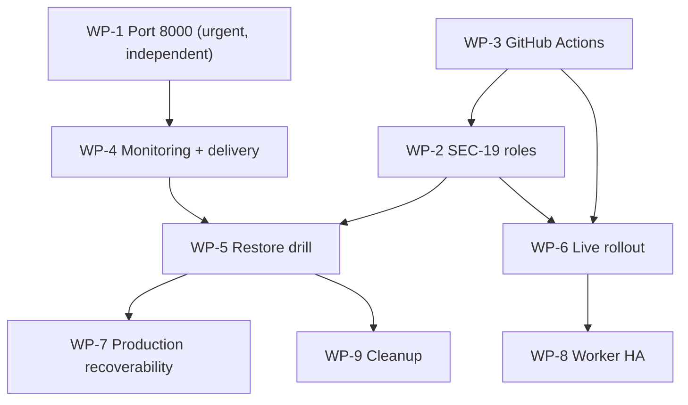

# Stages 1-6 gate-closure tracker

Tracker created: 2026-10-28T06:38:56Z
Last reconciled: 2026-10-29 (post Stage 7-10 acceptance review)
Repository: `ai-platform`, branch `postgres`, HEAD `296ea36`, with uncommitted
remediation work present.
Scope: actionable, evidence-backed tracking for the Stage 1-6 gates, plus the
Stage 7-10 code-completion status. Stage 7-10 are implemented in code (see
Section 10) but no operational package below is closed.

**This file is the single authoritative work-package tracker.** The registers in
`docs/audit/evidence/STAGES_1-6_GATE_CLOSURE_2026-10-27.md` Section 11.1 and
`docs/audit/STAGES_1-6_GATE_CLOSURE_HANDOFF_2026-10-28.md` Section 9E use a
different WP numbering. Section 2 of this file reconciles them so the two
numbering schemes cannot be confused.

## 1. How to read this tracker

Every work package records status, owner **role**, dependencies, required
authorization, the evidence artifact, the verification command, the expected
result, the actual result, the timestamp, the outstanding risk, the next action
and the closure criterion.

The operator procedure for each package is in
`docs/audit/STAGES_1-6_OPERATOR_EXECUTION_PACK_2026-10-28.md`. That pack holds
the commands, prechecks, rollbacks and approval points; it adds no evidence and
cannot change a status. Where the pack and the handoff disagree on a decision
ID, this tracker Section 7 wins, and the pack Section 0.2 carries the mapping.

Status vocabulary, used strictly:

| Status | Meaning |
|---|---|
| VERIFIED | The stated evidence exists and was independently reproduced |
| PARTIALLY VERIFIED | Some evidence exists; the closure criterion is not met |
| BLOCKED | Cannot progress without an external prerequisite |
| OPEN | Actionable but not done |
| NOT RUN | Never executed in the target environment |
| RISK ACCEPTED | A human accepted the residual risk for a bounded time |

Acceptance rules that this tracker enforces:

- Source code is not evidence that a running process is contained.
- A valid alert configuration is not evidence of notification delivery.
- A CronJob manifest is not evidence of a successful scheduled drill.
- RLS coverage is not evidence of database-role separation.
- A local Node run is not evidence of a GitHub Actions run.
- A local drill is not evidence of production recoverability.
- A risk exception is not a technical fix.

No work package below is closed. **The final decision remains NO-GO.**

## 2. Work-package numbering reconciliation

This tracker uses the numbering requested for this pass. Earlier documents used
different meanings for some of the same identifiers.

| This tracker | Meaning here | Legacy ID in gate doc §11.1 / handoff | Relationship |
|---|---|---|---|
| WP-1 | Port 8000 containment | WP-1 | Same |
| WP-2 | SEC-19 role separation | WP-2 | Same |
| WP-2.1 | API system-scope boundary (C1/C2) | none | **New sub-item of WP-2**; code only, closes no gate |
| WP-3 | GitHub Actions CI | WP-7 | **Renumbered** |
| WP-4 | Monitoring and alert delivery | WP-4 | Same |
| WP-5 | Scheduled restore drill | WP-5 | Same |
| WP-6 | Live Kubernetes rollout | WP-3 | **Renumbered** |
| WP-7 | Production recoverability | WP-9 | **Renumbered** |
| WP-8 | Worker HA | WP-10 | **Renumbered** |
| WP-9 | Cleanup | WP-8 | **Renumbered** |
| - | Restore identity wiring | legacy WP-6 | Folded into WP-2 + WP-5 |

Legacy WP-6 (restore identity) is not dropped: its requirements are enforced by
WP-2 (the `ai_restore` role) and WP-5 (the drill uses a separate credential).
The handoff retains its own detailed procedures; when the two documents
disagree on a WP number, this tracker wins.

## 3. Baseline revalidated in this pass

Re-run at 2026-10-28T06:38:56Z, not taken from the prior report:

| Fact | Observed | Method |
|---|---|---|
| Branch / HEAD | `postgres` / `296ea36` | `git rev-parse` |
| Worktree | 201 modified/untracked, 94 untracked | `git status --porcelain` |
| `ai_*` roles | **0** | `pg_roles` count |
| Max migration | `0018_tenant_row_level_security.sql` | `max(version)` |
| Port 8000 | `0.0.0.0:8000`, pid 23284 | `ss -ltnp` |
| Off-host anonymous `/metrics` | **200** on all 4 non-loopback IPs | `curl` per interface |
| Port 3001 | `0.0.0.0:3001`, pid 5865 | `ss -ltnp` |

These confirm the reported blockers are unchanged. No gate moved.

## 4. Gate matrix

| Gate | Status | Owner role | Dependency | Closure criterion |
|---|---|---|---|---|
| WP-1 Port 8000 | **OPEN** | Platform security lead + infra on-call | Authorized containment or exception | Off-host anon 401/refused **and** authorized monitoring works, or a signed expiring exception |
| WP-2 SEC-19 | **BLOCKED** | DBA + Platform SRE + security reviewer | DBA change window with superuser | 7 roles, 0019 applied, 14/14 role tests, cross-tenant denial, readiness |
| WP-3 CI | **PARTIALLY VERIFIED** | CI/repo maintainer | Authorized PR trigger | 12/12 shards green on `postgres:16`, every test file covered, artifacts retained |
| WP-4 Monitoring | **OPEN** | Observability owner + SRE | Owner assigned, architecture approved | Target `up`, rules loaded, receiver receipt for a test alert |
| WP-5 Restore drill | **OPEN** | Backup owner + DBA + SRE | WP-2 and a cluster; WP-4 for delivery | 5 separately evidenced items (see WP-5) |
| WP-6 Live rollout | **NOT RUN** | Platform SRE | WP-2 + green WP-3 + change window | Staged deploy healthy, rollback exercised |
| WP-7 Recoverability | **OPEN** | BCP + platform lead + security/DBA | Approved RPO/RTO | Approved targets met by a production-scale drill |
| WP-8 Worker HA | **OPEN** | Backend owner + SRE | WP-6 | 2-replica soak, no duplicate authoritative side effects |
| WP-9 Cleanup | **PARTIALLY VERIFIED** | Platform owner + evidence owner + DBA | Individual approvals | Per-item approve/reject, guarded execution, evidence preserved |

## 5. Work-package detail

### WP-1 - Port 8000 containment

| Field | Value |
|---|---|
| Status | **OPEN** |
| Owner role | Platform security lead + infrastructure on-call |
| Dependencies | None (independent and time-critical) |
| Required authorization | Approval to contain, or a time-limited risk exception |
| Evidence artifact | Operator log with before/after probe output; or signed exception record |
| Verification | `for ip in $(hostname -I); do curl -s -o /dev/null -w "$ip %{http_code}\n" --max-time 4 http://$ip:8000/metrics; done` |
| Expected result | No non-loopback 200; loopback bearer 200; loopback anon 401 for the current build |
| Actual result | **All four non-loopback IPs return 200** (2026-10-28T06:38:56Z) |
| Outstanding risk | Anonymous telemetry, Swagger and full OpenAPI schema remain reachable |
| Next action | Operator applies the reversible containment in handoff Section 3.2 and records the before/after probe |
| Closure criterion | Off-host anonymous access denied **and** authorized monitoring verified, or a signed exception with an absolute expiry |

Constraints already shown: `/api/v1/ai/docs` 200, `/api/v1/ai/openapi.json` 200,
`/api/v1/ai/events` 401, `/api/v1/ai/agents` 401. The exposure is the binding,
not the process age.

Re-probed 2026-10-31 04:13 UTC (read-only, no change made): all four non-loopback
IPs (`169.254.169.252`, `192.168.16.101`, `172.17.0.1`, `172.18.0.1`) return
**200** for `/metrics`, `/api/v1/ai/docs` and `/api/v1/ai/openapi.json`; loopback
anonymous `/metrics` is **200**; `/healthz` and `/readyz` are 200;
`/api/v1/ai/events` and `/api/v1/ai/agents` are 401. The same probe was run
2026-10-30 11:00 UTC with identical results. The gate is still OPEN.

The live process is **drifted from the checked-in tree**, proven without relying
on any timestamp: `/api/v1/ai/openapi.json` serves **94** paths while the current
source builds **97**, and the three routes missing at runtime are
`/api/v1/ai/assistant/agents/run`, `/api/v1/ai/knowledge/sources/{source_id}/acl`
and `/api/v1/ai/knowledge/sources/{source_id}/classification` (all 404 live); and
live anonymous `/metrics` is 200 while the current source returns 401 in-process
for anon and for a wrong bearer. Process identity across both sessions is stable
by **monotonic** `starttime_ticks = 97049685` (`/proc/23284/stat`), i.e. the same
process was not restarted. Do **not** quote an absolute wall-clock start time:
`btime` moved by 41,222 s between the two sessions, so a derived start shifts
(2026-10-25 10:29 vs 21:56 UTC) with unchanged ticks. The stale behaviour comes
from an older loaded module revision, not from the process predating the code.
Do not claim the auth build is live. A restart from the current tree (D2) applies
`metrics_authorized` and the production docs gating; the divergence is a finding
to disclose at the change window. `docs`/`openapi` staying 200 on loopback after a
rebind is expected in development (`api_docs_enabled = ai_docs_enabled or not
is_production`, `settings.py:379-385`); the gate is about off-host reachability.

### WP-2 - SEC-19 database role separation

| Field | Value |
|---|---|
| Status | **BLOCKED** |
| Owner role | DBA (provisioning), Platform SRE (workloads), security reviewer |
| Dependencies | DBA change window; superuser; halt of any migration job |
| Required authorization | Change window approval; authority to create roles |
| Evidence artifact | `psql` transcripts, `pg_roles`/`pg_class` output, `verify-db-roles.sh` log |
| Verification | `bash scripts/verify-db-roles.sh` (sets `AI_REQUIRE_ROLE_DB=1`) |
| Expected result | Exit 0, 14 tests passed |
| Actual result | **Exit 2**, no DSNs; separately, gate mode with no DSNs exits **1** with 14 errors |
| Outstanding risk | All runtime traffic currently uses the database owner; RLS verified only as owner |
| Next action | Execute handoff Section 4 steps 1-12 in an approved window |
| Closure criterion | 7 roles with correct attributes; 0019 applied (19 rows); 14/14 actual-role tests pass; cross-tenant read/write denied as `ai_api`; `/readyz` 200 intended / 503 on deliberate mismatch |

Supporting facts: 43/45 tables FORCE RLS; the two exceptions are `backup_runs`
and `schema_migrations` by design (global operational tables). RLS coverage does
**not** satisfy this gate on its own.

Execution facts found 2026-10-30 (do not change status; both are procedural
corrections in the pack/handoff):

1. **Apply 0019 with the migration runner, not raw `psql -f`.** `scripts/migrate.sh`
   inserts the `schema_migrations` row (`version`, `checksum`) and is the
   documented path (`infrastructure/db/roles/README.md` §3). A raw
   `psql -f migrations/0019_...sql` applies the function replacement but writes
   no bookkeeping row, so the "19 rows" closure check would fail even on success.
   The pack §4.2 and handoff §4 step 8 were corrected to call the runner.
2. **`provision_roles.sql` must run after the `ai` schema/helpers exist.** Its
   final grants `EXECUTE` on `ai.system_access()`, `ai.current_tenant_id()` and
   `ai.tenant_isolation_allows(bigint)`; those functions are created by migration
   0018. On a fresh install the required order is therefore migrations-with-
   `AI_MIGRATION_STOP_AFTER=0018` -> provision -> resume migrations (0019) ->
   rerun `provision_roles.sql` for post-0018 objects. On the current `helix`
   database (already at 0018) the stop-variable leg is not needed.
3. The `helix` login is `rolsuper=f, rolcreaterole=f`, and the three `ai.*` helper
   functions are owned by `helix`, not `ai_owner`; the ownership-transferring
   provisioning step is what moves them. Only the `postgres` role is superuser,
   so provisioning must run as `postgres` (or an equivalent), not as `helix`.

### WP-2.1 - API system-scope boundary (C1/C2)

A code-level sub-item of WP-2. It does **not** close WP-2 and does not change
WP-2's status. Recorded here so the implementation is discoverable; the
PostgreSQL role-level enforcement remains unverified.

| Field | Value |
|---|---|
| Status | **IMPLEMENTATION COMPLETE** (code only) |
| Owner role | Backend owner |
| Dependencies | None for code; WP-2 for runtime effect |
| Evidence artifact | `apps/ai-api/tests/test_system_scope_boundary.py`; suite output in E30-E31 |
| Scope | C1 application-level system-scope guard; C2 removal of the dead API event-consumer wiring |
| Closure criterion | Met for code: the guard rejects the API profile before any database access, and no unreferenced consumer dependency remains |

**C1 - application-level system-scope guard verified.** `system_scope()` in
`apps/ai-api/src/ai_api/infrastructure/db/tenant_context.py` now calls
`_assert_system_scope_allowed()` before setting the context variable, so an API
profile raises `ConfigurationError` ahead of any connection or query rather than
relying on row-level security to return zero rows. The allow-set is
`{worker, backup, migrate}`, matching the roles granted membership in
`ai_system_access` by `infrastructure/db/roles/provision_roles.sql`; `api` is
absent by design, and a blank profile keeps development/test behavior.

**C2 - dead wiring removed.** `get_event_consumer()` and `EventConsumerDep` are
gone from `apps/ai-api/src/ai_api/api/deps.py`; the import is narrowed to
`EventPublisher`. No repository reference to either symbol remains. The worker
side (`workers/event_consumer.py`, `EventConsumer` in
`application/services/event_service.py`) is intentionally untouched.

Evidence supplied for this item (executed in the implementation pass, **not
re-executed for this entry**):

| Check | Result |
|---|---|
| Boundary suite (`test_system_scope_boundary.py`) | 9 passed |
| Full AI API suite | 483 passed, 62 skipped |
| Worker / events / reconciliation | 50 passed, 2 skipped |
| Search / lifecycle / source | 54 passed |
| Indexing / agents | 57 passed |
| Real-Postgres RLS (`AI_TEST_POSTGRES=1`) | 12 passed |
| Ruff, formatting, `git diff --check` on the specified files | clean |
| Database role tests (`test_db_roles.py`) | 14 skipped: required role DSNs/configuration unavailable |

What this does and does not prove:

- **Verified:** the application refuses system scope under the API profile, and
  does so before touching the database.
- **Not verified:** PostgreSQL role-level enforcement. That needs the seven
  roles, applied migration `0019`, and the 14 real-role tests (E6/E7/E8 still
  show skips/no DSNs). Application code is not evidence of database-role
  separation, per the acceptance rules in Section 1.

WP-1 remains **OPEN**, WP-2 remains **BLOCKED**, and the production decision
remains **NO-GO**; this entry moves none of them.

### WP-3 - GitHub Actions CI

| Field | Value |
|---|---|
| Status | **PARTIALLY VERIFIED** |
| Owner role | CI/repository maintainer |
| Dependencies | A branch and an authorized PR or equivalent dispatch |
| Required authorization | Authority to open a PR / run the workflow |
| Evidence artifact | Actions run URL, 12 shard logs, durations, `node-shard-*.log` artifacts |
| Verification | `gh run view <id> --log` or the Actions UI; shard guard job output |
| Expected result | 12/12 shards pass, guard passes, 12 artifacts present |
| Actual result | **Never run in GitHub Actions**; workflow only validated locally |
| Outstanding risk | The suite has never executed on the CI runner or its Postgres service |
| Next action | Open an authorized PR and observe all 12 shards |
| Closure criterion | One green full run on `postgres:16` with measured durations and retained artifacts |

Design facts (revalidated 2026-10-30): the shard width is derived from the
actual file count instead of a frozen 13. With 162 test files the plan is
12 shards of 14 (last shard 8), verified 0 overlap and 0 uncovered by a local
`bash` partition simulation (zsh slice semantics differ and must not be used for
this check). Before that fix the guard hard-failed (`161 != 156`), so the
Stage 7-10 test files would never have run in CI; that was a real defect and is
fixed in `.github/workflows/ai-platform-ci.yml`.
`timeout-minutes: 75`; shard 2 projected ~42 min, unmeasured in CI.

**Execution prerequisite found 2026-10-30 (does not change status).** The fixed
workflow - including the entire `enterprise-node-coverage` guard and the
`enterprise-node` 12-shard matrix - is an **uncommitted worktree change**
(`git status` shows `M .github/workflows/ai-platform-ci.yml`, +93/-3). On the
remote default branch (`origin/main`) no `ai-platform-ci.yml` exists at all, and
`origin/postgres` still has the old workflow without either Node job
(`ai-api`, `web-console`, `web-ai`, `manifests`, `images`, `monitoring-configs`,
`dependency-scan` only). `workflow_dispatch` runs the workflow file **from the
dispatched ref**, so it cannot exercise the uncommitted fix. Therefore the D4
action must first land the workflow change on an authorized branch (commit +
push by the repo maintainer, not from this environment); dispatching from
`origin/postgres` or `origin/main` today would either omit the Node matrix or
find no workflow. Local partition validation (E25) remains local only.

### WP-4 - Monitoring and alert delivery

| Field | Value |
|---|---|
| Status | **OPEN** |
| Owner role | Observability owner + SRE |
| Dependencies | Owner assigned; architecture approved; cluster; WP-2 for meaningful worker targets |
| Required authorization | Approval to deploy `kubernetes/monitoring` and to add a real receiver |
| Evidence artifact | `/api/v1/targets`, `/api/v1/rules`, `/api/v1/alertmanagers` output; receiver receipt |
| Verification | Handoff Section 5.3, steps 1-11 |
| Expected result | All targets `up`, 5 rules loaded, one active Alertmanager, receipt captured |
| Actual result | **Nothing deployed**; receiver inert (validator emits one WARN) |
| Outstanding risk | Alerting has never delivered a notification; a valid config is not delivery |
| Next action | Assign the owner, approve the architecture, then execute Section 5 |
| Closure criterion | A test alert generated, forwarded, and received by a real integration with a receipt |

Fixed in the prior pass and revalidated now: `allow-alertmanager-ingress` and
`allow-alertmanager-egress` both exist, and the validator checks all three legs.
This is static correctness, not delivery.

### WP-5 - Scheduled restore drill

Status **OPEN**. The five evidence items are tracked separately and must not be
collapsed into one checkbox.

| # | Item | Status | Evidence required |
|---|---|---|---|
| 5a | Controlled manual drill | PARTIALLY VERIFIED (dev-scale only) | `"result": "success"` report from an approved run |
| 5b | Scheduled Job execution | **NOT RUN** | CronJob-created Job with `Complete` condition |
| 5c | `restore_drill` DB record | PARTIALLY VERIFIED (manual path only) | `SELECT ... FROM ai.backup_runs WHERE kind='restore_drill'` = `succeeded` |
| 5d | Stale-drill alert evaluation | **NOT RUN** | `AIRestoreDrillStale` observed transitioning in Prometheus |
| 5e | Actual notification receipt | **NOT RUN** | Receiver receipt for 5d |

| Field | Value |
|---|---|
| Owner role | Backup owner + DBA + SRE |
| Dependencies | WP-2 (real `ai_restore`), cluster; WP-4 for 5d/5e |
| Required authorization | Drill window; approval to create an isolated DB/bucket |
| Evidence artifact | `drill-<id>.json`, Job YAML/status, `backup_runs` row, alert + receipt |
| Verification | Handoff Section 6 |
| Expected result | All five items independently evidenced |
| Actual result | 5a and 5c exist, both from **manual** drills at development scale. `ai.backup_runs` holds 5 `restore_drill` rows: four `succeeded` (`6ae044` 2026-10-26, `53495d` 2026-10-26, `82f76b` 2026-10-25, `f9099b` 2026-10-25) and one `failed` (`5baad9`, 7/22 checks). None was produced by the CronJob. 5b, 5d and 5e are **NOT RUN**. |
| Outstanding risk | The scheduled path has never executed; the alert may fire immediately on fresh deploy because the gauge initialises to 0 |
| Next action | After WP-2 and WP-4, run the drill and file each item |
| Closure criterion | 5a-5e each individually evidenced |

Note: `AIRestoreDrillStale` uses `time() - ai_backup_last_success_timestamp_seconds
{kind="restore_drill"} > 7776000`, and the gauge initialises to 0, so it will
fire on a fresh deployment until the first successful drill. That is expected,
not a defect, but it must be understood before WP-5d is assessed.

### WP-6 - Live Kubernetes rollout

| Field | Value |
|---|---|
| Status | **NOT RUN** |
| Owner role | Platform SRE |
| Dependencies | WP-2 complete (roles + credentials); green WP-3; approved change window |
| Required authorization | Change window approval |
| Evidence artifact | `kubectl` rollout output, `/readyz` per replica, target health, rollback revision diff |
| Verification | Handoff Section 8 |
| Expected result | Rollout healthy, `/readyz` 200, targets `up`, rollback clean |
| Actual result | No cluster access; only static validation exists |
| Outstanding risk | The system has never run under the real role model in a cluster |
| Next action | Wait for WP-2 and WP-3, then execute the staged rollout |
| Closure criterion | Staged deploy with actual-role isolation checks, healthy workloads, working monitoring and backup, and an exercised rollback |

Static manifest validation does not close this package.

### WP-7 - Production recoverability

| Field | Value |
|---|---|
| Status | **OPEN** |
| Owner roles | Business continuity + platform lead + security/DBA |
| Dependencies | WP-5; approved RPO/RTO |
| Required authorization | Business decision on RPO/RTO; procurement for off-site/KMS |
| Evidence artifact | Approved targets, off-site copy proof, object-lock config, key-recovery drill, measured restore |
| Verification | Production-scale isolated drill measured against the approved targets |
| Expected result | Measured recovery within approved RPO/RTO |
| Actual result | Dev-scale only; no off-site, immutability, or KMS/escrow |
| Outstanding risk | A regional or account-level loss would exceed current capability |
| Next action | Obtain D4/D5 decisions, then implement and drill |
| Closure criterion | Approved RPO/RTO met by a production-scale, off-site, immutable, KMS-backed restore |

No target values are proposed here.

### WP-8 - Worker HA

| Field | Value |
|---|---|
| Status | **OPEN** |
| Owner role | Backend owner + SRE |
| Dependencies | WP-6 |
| Required authorization | Approval for a 2-replica soak in a non-production environment |
| Evidence artifact | Soak logs, duplicate-processing query, lease/reclaim trace, fencing proof |
| Verification | 2-replica soak with a claim race and a mid-flight kill |
| Expected result | No duplicate authoritative side effects; nothing stranded past lease |
| Actual result | All workers at 1 replica. Event consumer now has lease-token fencing (code-level, see E28); agent worker has `SKIP LOCKED` + fencing; no soak run |
| Outstanding risk | No 2-replica soak has been run; reconciler and indexer still lack an atomic claim; single-connection and local multi-connection tests are not a K8s soak |
| Next action | Run a 2-replica soak in a non-production environment |
| Closure criterion | Documented soak showing no duplicate side effects |

Per-worker state: event consumer now claims with a per-call `lease_token` and all
terminal transitions are fenced on it (code fix + real multi-connection
regression, E28), but it has not been soaked at 2 replicas; reconciler has no
global lease; indexer has a lease but non-atomic queued selection; agent worker
is safe after soak. Do not scale any worker now. The event-consumer fencing
proves correctness under concurrent connections, not Kubernetes/multi-pod
behaviour.

### WP-9 - Cleanup

| Field | Value |
|---|---|
| Status | **PARTIALLY VERIFIED** |
| Owner role | Platform owner + evidence owner + DBA |
| Dependencies | WP-5 evidence filed first |
| Required authorization | Per-item written approve/reject |
| Evidence artifact | Reviewed dry-run output; per-item decision record |
| Verification | `backup_restore.py cleanup` dry-run (prints `"executed": false`) |
| Expected result | Each item decided; protected evidence excluded |
| Actual result | Dry-run only; nothing deleted |
| Outstanding risk | Irreversible loss if an unapproved item is deleted |
| Next action | Review handoff Section 9B item by item |
| Closure criterion | Every item decided in writing; approved items executed separately; protected evidence intact |

Verified live targets (2026-10-28): 5 drill databases, 5 drill buckets, 3
artifacts under `/backup/artifacts`, 4 under `/tmp/sec20-backups/artifacts`.
**Protected, never delete:** `20261026T103104Z-3e8513`, drill report
`drill-20261026T103451Z-6ae044.json`, and everything under
`docs/audit/evidence/`.

## 6. Critical dependencies

Hard constraints, not preferences:

- WP-6 cannot precede WP-2: the API and workers must connect as `ai_api` and
  `ai_worker`, which do not exist yet.
- WP-5d/5e cannot precede WP-4: the alert must have somewhere to be delivered.
- WP-7 cannot close before WP-5: a production recovery claim needs a drill.
- WP-8 cannot close before WP-6: HA is only meaningful on a live deployment.
- WP-9 should follow WP-5: deleting drill targets before the report is filed
  would weaken the evidence.

## 7. Human decisions required

| ID | Decision | Role | Blocking |
|---|---|---|---|
| D1 | DBA change window for SEC-19 | DBA + platform owner | WP-2, WP-6 |
| D2 | Contain port 8000, or a time-limited exception | Platform security lead + infra on-call | WP-1 |
| D3 | Monitoring architecture and the real receiver | Observability owner + SRE | WP-4, WP-5e |
| D4 | Authorized CI PR trigger | Repo maintainer | WP-3, WP-6 |
| D5 | Approved RPO and RTO | Business continuity owner | WP-7 |
| D6 | Off-site, immutable-backup, and KMS/escrow arrangements | Security architect + DBA | WP-7 |
| D7 | Individual cleanup approvals | Platform owner + evidence owner | WP-9 |

No named individuals are assigned; the repository does not identify any, and
inventing them would be fabrication.

## 8. Evidence ledger

Legend: **NEW** = executed in this pass; **HIST** = carried from earlier passes
and not re-executed; **STATIC** = configuration/manifest validation; **RUNTIME**
= evidence from a running system; **ATTEST** = operator statement;
**ACCEPT** = signed risk acceptance.

| ID | Class | Item | Command / source | Result | When |
|---|---|---|---|---|---|
| E1 | NEW | Manifest structure | `validate-k8s.py` | 50 documents / 31 files, exit 0 | 2026-10-28T06:38Z |
| E2 | NEW | Monitoring structure + network path | `validate-monitoring.py` | OK, 1 expected WARN, exit 0 | 2026-10-28T06:38Z |
| E3 | NEW | Prometheus/Alertmanager configs | `check-prometheus-configs.sh` | 5 rules, both configs valid, exit 0 | 2026-10-28T06:38Z |
| E4 | NEW | Render + schema | kustomize 5.5.0 / kubeconform 0.6.7 | 34/34, 34/34, 11/11 | 2026-10-28T06:38Z |
| E5 | NEW | Backup/restore suite | `pytest tests/test_backup_restore.py` | 24 passed, 1 skipped | 2026-10-28T06:38Z |
| E6 | NEW | Role tests default mode | `pytest tests/test_db_roles.py` | 14 skipped, exit 0 | 2026-10-28T06:38Z |
| E7 | NEW | Role tests gate mode | `AI_REQUIRE_ROLE_DB=1 pytest ...` | 14 errors, exit 1 | 2026-10-28T06:38Z |
| E8 | NEW | Role gate script | `verify-db-roles.sh` | exit 2 (no DSNs) | 2026-10-28T06:38Z |
| E9 | NEW | Lint / whitespace | ruff, `git diff --check` | clean | 2026-10-28T06:38Z |
| E10 | NEW | Port 8000 exposure | `curl` per interface | 200 on 4/4 non-loopback IPs | 2026-10-28T06:38Z |
| E11 | NEW | SEC-19 state | `pg_roles`, `schema_migrations` | 0 roles, max `0018` | 2026-10-28T06:38Z |
| E12 | NEW | Cleanup inventory | `pg_database`, S3 list, `ls` | 5 DBs, 5 buckets, 7 artifacts present | 2026-10-28T06:38Z |
| E13 | HIST | Node shard 0 | local run | 151 passed / 1181.2 s | 2026-10-27 |
| E14 | HIST | SEC-20 encrypted drill | local run | 21/21 checks, 43 FORCE RLS | 2026-10-26 |
| E15 | STATIC | RLS coverage | `pg_class` query | 43/45 FORCE, 2 by design | 2026-10-28 |
| E16 | STATIC | Operator execution pack | `docs/audit/STAGES_1-6_OPERATOR_EXECUTION_PACK_2026-10-28.md` | Procedure only; closes nothing | 2026-10-28 |
| E17 | NEW | Restore-drill DB records | `SELECT ... FROM ai.backup_runs WHERE kind='restore_drill'` | 5 rows: 4 succeeded, 1 failed; all manual | 2026-10-28 |
| E18 | NEW | Full Node suite (162 files) | `node --test --test-concurrency=1 --test-reporter=spec server/tests/*.test.js` in 4 disjoint serial batches (41+41+40+40 files) | 2,020 tests passed, 0 failed, 0 skipped, all batches exit 0; batch totals 650+543+395+432; file set identical to the 162-file list | 2026-10-30 |
| E19 | NEW | Stage 7-10 + cross-stage | 5 test files, serial | 75 passed, 0 failed | 2026-10-29 |
| E20 | NEW | ai-api Python suite | `PYTHONPATH=src python -m pytest` | 474 passed, 62 skipped, exit 0 | 2026-10-29 |
| E21 | NEW | Real-Postgres RLS | `AI_TEST_POSTGRES=1 pytest tests/test_rls_tenant_isolation.py` | 12 passed, exit 0 | 2026-10-30 |
| E22 | NEW | Frontend Vitest + build | `npx vitest run`, `npx vite build` | 30 passed / 6 files, build exit 0 | 2026-10-30 |
| E23 | NEW | web-ai lint/test/build | `npm run lint`, `npm test`, `npm run build` | all exit 0 (2 tests) | 2026-10-30 |
| E24 | NEW | Lint / whitespace | `ruff check src tests scripts`, `git diff --check` | clean | 2026-10-30 |
| E25 | NEW | Node shard-plan guard | local guard + partition simulation | fixed to derived width; 162/162 covered, 12 shards (14 x11 + 8), 0 overlap | 2026-10-30 |
| E26 | NEW | Port 8000 exposure (re-probe) | `curl` per interface | 200 on 4/4 non-loopback IPs **and** loopback anon 200 | 2026-10-29 |
| E27 | NEW | Stage 10 freshness + Stage 7 claim regressions | `node --test --test-concurrency=1 server/tests/predictive-intelligence.test.js`, `.../events-e2e.test.js`, `.../events-async.test.js`, `.../events.test.js`, `.../events-domain.test.js`, `.../predictive-intelligence-api.test.js`, `.../cross-stage-e2e.test.js` | 27 + 12 + 6 + 14 + 9 = 82 affected tests pass (targeted + cross-stage); each new regression proven to fail when its fix is reverted | 2026-10-30 |
| E28 | NEW | Lease-fencing concurrency regression | `node --test --test-concurrency=1 --test-reporter=spec server/tests/events-consumer-concurrency.test.js` | 5/5 pass on real multi-connection PG (async pool + raw `pg.Client` observer, barrier-coordinated, no sleeps); 2 of 5 proven to fail (`delivered`/`retry` instead of `stale_lease`) with the matching fence removed, then restored | 2026-10-30 |
| E29 | NEW | K8s + monitoring manifest validation | `python3 scripts/validate-k8s.py`, `python3 scripts/validate-monitoring.py` | 50 documents / 31 files, exit 0; monitoring OK with 1 expected receiver WARN, exit 0 | 2026-10-30 |
| E30 | HIST | WP-2.1 C1/C2 boundary tests | `PYTHONPATH=src pytest tests/test_system_scope_boundary.py` | 9 passed; API profile rejected before database access; trusted profiles and blank profile unchanged; reconcile stays tenant-scoped | implementation pass, not re-executed for this entry |
| E31 | HIST | WP-2.1 C1/C2 regression suites | full `pytest`; worker/events/reconciliation; search/lifecycle/source; indexing/agents; `AI_TEST_POSTGRES=1 pytest tests/test_rls_tenant_isolation.py` | 483 passed / 62 skipped; 50 passed / 2 skipped; 54 passed; 57 passed; 12 passed; ruff + format + `git diff --check` clean; `test_db_roles.py` 14 skipped (no role DSNs) | implementation pass, not re-executed for this entry |

E18-E19 are code-gate evidence only. They do not satisfy any operational package;
in particular E20-E24 are local runs, not GitHub Actions (WP-3) or live rollout
(WP-6). E26 reconfirms WP-1 remains open. The running build is stale relative to
the checked-in tree, proven without timestamps (re-probed 2026-10-31): live
`/api/v1/ai/openapi.json` exposes **94** paths vs **97** from source, three
source routes are 404 live
(`/api/v1/ai/assistant/agents/run`, `/api/v1/ai/knowledge/sources/{source_id}/acl`,
`/api/v1/ai/knowledge/sources/{source_id}/classification`), and live anonymous
`/metrics` is **200** vs **401** in-process
(`TestClient(create_app()).get("/metrics")`). The same process is confirmed by
monotonic `starttime_ticks = 97049685` across sessions; do not derive an absolute
start time because `btime` is unstable here (a 41,222 s shift was observed with
the same ticks). A restart from the current tree is what would apply
`metrics_authorized` and the docs gating. Containment of the live process is
still required.

E16 is a procedure artifact. It is listed so the pack is discoverable from the
ledger, not because it evidences any package.

E30-E31 are application-level evidence for WP-2.1 only. They are HIST entries
carried from the implementation pass and were not re-executed for this entry.
They do not evidence PostgreSQL role-level enforcement: the 14 role tests remain
skipped without the per-role DSNs, so WP-2 is still BLOCKED.

Nothing in this ledger is RUNTIME evidence for WP-1, WP-3, WP-4, WP-5, WP-6,
WP-7 or WP-8. No ATTEST or ACCEPT entries exist yet.

## 9. Next three actions, by urgency

1. **WP-1 containment (D2).** The only exposure that is actively reachable from
   off-host today, and it needs no restart to fix. Time-critical.
2. **WP-2 change window (D1).** Everything downstream that involves workload
   identity is blocked on the seven roles. Longest lead time.
3. **WP-3 CI trigger (D4).** Cheap, fast, and a prerequisite for WP-6; it also
   validates the code gate before any change window.

## 10. Stage 7-10 code status (2026-10-29 review)

This section records code-completion only. It changes no work package above.

| Stage | Code status | Evidence | Notes |
|---|---|---|---|
| 7 Digital thread / knowledge graph | CODE COMPLETE | 12 tests, real DB; replay-safe events, bounded traversal with cycle detection, tenant/authorization denial test; events e2e 6 + async 14 incl. claim-overlap regression; lease-token reclaim fencing + 5 real multi-connection concurrency tests | No operational gate applies |
| 8 BOM intelligence | CODE COMPLETE | 10 tests, real DB; revision lifecycle, structure cycle block, where-used, transformation | Pre-existing module; verified present |
| 9 Manufacturing & quality | CODE COMPLETE | 19 + 13 tests, real DB and HTTP; NOT_EVALUATED on missing evidence, stale marking, tenant isolation | Advisory; never mutates the assessed subject |
| 10 Predictive & recommendations | CODE COMPLETE | 27 + 12 tests, real DB and HTTP; rule-based method/versioning, calibrated_probability=false, idempotent lifecycle, read-time freshness enforcement (sync+async), latest-only readiness regression, feedback auth | Advisory; ML gated behind a measured evaluation |

Defects found and fixed in this review (items 1-4 in the earlier pass, item 5 in
the current pass):

1. `assessment.js` counted every historical readiness row, so a superseded FAIL
   still inflated `failed_readiness` and the change-risk score after the subject
   was re-evaluated. Now only the latest evaluation per subject counts (sync and
   async twins), with a regression test that fails without the fix.
2. The CI shard guard hardcoded `12 x 13 = 156`; with 161 test files it failed
   closed, meaning the new Stage 7-10 tests would never execute in CI. The width
   is now derived from the actual file count with full-coverage and short-final-
   shard handling; a local `bash` partition simulation covers 162/162 with 0
   overlap (`12 x 14`, last shard 8).
3. `predictions.js` computed `available` only from `status !== 'STALE'`, so an
   ACTIVE prediction whose `freshness_expires_at` had elapsed was still returned
   as usable by `getPrediction`/`getPredictionAsync` and the idempotent execute
   path. Availability is now derived at read time from status **and** the
   freshness window (`predictionAvailable`), and the projection exposes
   `expired`/`available` without mutating the stored row. Covered by four new
   sync+async tests (not-expired, expired, explicitly STALE, expired re-execute).
4. `consumer.js` `claimDeliveries` re-selected `locked_by = ? AND status =
   'processing'`, returning **earlier** in-flight deliveries claimed by the same
   worker name; a second overlapping sweep could then process them twice. It now
   returns only the ids transitioned by that call (sync + async), with regression
   tests in `events-e2e` and `events-async` that fail without the fix. Lease
   reclamation (`releaseStaleDeliveries`) also re-checks status/expiry inside the
   UPDATE so a completed delivery cannot be dragged back to `retry`.
5. **Lease-reclaim fencing defect (event consumer).** Delivery terminal
   transitions (`delivered` / `retry` / `dead_letter` and the duplicate /
   out-of-order / ignored branches) were keyed on delivery `id` only. A worker
   whose lease had expired and been reclaimed could therefore still write a
   terminal state and authoritative side effects (`event_records.delivered_count`,
   `event_idempotency`, dead-letter rows) after another worker had taken the
   delivery. Fix: a per-claim `lease_token` column (`event_deliveries.lease_token`,
   idempotent `ALTER TABLE ... ADD COLUMN IF NOT EXISTS`, `SCHEMA_VERSION`
   `postgres_009` -> `postgres_010`); `claimDeliveries` stamps and returns rows by
   token; every terminal transition is a conditional UPDATE fenced on
   `lease_token = ?`, and a lost race returns `stale_lease` with no side effects
   (the failed-attempt record also sits behind the fence); `releaseStaleDeliveries`
   clears the token under the same guarded re-check; operator requeue paths clear
   it too. Proven by `events-consumer-concurrency.test.js` (5 tests, real
   multi-connection PG pool plus a separate raw `pg.Client` observer, barrier-
   coordinated with no sleeps): concurrent sweeps partition deliveries, a
   reclaimed delivery is not completed by the stale worker, a stale worker cannot
   revert via retry, stale reclamation cannot disturb a fresh claim, and a
   terminal delivery holds no token. Two of the five were shown to fail
   (`delivered`/`retry` instead of `stale_lease`) with the matching fence removed,
   then restored. This is concurrency correctness against real PostgreSQL
   connections, **not** a Kubernetes or multi-pod soak.

Cross-stage E2E (`cross-stage-e2e.test.js`, 9 tests) runs against a real migrated
PostgreSQL clone via `openTestDatabase()`; it uses no mocks. It proves graph
traversal, EBOM/MBOM/BOP, change lifecycle to release, readiness fail then
remediate, risk citing real rows, recommendations from the failing evaluation,
and no mutation of authoritative change/quality records.

## Final decision

**Code complete for Stages 7-10; NO-GO for production.**
No operational work package closed. Remaining blockers are operational, not
code-level: WP-1 live containment, WP-2 role separation, WP-3 a real GitHub
Actions run, WP-4 alert delivery, WP-5 scheduled drill, WP-6 authorised rollout,
WP-7 recovery objectives, WP-8 worker HA, WP-9 cleanup.
