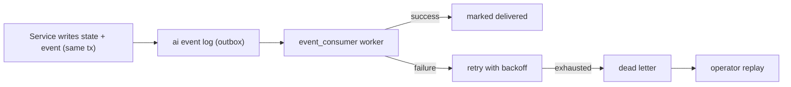

# Events

The AI platform emits versioned domain events for its own lifecycle (ingestion,
indexing, agent execution, feedback, ML runs). The design is in
`PHASE8_EVENTS.md`; this is the operational summary.

## Transport and authority

- The **durable database outbox** (`EVENT_BUS_PROVIDER=database`, default) is the
  authority for delivery, retries, ordering and replay. Events are written in
  the same transaction as the state change.
- **Kafka** (`EVENT_BUS_PROVIDER=kafka`) is an optional transport for
  cross-service propagation. Enabling it does not remove the outbox.
- The AI platform does **not** fabricate enterprise domain events; enterprise
  events remain owned by the enterprise platform.

## Topic and schema

- Default topic: `AI_EVENT_TOPIC` (`ai.platform.events`).
- Consumer group: `AI_EVENT_CONSUMER_GROUP` (`ai-api-events`).
- Each event carries a type, version, tenant, occurrence time, correlation
  (request id) and a payload conforming to the platform's event schema.

## Processing

- The consumer runs in its own process:
  `python -m ai_api.workers.event_consumer --watch`.
- Attempts are bounded by `AI_EVENT_MAX_ATTEMPTS`; delays use persisted
  exponential backoff with jitter (`AI_EVENT_RETRY_*`) so a worker restart does
  not reset the schedule. Exhausted events move to the dead-letter set.
- Replay is tenant-scoped, bounded by age (`AI_EVENT_REPLAY_MAX_AGE_DAYS`,
  default 7), removes the matching dead letter, and is audited as
  `ai.events.replay` with actor, event and consumer group.
- `KnowledgeSourceSecurityUpdated` is an invalidation signal, not an authority.
  Its consumer re-reads the source and enqueues an idempotent refresh for the
  current state; it ignores stale versions and never resurrects deleted or
  disabled sources. Malformed/unsupported events fail into the dead-letter set.

## API

| Method | Path | Purpose |
| --- | --- | --- |
| GET | `/events` | List events. |
| GET | `/events/stats` | Counts by status/type. |
| GET | `/events/dead-letters` | Dead-lettered events. |
| POST | `/events/{event_id}/replay` | Replay a dead-lettered event. |

## Configuration

| Variable | Default | Purpose |
| --- | --- | --- |
| `EVENT_BUS_PROVIDER` | database | `database` outbox or `kafka`. |
| `KAFKA_BOOTSTRAP_SERVERS` | 127.0.0.1:9092 | Kafka brokers (when enabled). |
| `AI_EVENT_TOPIC` | ai.platform.events | Topic name. |
| `AI_EVENT_CONSUMER_GROUP` | ai-api-events | Consumer group. |
| `AI_EVENT_MAX_ATTEMPTS` | 5 | Retries before dead-lettering. |
| `AI_EVENT_BATCH_SIZE` | 20 | Batch size. |
| `AI_EVENT_POLL_SECONDS` | 5.0 | Poll interval. |
| `AI_EVENT_RETRY_BASE_SECONDS` | 2.0 | First retry delay. |
| `AI_EVENT_RETRY_MAX_SECONDS` | 60.0 | Retry delay cap. |
| `AI_EVENT_RETRY_JITTER` | 0.1 | Fractional jitter. |
| `AI_EVENT_REPLAY_MAX_AGE_DAYS` | 7 | Replay safety window. |

## Observability

Event processing exposes `ai_events_published_total`,
`ai_events_publish_failed_total{event_type}`,
`ai_events_consumed_total{consumer_group,outcome}` and
`ai_event_delivery_backlog{state="pending|delayed|dead"}` (see
`observability.md`). Dead letters are also available at
`GET /events/dead-letters`; use `/events/stats` for per-tenant counts.
