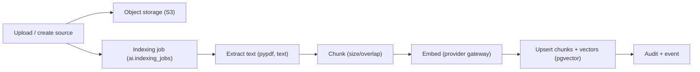

# RAG — ingestion and retrieval

Retrieval-augmented generation grounds answers in the caller's **authorized**
knowledge and returns citations. The design and implementation details are in
`PHASE7_KNOWLEDGE_RAG.md`; this is the operational summary.

## Ingestion pipeline

- **Sources** group documents (`/knowledge/sources`). Documents are stored in
  object storage; metadata and chunks live in PostgreSQL (`ai` schema).
- **Chunking** uses `AI_CHUNK_SIZE` / `AI_CHUNK_OVERLAP`.
- **Embeddings** are produced by the provider gateway; dimensions are fixed at
  1536 (enforced by a `CHECK` constraint). The mock provider is deterministic.
- **Indexing** is a durable job: it can run inline (`AI_INGEST_INLINE=true`, dev)
  or in the indexer worker (`python -m ai_api.workers.indexer --watch`).
  Failures retry and then dead-letter with a recorded error.

## Retrieval

- Query embeddings are compared with stored vectors using **pgvector cosine
  distance** (`<=>`), with an HNSW index.
- The query is filtered by tenant and the caller's ACL **before** ranking, and
  results are re-checked. Ranking never grants access.
- `AI_RAG_MIN_SCORE` is the minimum similarity for a chunk to count as
  evidence. `AI_RAG_DEFAULT_LIMIT` / `limit` bound the number of chunks.

## Answering and citations

- Relevant authorized chunks form the context (bounded by
  `AI_RAG_MAX_CONTEXT_CHARS`).
- If no chunk clears the threshold, the platform returns
  `insufficient_evidence: true` with **no citations** — it does not fabricate
  sources.
- Otherwise the answer carries `citations[]` (source, document, chunk index,
  score, snippet) rendered by the console as links back to the source.

## Untrusted content

Retrieved text is treated as data, not instructions. Prompt-injection payloads
inside documents are passed through as text and cannot invoke tools or broaden
access (see `security.md`).

## Configuration

| Variable | Default | Purpose |
| --- | --- | --- |
| `AI_CHUNK_SIZE` | 800 | Chunk size (characters). |
| `AI_CHUNK_OVERLAP` | 120 | Chunk overlap. |
| `AI_INGEST_INLINE` | true | Process indexing inline (dev). |
| `AI_INGEST_MAX_DOCUMENTS` | 100 | Max documents per ingest call. |
| `AI_RAG_MIN_SCORE` | 0.2 | Minimum similarity for evidence. |
| `AI_RAG_MAX_CONTEXT_CHARS` | 6000 | Context budget. |
| `AI_RAG_DEFAULT_LIMIT` | 5 | Default chunks. |
| `LLM_EMBEDDING_DIMENSIONS` | 1536 | Embedding size (fixed). |

## Troubleshooting

Stuck or dead-lettered jobs, and "insufficient evidence" for known content, are
covered in `troubleshooting.md`.
